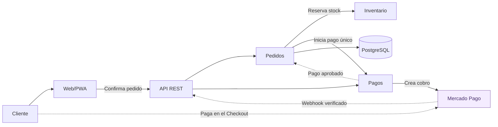
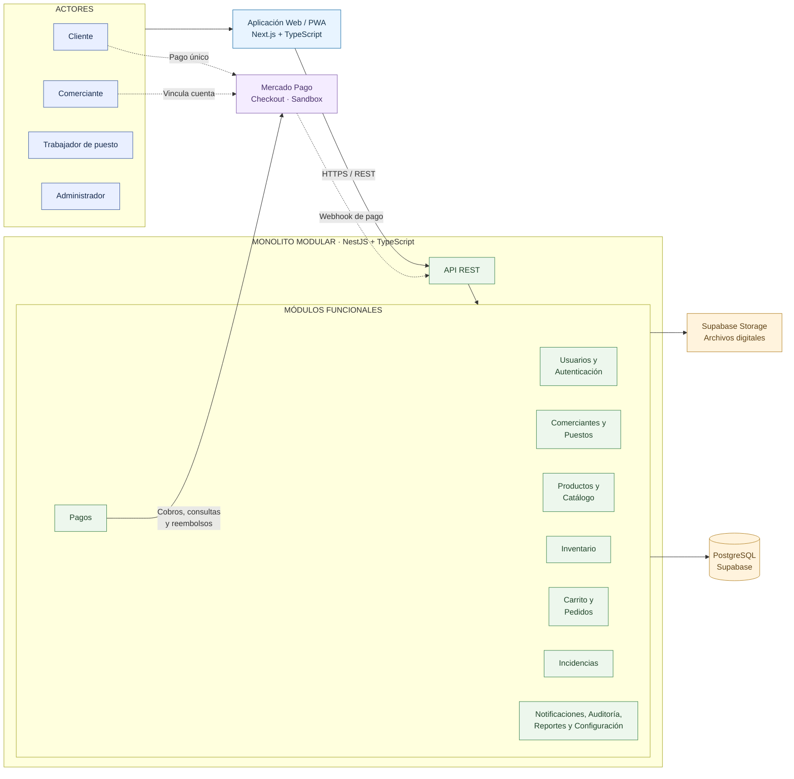

# Arquitectura Inicial del Sistema

## 1. Estilo arquitectónico

La Plataforma Integral Multivendedor para la Gestión Comercial y Operativa de un Mercado de Abastos adopta como estilo arquitectónico principal un **monolito modular** ([ADR-001](../01-analisis-de-sistema/decisiones/ADR-001-monolito-modular.md)).

La solución se compone de:

1. Una aplicación Web/PWA, que actúa como cliente.
2. El monolito modular, que expone una API REST y contiene todos los módulos de negocio.
3. Los servicios de persistencia y externos con los que se integra el monolito: PostgreSQL, almacenamiento de archivos y Mercado Pago.

Esta organización permite separar responsabilidades por módulos, mantener una sola unidad de desarrollo y despliegue para un equipo reducido y coordinar transacciones entre módulos.

---

## 2. Aplicación Web/PWA

La aplicación Web/PWA es el contenedor cliente mediante el cual los usuarios interactúan con la plataforma.

### Tecnología

- Next.js
- TypeScript
- Aplicación Web/PWA

### Usuarios principales

- Cliente
- Comerciante
- Trabajador de puesto
- Administrador

### Interfaces principales

- Marketplace
- Catálogo de productos
- Detalle de producto
- Carrito multivendedor
- Seguimiento de pedidos
- Resumen del pago único y redirección al Checkout de Mercado Pago
- Panel del comerciante, incluida la vinculación de la cuenta de Mercado Pago y la consulta de cobros y comisiones
- Panel del trabajador de puesto
- Panel del administrador, incluida la conciliación de pagos

La aplicación Web/PWA se comunica con el monolito exclusivamente mediante su API REST.

---

## 3. Monolito modular: API REST y módulos de negocio

El monolito modular procesa las reglas y operaciones principales de la plataforma. Se desarrolla y despliega como una única aplicación.

### Tecnología

- NestJS
- TypeScript
- API REST

### Módulos principales

#### Autenticación y usuarios

Responsable del registro, inicio de sesión, gestión de perfiles, roles y permisos.

#### Comerciantes y puestos

Responsable de administrar comerciantes, puestos comerciales, tiendas virtuales y la vinculación de la cuenta de Mercado Pago de cada comerciante.

#### Productos y categorías

Responsable del registro, actualización, disponibilidad y clasificación de productos.

#### Inventario

Responsable del control de stock físico, reservado y disponible, así como de los movimientos de inventario.

#### Marketplace y catálogo

Responsable de presentar los productos publicados por los diferentes puestos comerciales.

#### Carrito multivendedor

Responsable de permitir que el cliente agregue productos pertenecientes a diferentes puestos dentro del mismo carrito.

#### Pedidos

Responsable de generar y gestionar pedidos, agrupar productos por puesto y controlar sus diferentes estados, incluida la preparación de los productos y su retiro por el cliente en cada puesto.

#### Pagos

Responsable del pago único por pedido mediante Mercado Pago Checkout, la recepción y verificación de Webhooks, la conciliación periódica, los reembolsos y el registro de comisiones ([ADR-005](../01-analisis-de-sistema/decisiones/ADR-005-pago-unico-mercado-pago.md)).

#### Incidencias

Responsable de gestionar cancelaciones, devoluciones, reclamos e incidencias.

#### Notificaciones

Responsable de informar a los usuarios sobre eventos importantes relacionados con pedidos y operaciones.

#### Auditoría

Responsable de registrar operaciones críticas y mantener la trazabilidad del sistema.

#### Configuración operativa

Responsable de administrar las reglas operativas parametrizables, como tiempos de reserva y tolerancias de peso o precio (RF45).

#### Reportes

Responsable de generar indicadores, estadísticas y paneles de control para administradores y comerciantes.

---

## 4. Persistencia

El monolito almacena y recupera la información persistente del sistema en los siguientes servicios.

### Tecnologías

- PostgreSQL
- Supabase
- Supabase Storage o Cloudflare R2

### Información almacenada

- Usuarios
- Roles y permisos
- Comerciantes
- Puestos
- Tiendas virtuales
- Cuentas de Mercado Pago vinculadas (tokens cifrados)
- Productos
- Categorías
- Inventarios
- Movimientos de inventario
- Carritos
- Pedidos
- Historial de estados
- Pagos, comisiones y reembolsos
- Notificaciones de pago recibidas (Webhooks)
- Incidencias
- Notificaciones
- Auditoría
- Reportes
- Configuración operativa
- Imágenes de productos y tiendas

---

## 5. Sistemas externos

La plataforma interactúa con los siguientes sistemas o servicios externos.

### Mercado Pago

Pasarela de pago utilizada, en entorno Sandbox, para cobrar el pedido completo en una única transacción, notificar el resultado del pago mediante Webhooks y ejecutar reembolsos.

### Supabase Storage / Cloudflare R2

Utilizados para almacenar imágenes de productos y tiendas, y otros documentos de la plataforma.

---

## 6. Flujo general de comunicación

El flujo principal del sistema será:

Usuario → Aplicación Web/PWA → API REST del monolito → Módulos de negocio → PostgreSQL

Los servicios externos son utilizados por determinados módulos mediante adaptadores.

Ejemplo del flujo de compra y pago:

## 7. Diagrama de arquitectura

La solución se organiza como un monolito modular consumido por una aplicación Web/PWA e integrado con servicios de persistencia y con Mercado Pago.

El siguiente diagrama representa la estructura general del sistema, sus actores, los principales módulos de negocio y los servicios con los que se integra.

## 8. Justificación de la arquitectura

### Monolito modular como estilo principal

La lógica de negocio se implementa como una sola aplicación NestJS organizada en módulos con responsabilidades definidas. Esto responde a un equipo de 2 integrantes que debe desarrollar, desplegar y operar la solución en un semestre (RC11, DA14).

### Cliente Web/PWA

Los usuarios acceden mediante una aplicación Web/PWA independiente, que consume la API REST del monolito.

### Enfoque modular

Los módulos funcionales tienen responsabilidades definidas y se comunican mediante contratos explícitos, permitiendo organizar el sistema y facilitar su evolución.

### Consistencia transaccional

Al compartir una única aplicación y una base de datos PostgreSQL, los módulos de inventario, pedidos y pagos pueden coordinar sus operaciones críticas dentro de transacciones.

### Pago único mediante Mercado Pago

El cliente paga el pedido completo en una única transacción mediante Mercado Pago Checkout, por la suma de los subtotales de cada puesto.

La plataforma recibe la confirmación del pago de forma automática mediante un Webhook verificado y una consulta a la API de Mercado Pago; ningún usuario valida pagos manualmente.

Cada comerciante vincula su cuenta de Mercado Pago y asume la comisión de la pasarela.

### Retiro en el puesto

La plataforma no incluye servicio de delivery. Una vez que la pasarela aprueba el pago, cada puesto prepara sus productos y el cliente los retira directamente en el puesto correspondiente.

### Organización interna mediante Clean Architecture

El estilo arquitectónico es el monolito modular. Clean Architecture se aplica únicamente para organizar el código interno de cada módulo y orientar sus dependencias hacia las reglas del negocio ([organización interna de los módulos](enfoque-arquitectonico.md)).

Los diagramas presentados son vistas conceptuales. Las conexiones hacia PostgreSQL y Mercado Pago representan integraciones en tiempo de ejecución y no implican que las reglas de negocio dependan directamente de esas tecnologías.
