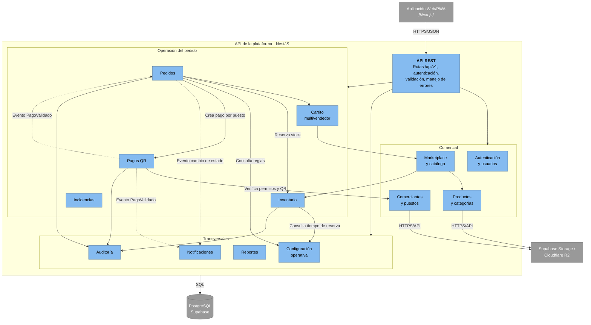

# Componentes Arquitectónicos

Este documento identifica los componentes que forman la Plataforma Integral Multivendedor para la Gestión Comercial y Operativa de un Mercado de Abastos, su responsabilidad y los requisitos que atienden.

La organización responde a la arquitectura cliente-servidor de tres capas, al [monolito modular](../01-analisis-de-sistema/decisiones/ADR-001-monolito-modular.md) y al [enfoque Clean Architecture](enfoque-arquitectonico.md).

## 1. Componentes por capa

| Capa | Componente | Tecnología | Responsabilidad |
|---|---|---|---|
| Presentación | Aplicación Web/PWA | Next.js + TypeScript | Interfaces del marketplace, carrito, pago por puesto, panel del comerciante, del trabajador de puesto y del administrador. |
| Lógica de negocio | API REST | NestJS + TypeScript | Punto de entrada HTTP: autenticación, validación de solicitudes y delegación a los módulos. |
| Lógica de negocio | Módulos de negocio | NestJS + TypeScript | Reglas de negocio organizadas en módulos independientes (ver sección 2). |
| Datos | Base de datos | PostgreSQL (Supabase) | Información estructurada: usuarios, puestos, productos, inventario, pedidos, pagos y auditoría. |
| Datos | Almacenamiento de archivos | Supabase Storage (alternativa: Cloudflare R2) | Imágenes de productos y tiendas, códigos QR de cobro y evidencias digitales. |

## 2. Módulos de negocio

| Módulo | Responsabilidad | Requisitos funcionales |
|---|---|---|
| **Autenticación y usuarios** | Registro, inicio de sesión, perfiles, roles y permisos. | RF01–RF05 |
| **Comerciantes y puestos** | Comerciantes, puestos comerciales, tiendas virtuales y códigos QR de cobro. | RF06–RF08, RF33 |
| **Productos y categorías** | Registro, actualización, precios, presentaciones, imágenes y clasificación de productos. | RF09–RF11 |
| **Inventario** | Stock físico, reservado y disponible; movimientos de inventario y reservas. | RF12–RF15, RF25 |
| **Marketplace y catálogo** | Catálogo general, búsqueda, filtros y detalle de productos. | RF16–RF19 |
| **Carrito multivendedor** | Carrito con productos de varios puestos, subtotales por puesto y total general. | RF20–RF24 |
| **Pedidos** | Pedido principal agrupado por puesto, estados, preparación, retiro en el puesto y variaciones de peso o precio. | RF26–RF31, RF36–RF39 |
| **Pagos** | Presentación del QR por puesto, aviso de pago del cliente y validación por el comerciante o trabajador autorizado. | RF32, RF34, RF35 |
| **Incidencias** | Cancelaciones, devoluciones, reclamos e incidencias. | RF40 |
| **Notificaciones** | Avisos a los usuarios sobre cambios de estado del pedido. | RF41 |
| **Auditoría** | Registro de operaciones críticas y trazabilidad. | RF42 |
| **Reportes** | Indicadores, estadísticas, paneles y consultas de operaciones por puesto. | RF43, RF44, RF46 |
| **Configuración operativa** *(transversal)* | Reglas operativas como tiempos de reserva y tolerancias de peso o precio. Es consultada por Pedidos e Inventario. | RF45 |

> RF45 se atiende en un módulo propio, **Configuración operativa**, incluido en la lista de [ADR-001](../01-analisis-de-sistema/decisiones/ADR-001-monolito-modular.md).

## 3. Componentes externos

| Componente | Tipo | Relación con la plataforma |
|---|---|---|
| Yape | Medio de pago externo | El cliente paga al puesto con el QR; no hay integración por API en la primera versión. |
| Plin | Medio de pago externo | Igual que Yape. |
| Supabase | Proveedor de base de datos y almacenamiento | Aloja PostgreSQL y Supabase Storage. |

## 4. Diagrama de componentes

Diagrama C4 nivel 3 del contenedor API de la plataforma. La fuente de referencia es [Nivel 3 · Diagrama de componentes](../04-modelo-c4/Nivel3-Diagrama-de-Componentes.md), donde se detallan responsabilidades y relaciones; si ese diagrama cambia, este debe actualizarse.

> Las líneas continuas son llamadas en memoria a la API pública de otro módulo; las discontinuas son eventos en memoria.

Contexto adicional:

- [Nivel 2 · Diagrama de contenedores](../04-modelo-c4/Nivel2-DiagramadeContenedores.md)
- [Nivel 3 · Diagrama de componentes](../04-modelo-c4/Nivel3-Diagrama-de-Componentes.md)
