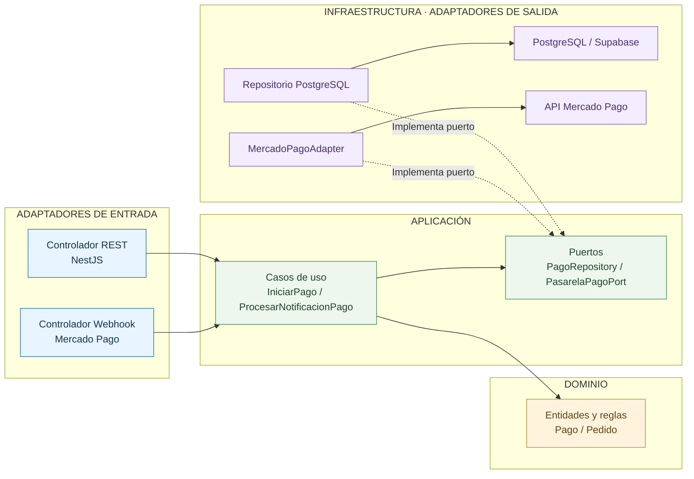

# Organización Interna de los Módulos (Clean Architecture)

## 1. Información general

| Campo | Descripción |
|---|---|
| Proyecto | Plataforma Integral Multivendedor para la Gestión Comercial y Operativa de un Mercado de Abastos |
| Enfoque seleccionado | Clean Architecture con puertos y adaptadores |
| Ámbito de aplicación | Organización interna del código de cada módulo del monolito |
| Estilo arquitectónico | Monolito modular ([ADR-001](../01-analisis-de-sistema/decisiones/ADR-001-monolito-modular.md)) |
| Tecnología backend | NestJS + TypeScript |
| Tecnología frontend | Next.js + TypeScript |
| Driver principal | DA12 - Mantenibilidad y evolución modular |
| Decisión relacionada | ADR-002 - Clean Architecture |
| Estado | Arquitectura propuesta |

## 2. Contexto

La plataforma integrará múltiples procesos comerciales y operativos de un mercado de abastos.

Entre sus funcionalidades se encuentran la gestión de comerciantes y puestos, productos, inventarios, pedidos multivendedor, el pago único por pedido mediante Mercado Pago y la preparación y retiro de pedidos en los puestos.

Estas funcionalidades necesitan reglas de negocio independientes de los frameworks y servicios tecnológicos empleados.

Para facilitar su mantenimiento, evolución y pruebas se propone aplicar Clean Architecture dentro de los módulos del monolito.

## 3. Enfoque arquitectónico seleccionado

Se selecciona Clean Architecture para organizar la **estructura interna de cada módulo** del monolito.

Clean Architecture **no es el estilo arquitectónico global** de la solución ni define capas de despliegue. El estilo arquitectónico es el monolito modular, y todos los anillos descritos en este documento forman parte del mismo código que se despliega como una única aplicación.

Dentro de cada módulo, el código se organiza en anillos concéntricos y se integra con el exterior mediante **puertos y adaptadores**:

- Los **puertos** son interfaces definidas por la aplicación para acceder a persistencia y servicios externos.
- Los **adaptadores de entrada** reciben solicitudes (controladores REST, endpoint del Webhook) y las traducen a casos de uso.
- Los **adaptadores de salida** implementan los puertos con tecnologías concretas (PostgreSQL, Supabase Storage, Mercado Pago).

Su principal objetivo es proteger las reglas del negocio de los cambios tecnológicos. Las dependencias del código deberán orientarse hacia los anillos internos, evitando que el dominio dependa directamente de NestJS, PostgreSQL, Supabase, Mercado Pago u otros servicios externos.

## 4. Anillos de Clean Architecture dentro de un módulo

### 4.1. Dominio (Domain)

Contiene las entidades, objetos de valor y reglas fundamentales del negocio.

**Responsabilidades:**

- Definir las entidades del sistema.
- Aplicar reglas de negocio.
- Validar invariantes del dominio.
- Controlar transiciones permitidas.
- Proteger las condiciones fundamentales de inventario, pedidos y pagos.

**Ejemplos:**

- Pedido.
- Producto.
- Inventario.
- Pago.
- ReservaInventario.

El dominio no dependerá directamente de frameworks, controladores HTTP ni repositorios concretos.

### 4.2. Aplicación (Application)

Contiene los casos de uso encargados de coordinar las operaciones del sistema y los puertos que estos requieren.

**Responsabilidades:**

- Ejecutar casos de uso.
- Coordinar entidades del dominio.
- Definir puertos de repositorios.
- Establecer puertos para servicios externos, como `PasarelaPagoPort`.
- Coordinar transacciones mediante abstracciones.

**Ejemplos de casos de uso:**

- CrearPedido.
- ReservarInventario.
- IniciarPago.
- ProcesarNotificacionPago.
- RegistrarPreparacion.
- RegistrarEntregaEnPuesto.

La aplicación dependerá del dominio y de sus puertos, pero no directamente de implementaciones concretas de PostgreSQL o Mercado Pago.

### 4.3. Adaptadores de entrada (controladores REST)

Reciben las solicitudes dirigidas a la API del monolito y entregan las respuestas correspondientes.

**Responsabilidades:**

- Recibir solicitudes HTTP.
- Validar estructuras de entrada.
- Verificar la firma de las notificaciones del Webhook de pago.
- Ejecutar casos de uso.
- Transformar respuestas.
- Gestionar códigos y errores HTTP.

**Elementos:**

- Controladores REST de NestJS.
- Controlador del Webhook de Mercado Pago.
- DTO de entrada y salida.
- Validadores.

La aplicación Web/PWA desarrollada con Next.js es un contenedor separado que consume la API REST; no forma parte de los anillos de ningún módulo.

### 4.4. Infraestructura y adaptadores de salida (Infrastructure)

Contiene implementaciones concretas de persistencia e integración tecnológica.

**Responsabilidades:**

- Implementar los puertos de repositorios.
- Acceder a PostgreSQL.
- Gestionar almacenamiento de archivos.
- Implementar servicios de notificaciones.
- Integrar servicios externos, como Mercado Pago.
- Configurar proveedores y frameworks.

**Elementos:**

- Repositorios concretos sobre PostgreSQL / Supabase.
- Adaptador de Supabase Storage.
- `MercadoPagoAdapter`, que implementa `PasarelaPagoPort`.
- Otros adaptadores externos.

La infraestructura implementará los puertos definidos por los anillos internos.

## 5. Diagrama de Clean Architecture

El siguiente diagrama representa las dependencias del código dentro de un módulo del monolito, tomando como ejemplo el módulo Pagos.

Las flechas indican la dirección de las dependencias hacia los anillos internos.



**Nota:** El diagrama representa dependencias del código y relaciones de implementación dentro de un único módulo desplegado con el resto del monolito. El acceso a la base de datos y a Mercado Pago ocurre en tiempo de ejecución a través de los adaptadores de salida; el dominio no depende directamente de esas tecnologías.

## 6. Regla de dependencias

La regla fundamental establece que las dependencias del código deben apuntar hacia los anillos internos.

| Componente | Puede depender de | No debe depender directamente de |
|---|---|---|
| Dominio | Elementos internos del dominio | NestJS, PostgreSQL, Next.js, Mercado Pago, infraestructura |
| Aplicación | Dominio y puertos propios | Repositorios concretos, adaptadores externos, controladores HTTP |
| Adaptadores de entrada | Casos de uso y contratos de entrada/salida | Detalles concretos de persistencia o de la pasarela |
| Infraestructura | Puertos de aplicación y tipos del dominio | Controladores de entrada para implementar reglas de negocio |

La conexión entre puertos e implementaciones se resolverá mediante inyección de dependencias en la configuración de cada módulo NestJS.

## 7. Ejemplo aplicado: creación de pedido multivendedor

### Adaptador de entrada

El cliente confirma un carrito que contiene productos de diferentes puestos.

El controlador REST recibe la solicitud y delega la operación al caso de uso correspondiente.

### Aplicación

El caso de uso `CrearPedido` coordina:

1. Validación del carrito.
2. Verificación de disponibilidad.
3. Reserva de inventario.
4. Creación del pedido principal.
5. Agrupación de productos por puesto.
6. Registro inicial del estado del pedido.

### Dominio

El dominio aplica las reglas necesarias para:

- Impedir cantidades inválidas.
- Mantener la relación entre productos y puestos.
- Controlar la estructura del pedido.
- Aplicar las reglas de transición de estados.

### Infraestructura

Los repositorios concretos ejecutan las operaciones necesarias sobre PostgreSQL.

Las operaciones críticas se realizarán mediante mecanismos transaccionales para evitar inconsistencias.

## 8. Ejemplo aplicado: procesamiento del Webhook de pago

### Adaptador de entrada

Mercado Pago envía una notificación al endpoint del Webhook de la API del monolito.

El controlador del Webhook verifica la firma de la notificación; si es inválida, la rechaza sin invocar ningún caso de uso. Si es válida, delega en `ProcesarNotificacionPago` el identificador del pago recibido.

### Aplicación

El caso de uso `ProcesarNotificacionPago` coordina:

1. La consulta del estado real del pago mediante `PasarelaPagoPort`, sin confiar en el contenido de la notificación.
2. La localización del pedido a partir de la referencia externa.
3. La comprobación de que la notificación no haya sido procesada previamente (idempotencia).
4. La actualización del estado del pago y de las agrupaciones por puesto dentro de una transacción.
5. El registro de la notificación para auditoría y la publicación del evento de pago aprobado.

### Dominio

Se validan reglas como:

- El monto aprobado debe coincidir con la suma de los subtotales por puesto.
- El pago debe encontrarse en un estado que permita la transición informada.
- Una misma notificación no puede producir más de un cambio de estado.
- Los productos de un puesto solo pueden pasar a preparación cuando el pago esté aprobado por la pasarela.

### Infraestructura

`MercadoPagoAdapter` consulta el pago en la API de Mercado Pago utilizando las credenciales configuradas.

El repositorio de pagos registra la notificación y el cambio de estado mediante transacciones o actualizaciones condicionales de PostgreSQL, evitando que notificaciones repetidas o simultáneas generen estados incompatibles. El tratamiento de aprobaciones posteriores a la expiración de la reserva se describe en [ADR-003](../01-analisis-de-sistema/decisiones/ADR-003-control-concurrencia.md).

## 9. Estructura de carpetas propuesta

La siguiente estructura es referencial para el desarrollo posterior del monolito NestJS.

```text
src/
├── modules/
│   ├── pagos/
│   │   ├── domain/
│   │   │   ├── entities/
│   │   │   └── value-objects/
│   │   ├── application/
│   │   │   ├── use-cases/
│   │   │   └── ports/
│   │   ├── infrastructure/
│   │   │   ├── persistence/
│   │   │   └── mercado-pago/
│   │   └── entry-adapters/
│   │       ├── controllers/
│   │       └── webhooks/
│   ├── pedidos/
│   ├── inventario/
│   ├── comerciantes/
│   └── productos/
├── shared/
└── main.ts
```

Los demás módulos podrán utilizar una organización equivalente, ajustada a sus responsabilidades.

Esta estructura no implica que las carpetas ya estén implementadas.

## 10. Relación con los drivers arquitectónicos

| Driver | Respuesta arquitectónica |
|---|---|
| DA03 - Seguridad | Separación de políticas de negocio y mecanismos técnicos de autenticación y verificación de Webhooks. |
| DA04 - Escalabilidad y modularidad | Módulos organizados mediante contratos y responsabilidades definidas. |
| DA05 - API REST | Controladores REST como adaptadores de entrada. |
| DA08 - Pago único por pedido | Integración con Mercado Pago aislada mediante `PasarelaPagoPort` y `MercadoPagoAdapter`. |
| DA11 - Aislamiento de fallos | Integraciones externas desacopladas mediante puertos. |
| DA12 - Mantenibilidad | Dependencias dirigidas hacia las reglas del negocio. |

## 11. Beneficios esperados

- Separación de responsabilidades dentro de cada módulo.
- Menor acoplamiento entre reglas de negocio y tecnologías externas.
- Facilidad para realizar pruebas unitarias.
- Posibilidad de sustituir adaptadores, como el de la pasarela de pago, sin modificar el dominio.
- Mejor organización de casos de uso.
- Mayor claridad de los límites entre módulos.

## 12. Limitaciones y consideraciones

- Se incrementa la cantidad de clases, interfaces y archivos.
- Requiere comprender correctamente la regla de dependencias.
- Puede generar complejidad innecesaria si se aplica excesivamente a funcionalidades simples.
- No garantiza por sí sola seguridad, rendimiento o escalabilidad.
- Debe complementarse con transacciones, autorización, observabilidad y pruebas.

## 13. Justificación de la selección

Clean Architecture se selecciona principalmente para responder al driver DA12, relacionado con la mantenibilidad y evolución modular.

Este enfoque permitirá preservar las reglas de negocio de inventario, pedidos y pagos frente a cambios tecnológicos, incluido un eventual cambio de proveedor o modalidad de pago.

Su aplicación contribuirá a mantener una estructura comprensible dentro de cada módulo, sin alterar el estilo arquitectónico de monolito modular.

## 14. Relación con otros documentos

- [Arquitectura inicial](arquitectura-inicial.md)
- [Estilo arquitectónico](estilo-arquitectonico.md)
- [ADR-001: Monolito modular](../01-analisis-de-sistema/decisiones/ADR-001-monolito-modular.md)
- [ADR-002: Clean Architecture](../01-analisis-de-sistema/decisiones/ADR-002-clean-architecture.md)
- [ADR-003: Control de concurrencia](../01-analisis-de-sistema/decisiones/ADR-003-control-concurrencia.md)
- [ADR-005: Pago único mediante Mercado Pago](../01-analisis-de-sistema/decisiones/ADR-005-pago-unico-mercado-pago.md)
