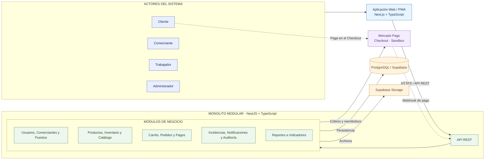

# Estilo Arquitectónico del Sistema

## 1. Información general

| Campo | Descripción |
|---|---|
| Proyecto | Plataforma Integral Multivendedor para la Gestión Comercial y Operativa de un Mercado de Abastos |
| Documento | Definición del estilo arquitectónico |
| Estilo arquitectónico | Monolito modular |
| Organización interna de los módulos | Clean Architecture (ver [enfoque](enfoque-arquitectonico.md)) |
| Tecnologías | Next.js, TypeScript, NestJS, PostgreSQL, Supabase y Mercado Pago |
| Estado | Arquitectura propuesta |
| Fecha | 08/10/2026 |

## 2. Contexto arquitectónico

La plataforma permitirá integrar los procesos comerciales y operativos de un mercado de abastos mediante una aplicación web multivendedor.

Los clientes podrán consultar productos de distintos puestos, crear pedidos multivendedor, pagar el pedido completo en una única transacción mediante Mercado Pago y retirar sus productos en los puestos correspondientes.

Los comerciantes administrarán sus productos e inventarios de manera independiente, vincularán su cuenta de Mercado Pago y prepararán los pedidos de sus puestos una vez que la pasarela apruebe el pago. La plataforma no incluye servicio de delivery.

El proyecto lo desarrolla un equipo reducido de 2 integrantes en un semestre (RC11), y las operaciones de inventario, pedidos y pagos requieren consistencia transaccional entre módulos. Por ello se requiere un estilo que separe responsabilidades por módulos y, al mismo tiempo, mantenga una única unidad de desarrollo y despliegue.

## 3. Estilo arquitectónico seleccionado

Se selecciona como **único estilo arquitectónico** el **monolito modular**, definido en [ADR-001](../01-analisis-de-sistema/decisiones/ADR-001-monolito-modular.md).

La lógica de negocio se implementa como una sola aplicación NestJS desplegable, organizada en módulos con responsabilidades y contratos definidos. A su alrededor se ubican el cliente Web/PWA, la persistencia y los servicios externos.

### 3.1. Aplicación Web/PWA

**Tecnologías:**

- Next.js.
- TypeScript.
- Aplicación Web/PWA.

**Responsabilidades:**

- Presentar el marketplace y catálogo.
- Gestionar las interfaces de los clientes.
- Permitir la administración de comerciantes y puestos.
- Mostrar el carrito y los pedidos.
- Mostrar el resumen del pago único y redirigir al cliente al Checkout de Mercado Pago.
- Permitir el seguimiento de pedidos.
- Proporcionar paneles administrativos.

La aplicación Web/PWA es un contenedor cliente que se comunica con el monolito mediante HTTPS y API REST.

### 3.2. Monolito modular: API REST y módulos

**Tecnologías:**

- NestJS.
- TypeScript.
- API REST.

La API REST es el punto de entrada del monolito y delega cada operación en el módulo responsable.

| Grupo funcional | Módulos |
|---|---|
| Identidad y administración | Autenticación, usuarios, comerciantes, puestos y tiendas |
| Gestión comercial | Productos, categorías, inventario y catálogo |
| Proceso de compra | Carrito multivendedor, pedidos (incluidos preparación y retiro en el puesto) y pagos |
| Servicios transversales | Notificaciones, incidencias, auditoría y configuración operativa |
| Explotación de información | Reportes e indicadores |

Cada módulo tendrá responsabilidades definidas y deberá mantener contratos claros para sus interacciones.

El monolito se desplegará como una única aplicación.

### 3.3. Persistencia y servicios externos

**Tecnologías:**

- PostgreSQL.
- Supabase.
- Supabase Storage.
- Mercado Pago (entorno Sandbox).

**Responsabilidades:**

- Almacenar usuarios, roles y permisos.
- Gestionar comerciantes, puestos y tiendas virtuales.
- Mantener productos, categorías e inventarios.
- Registrar carritos, pedidos y reservas.
- Conservar pagos, notificaciones de la pasarela, comisiones, reembolsos y estados de preparación y retiro de los pedidos.
- Mantener auditoría e incidencias.
- Almacenar referencias a archivos digitales.

PostgreSQL será la fuente principal de persistencia para la información estructurada.

Supabase Storage se utilizará inicialmente para archivos digitales. Cloudflare R2 se mantendrá como alternativa futura.

Mercado Pago procesará el pago único del pedido y notificará su resultado al monolito mediante Webhooks ([ADR-005](../01-analisis-de-sistema/decisiones/ADR-005-pago-unico-mercado-pago.md)).

## 4. Diagrama del estilo arquitectónico

El siguiente diagrama representa el monolito modular, el cliente Web/PWA que lo consume y los servicios con los que se integra.

Los módulos están agrupados por responsabilidad para facilitar la lectura.

**Nota:** Las conexiones del diagrama representan relaciones funcionales entre componentes. No implican dependencias directas de las reglas de negocio hacia la base de datos ni hacia Mercado Pago.

La organización interna de las dependencias de cada módulo se especifica en el documento de [organización interna de los módulos](enfoque-arquitectonico.md).

## 5. Relaciones entre componentes

| Origen | Destino | Comunicación |
|---|---|---|
| Usuarios | Aplicación Web/PWA | Interacción mediante navegador |
| Web/PWA | API del monolito | HTTPS / API REST |
| API REST | Módulos funcionales | Invocación de casos de uso |
| Módulos funcionales | PostgreSQL | Persistencia mediante repositorios y adaptadores |
| Módulos funcionales | Supabase Storage | Almacenamiento mediante adaptadores |
| Módulo Pagos | Mercado Pago | Creación de cobros, consulta de pagos y reembolsos mediante API |
| Mercado Pago | API del monolito | Notificación del resultado del pago mediante Webhook verificado |
| Cliente | Mercado Pago | Pago único del pedido en el Checkout |

## 6. Justificación de la arquitectura

### 6.1. Separación de responsabilidades

El monolito modular separa las responsabilidades por módulos de negocio, mientras que la aplicación Web/PWA, la persistencia y los servicios externos se mantienen como elementos independientes del código de negocio.

### 6.2. Mantenibilidad

El monolito modular permite organizar las funcionalidades en módulos definidos.

Clean Architecture complementa esta decisión controlando las dependencias internas de cada módulo, sin constituir un estilo arquitectónico adicional.

### 6.3. Consistencia transaccional

El monolito permite coordinar operaciones críticas entre módulos mediante transacciones de PostgreSQL.

Esto resulta relevante para evitar reservas incompatibles de inventario y estados de pago inconsistentes frente a las notificaciones de la pasarela.

### 6.4. Equipo reducido y despliegue simple

Una única aplicación desplegable reduce el esfuerzo de construcción, despliegue y operación para un equipo de 2 integrantes (RC11, DA14).

### 6.5. Escalabilidad progresiva

La plataforma podrá evolucionar mediante optimización de consultas, incorporación de caché y, cuando sea necesario, escalamiento de instancias del monolito.

La separación modular permitirá evaluar futuras extracciones de servicios independientes.

### 6.6. Seguridad

La arquitectura permitirá centralizar autenticación, autorización, verificación de Webhooks y validaciones de operaciones críticas en el monolito.

Los permisos deberán verificarse para cada operación y recurso protegido.

## 7. Alternativas evaluadas

| Alternativa | Evaluación |
|---|---|
| Monolito tradicional sin modularidad | Descartado por el riesgo de generar alto acoplamiento entre funcionalidades. |
| Microservicios desde la primera versión | No seleccionados debido a la complejidad adicional de despliegue, comunicación y consistencia distribuida para un equipo reducido. |
| Monolito modular | **Seleccionado** como único estilo arquitectónico: organiza la lógica de negocio en módulos con responsabilidades claras dentro de una sola aplicación desplegable. |

La elección del monolito modular no impide que determinados componentes puedan independizarse posteriormente, si los requisitos operativos lo justifican.

## 8. Drivers arquitectónicos relacionados

| Driver | Respuesta arquitectónica |
|---|---|
| DA02 - Consistencia del inventario | Coordinación de operaciones transaccionales mediante PostgreSQL. |
| DA03 - Seguridad de la información | Autenticación, autorización y verificación de Webhooks centralizadas. |
| DA04 - Escalabilidad y modularidad | Monolito modular con evolución progresiva. |
| DA05 - API REST | Comunicación HTTP entre la aplicación Web/PWA y la API del monolito. |
| DA07 - Pedidos multivendedor | Módulos de carrito, pedidos, inventario y pagos coordinados. |
| DA08 - Pago único por pedido | Integración del módulo Pagos con Mercado Pago Checkout y Webhooks. |
| DA12 - Mantenibilidad | Separación modular y organización interna mediante Clean Architecture. |
| DA14 - Desarrollo y despliegue como una sola unidad | Monolito modular desplegado como una única aplicación con transacciones compartidas entre módulos. |

## 9. Consecuencias arquitectónicas

### Consecuencias positivas

- Separación clara de responsabilidades por módulos.
- Una sola unidad de desarrollo y despliegue.
- Despliegue inicial relativamente sencillo.
- Mayor facilidad para realizar pruebas de integración.
- Coordinación transaccional de operaciones críticas.
- Posibilidad de crecimiento progresivo.

### Consecuencias negativas

- Los módulos comparten un proceso de ejecución.
- El despliegue de cambios se realiza conjuntamente.
- La escalabilidad individual de cada módulo no está disponible inicialmente.
- Será necesario controlar las dependencias entre módulos.
- El flujo de compra depende de la disponibilidad de Mercado Pago.

## 10. Relación con otros documentos

- [Arquitectura inicial](arquitectura-inicial.md)
- [ADR-001: Monolito modular](../01-analisis-de-sistema/decisiones/ADR-001-monolito-modular.md)
- [ADR-002: Clean Architecture](../01-analisis-de-sistema/decisiones/ADR-002-clean-architecture.md)
- [ADR-003: Control de concurrencia](../01-analisis-de-sistema/decisiones/ADR-003-control-concurrencia.md)
- [ADR-005: Pago único mediante Mercado Pago](../01-analisis-de-sistema/decisiones/ADR-005-pago-unico-mercado-pago.md)
- [Organización interna de los módulos](enfoque-arquitectonico.md)
