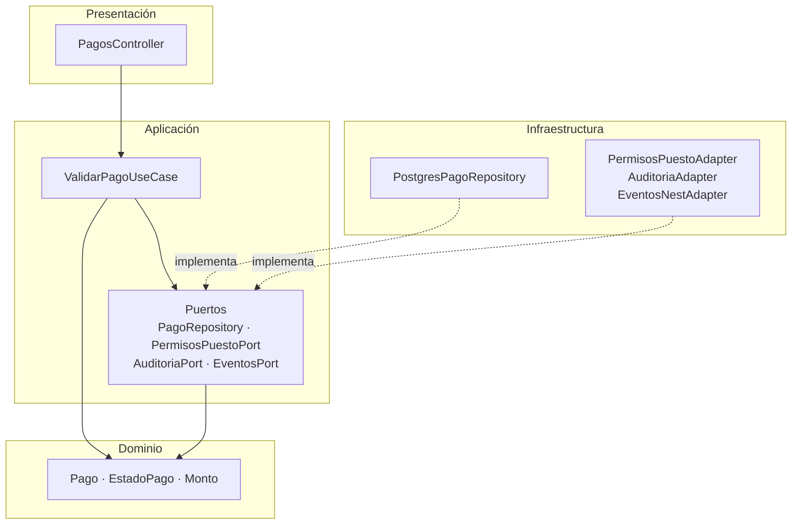
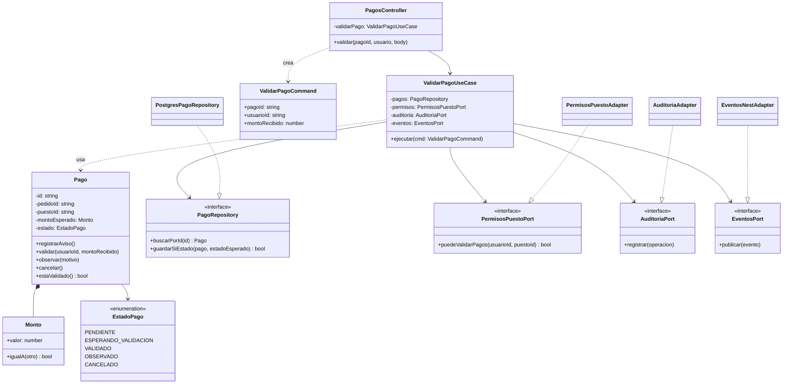
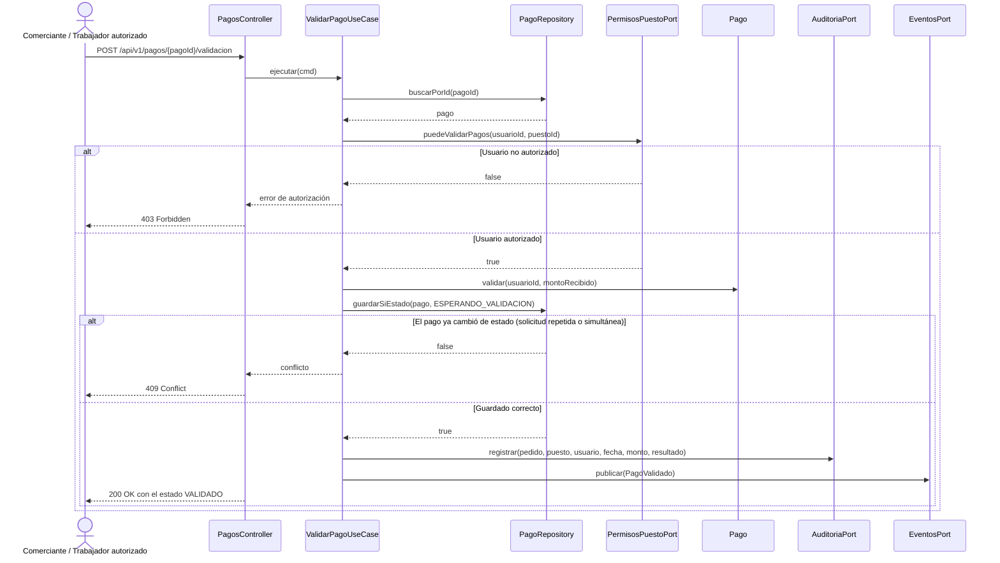

# Diseño Interno de Módulos

> **Proyecto:** Plataforma Integral Multivendedor para la Gestión Comercial y Operativa de un Mercado de Abastos
> **Backend:** NestJS + TypeScript · **Módulo de referencia:** Pagos
> **Enfoque arquitectónico:** Clean Architecture dentro de cada módulo del monolito modular
> **Nivel C4:** 4 – Código · **Versión:** 1.0

---

## 1. Propósito

Este documento describe **cómo se organiza el código dentro de un módulo** del backend NestJS. Tiene tres objetivos:

- que todos los módulos se construyan con la misma estructura;
- que las reglas de negocio de inventario, pedidos y pagos queden aisladas de NestJS, PostgreSQL y Supabase;
- que cualquier integrante del equipo sepa dónde va cada archivo y de qué puede depender.

Se toma como referencia el módulo **Pagos** y su caso de uso **ValidarPago**, porque concentra reglas críticas del negocio: autorización por puesto, transiciones de estado, prevención de duplicaciones y trazabilidad ([ADR-004](../../01-analisis-de-sistema/decisiones/ADR-004-pagos-qr.md)).

> Este diseño es una propuesta para la implementación. No implica que el código ya exista.

---

## 2. Estructura de carpetas

La estructura sigue la propuesta del [enfoque arquitectónico](../../02-arquitectura-software/enfoque-arquitectonico.md).

```text
src/
└── modules/
    └── pagos/
        ├── domain/
        │   ├── entities/
        │   │   └── pago.entity.ts                  Entidad Pago y sus reglas
        │   ├── value-objects/
        │   │   ├── estado-pago.ts                  Enumeración EstadoPago
        │   │   └── monto.ts                        Objeto de valor Monto (soles)
        │   └── errors/
        │       └── transicion-pago-invalida.error.ts
        ├── application/
        │   ├── ports/
        │   │   ├── pago.repository.ts              Interfaz de persistencia
        │   │   ├── permisos-puesto.port.ts         Interfaz para verificar permisos del puesto
        │   │   ├── auditoria.port.ts               Interfaz para registrar operaciones críticas
        │   │   └── eventos.port.ts                 Interfaz para publicar eventos del módulo
        │   ├── use-cases/
        │   │   ├── obtener-datos-pago.use-case.ts
        │   │   ├── registrar-aviso-pago.use-case.ts
        │   │   ├── validar-pago.use-case.ts        Caso de uso ValidarPago
        │   │   └── observar-pago.use-case.ts
        │   └── dto/
        │       └── validar-pago.command.ts         Datos de entrada del caso de uso
        ├── infrastructure/
        │   ├── persistence/
        │   │   └── postgres-pago.repository.ts     Implementación con PostgreSQL (Supabase)
        │   └── adapters/
        │       ├── permisos-puesto.adapter.ts      Usa la API pública del módulo Comerciantes y puestos
        │       ├── auditoria.adapter.ts            Usa la API pública del módulo Auditoría
        │       └── eventos-nest.adapter.ts         Publica eventos en memoria
        ├── presentation/
        │   └── controllers/
        │       └── pagos.controller.ts             Traduce HTTP ⇄ caso de uso
        ├── pagos.module.ts                         Raíz de composición (módulo NestJS)
        └── index.ts                                API pública del módulo
```

| Archivo | Capa | Responsabilidad | Importa de |
|---|---|---|---|
| `pago.entity.ts` | Dominio | Controlar los estados del pago y validar sus transiciones (RN01, RN04, RN05) | Solo dominio |
| `estado-pago.ts` | Dominio | Definir PENDIENTE, ESPERANDO_VALIDACION, VALIDADO, OBSERVADO y CANCELADO | Nada |
| `monto.ts` | Dominio | Representar el importe esperado del puesto (RN02) | Nada |
| `pago.repository.ts` | Aplicación (puerto) | Declarar **qué** operaciones de persistencia necesita el módulo | Dominio |
| `permisos-puesto.port.ts` | Aplicación (puerto) | Declarar cómo saber si un usuario puede operar sobre un puesto | Nada |
| `auditoria.port.ts` | Aplicación (puerto) | Declarar el registro de operaciones críticas (RN06) | Nada |
| `eventos.port.ts` | Aplicación (puerto) | Declarar la publicación del evento `PagoValidado` | Nada |
| `validar-pago.use-case.ts` | Aplicación | Coordinar los pasos de la validación | Dominio + puertos |
| `validar-pago.command.ts` | Aplicación | Datos de entrada: `pagoId`, `usuarioId`, `montoRecibido` | Nada |
| `postgres-pago.repository.ts` | Infraestructura | Guardar el pago con actualización condicional en PostgreSQL | Dominio + cliente de BD |
| `permisos-puesto.adapter.ts` | Infraestructura | Consultar al módulo Comerciantes y puestos | Puerto + `comerciantes/index.ts` |
| `auditoria.adapter.ts` | Infraestructura | Enviar el registro al módulo Auditoría | Puerto + `auditoria/index.ts` |
| `eventos-nest.adapter.ts` | Infraestructura | Publicar eventos en memoria para Pedidos y Notificaciones | Puerto + NestJS |
| `pagos.controller.ts` | Presentación | Leer la petición HTTP, invocar el caso de uso y responder | Aplicación |
| `pagos.module.ts` | Composición | Registrar los providers y conectar cada puerto con su implementación | Todas las capas |
| `index.ts` | Composición | Exponer solo lo que otros módulos pueden usar | `pagos.module.ts` |

---

## 3. Capas del módulo y regla de dependencia



**Regla de dependencia:** el código solo puede importar hacia el centro (dominio). El dominio no conoce NestJS, PostgreSQL ni Supabase ([ADR-002](../../01-analisis-de-sistema/decisiones/ADR-002-clean-architecture.md)).

| Capa | Contiene | Responsabilidad | Puede depender de | **No** puede depender de |
|---|---|---|---|---|
| **Dominio** | Entidades, objetos de valor, enumeraciones, errores | Reglas del negocio que serían ciertas con cualquier tecnología | Nada externo | Aplicación, infraestructura, presentación, NestJS, cliente de BD |
| **Aplicación** | Casos de uso, puertos (interfaces), comandos | Orquestar el flujo: qué paso va primero y qué hacer si falla | Dominio | Infraestructura, presentación, NestJS, SQL |
| **Infraestructura** | Repositorios concretos y adaptadores | Implementar los puertos con una tecnología o con la API pública de otro módulo | Aplicación (puertos), dominio, librerías externas | Presentación |
| **Presentación** | Controladores REST | Traducir HTTP a llamadas del caso de uso y viceversa | Aplicación | Infraestructura, base de datos |
| **Composición** | `pagos.module.ts` | Elegir implementaciones concretas y conectarlas mediante la inyección de dependencias de NestJS | Todas | — |

> **Cómo comprobarlo en el código:** basta revisar los `import` de `domain/`. Si aparece `@nestjs/*`, `@supabase/*`, `pg` o cualquier archivo de `infrastructure/`, la regla se rompió.

---

## 4. Diagrama de clases



### 4.1 Notación UML utilizada

| Símbolo | Significado | Ejemplo en el diagrama |
|---|---|---|
| Línea continua con flecha abierta | Asociación: la clase guarda una referencia a la otra | `ValidarPagoUseCase` → `PagoRepository` |
| Línea discontinua con flecha abierta | Dependencia: la usa o la crea, pero no la guarda | `PagosController` «crea» `ValidarPagoCommand` |
| Línea discontinua con triángulo hueco | Realización: implementa una interfaz | `PostgresPagoRepository` ▷ `PagoRepository` |
| Rombo relleno | Composición: la parte no existe sin el todo | `Pago` ◆ `Monto` |
| «interface» | Interfaz (contrato sin implementación) | `PagoRepository`, `PermisosPuestoPort` |
| `-` / `+` | Privado / público | `- estado`, `+ validar()` |

---

## 5. Flujo de ejecución: validar el pago de un puesto



| Paso | Origen → destino | Acción | Capa |
|---|---|---|---|
| 1 | Web/PWA → `PagosController` | `POST /api/v1/pagos/{pagoId}/validacion` con `montoRecibido` y el token de sesión | Presentación |
| 2 | `PagosController` → `ValidarPagoUseCase` | `ejecutar(cmd)` | Presentación → Aplicación |
| 3 | `ValidarPagoUseCase` → `PagoRepository` | `buscarPorId(pagoId)` | Aplicación → puerto |
| 4 | `ValidarPagoUseCase` → `PermisosPuestoPort` | Verifica que el usuario sea el comerciante del puesto o un trabajador con permiso (RN01) | Aplicación → puerto |
| 5 | `ValidarPagoUseCase` → `Pago` | `validar()`: comprueba que el estado permita la validación y registra el monto recibido (RN02, RN03) | Aplicación → Dominio |
| 6 | `ValidarPagoUseCase` → `PagoRepository` | `guardarSiEstado()`: actualización condicional; si otra solicitud ya validó el pago, no se aplica (RN05) | Aplicación → Infraestructura |
| 7 | `ValidarPagoUseCase` → `AuditoriaPort` | Registra pedido, puesto, usuario, fecha, hora, monto y resultado (RN06) | Aplicación → puerto |
| 8 | `ValidarPagoUseCase` → `EventosPort` | Publica `PagoValidado`; el módulo Pedidos habilita la preparación del puesto (RN04) y Notificaciones avisa al cliente | Aplicación → puerto |
| 9 | `PagosController` → Web/PWA | `200 OK` con el estado VALIDADO | Presentación |
| Alt. | — | `403` si el usuario no pertenece al puesto; `409` si el pago ya no está en ESPERANDO_VALIDACION | Presentación |

> **TODO:** confirmar si el comerciante puede validar un pago que sigue en PENDIENTE (el cliente pagó pero no registró el aviso en la plataforma).

---

## 6. Código de referencia

El siguiente código es **referencial** y muestra cómo se aplica la regla de dependencia. Los nombres pueden ajustarse durante la implementación.

### 6.1 Dominio · entidad

```typescript
// domain/entities/pago.entity.ts
import { EstadoPago } from '../value-objects/estado-pago';
import { Monto } from '../value-objects/monto';
import { TransicionPagoInvalidaError } from '../errors/transicion-pago-invalida.error';

export class Pago {
  constructor(
    readonly id: string,
    readonly pedidoId: string,
    readonly puestoId: string,
    readonly montoEsperado: Monto,
    private estado: EstadoPago,
    private validadoPor?: string,
    private montoRecibido?: Monto,
  ) {}

  validar(usuarioId: string, montoRecibido: Monto): void {
    if (this.estado !== EstadoPago.ESPERANDO_VALIDACION) {
      throw new TransicionPagoInvalidaError(this.estado, EstadoPago.VALIDADO);
    }
    if (!montoRecibido.igualA(this.montoEsperado)) {
      // Una diferencia de monto no valida el pago: queda observado (RN08)
      this.estado = EstadoPago.OBSERVADO;
      return;
    }
    this.estado = EstadoPago.VALIDADO;
    this.validadoPor = usuarioId;
    this.montoRecibido = montoRecibido;
  }

  estaValidado(): boolean {
    return this.estado === EstadoPago.VALIDADO;
  }

  get estadoActual(): EstadoPago {
    return this.estado;
  }

  get validadoPorUsuario(): string | undefined {
    return this.validadoPor;
  }

  get montoRecibidoValor(): number | undefined {
    return this.montoRecibido?.valor;
  }
}
```

### 6.2 Aplicación · puerto y caso de uso

```typescript
// application/ports/pago.repository.ts
import { Pago } from '../../domain/entities/pago.entity';
import { EstadoPago } from '../../domain/value-objects/estado-pago';

export const PAGO_REPOSITORY = Symbol('PAGO_REPOSITORY');

export interface PagoRepository {
  buscarPorId(id: string): Promise<Pago | null>;
  /** Guarda solo si el pago sigue en el estado esperado. Devuelve false si otra solicitud lo cambió. */
  guardarSiEstado(pago: Pago, estadoEsperado: EstadoPago): Promise<boolean>;
}
```

```typescript
// application/use-cases/validar-pago.use-case.ts
export class ValidarPagoUseCase {
  constructor(
    private readonly pagos: PagoRepository,
    private readonly permisos: PermisosPuestoPort,
    private readonly auditoria: AuditoriaPort,
    private readonly eventos: EventosPort,
  ) {}

  async ejecutar(cmd: ValidarPagoCommand): Promise<EstadoPago> {
    const pago = await this.pagos.buscarPorId(cmd.pagoId);
    if (!pago) throw new PagoNoEncontradoError(cmd.pagoId);

    const autorizado = await this.permisos.puedeValidarPagos(cmd.usuarioId, pago.puestoId);
    if (!autorizado) throw new UsuarioNoAutorizadoError(cmd.usuarioId, pago.puestoId);

    pago.validar(cmd.usuarioId, new Monto(cmd.montoRecibido));

    const guardado = await this.pagos.guardarSiEstado(pago, EstadoPago.ESPERANDO_VALIDACION);
    if (!guardado) throw new PagoYaProcesadoError(cmd.pagoId);

    await this.auditoria.registrar({
      operacion: 'VALIDAR_PAGO',
      pedidoId: pago.pedidoId,
      puestoId: pago.puestoId,
      usuarioId: cmd.usuarioId,
      monto: cmd.montoRecibido,
      resultado: pago.estadoActual,
    });

    if (pago.estaValidado()) {
      await this.eventos.publicar({ tipo: 'PagoValidado', pedidoId: pago.pedidoId, puestoId: pago.puestoId });
    }
    return pago.estadoActual;
  }
}
```

> El caso de uso no importa nada de NestJS: recibe sus dependencias por el constructor.

### 6.3 Infraestructura · repositorio

```typescript
// infrastructure/persistence/postgres-pago.repository.ts
export class PostgresPagoRepository implements PagoRepository {
  constructor(private readonly db: ClienteBaseDatos) {}

  async guardarSiEstado(pago: Pago, estadoEsperado: EstadoPago): Promise<boolean> {
    // Actualización condicional: si dos solicitudes llegan a la vez, solo una modifica la fila (RN05)
    const filas = await this.db.query(
      `UPDATE pagos
          SET estado = $1, validado_por = $2, monto_recibido = $3, actualizado_en = now()
        WHERE id = $4 AND estado = $5`,
      [pago.estadoActual, pago.validadoPorUsuario, pago.montoRecibidoValor, pago.id, estadoEsperado],
    );
    return filas.rowCount === 1;
  }

  // buscarPorId(...) convierte la fila de la tabla en una entidad Pago
}
```

### 6.4 Presentación · controlador

```typescript
// presentation/controllers/pagos.controller.ts
@Controller('api/v1/pagos')
export class PagosController {
  constructor(private readonly validarPago: ValidarPagoUseCase) {}

  @Post(':pagoId/validacion')
  async validar(@Param('pagoId') pagoId: string, @UsuarioActual() usuario: UsuarioSesion, @Body() body: ValidarPagoDto) {
    const estado = await this.validarPago.ejecutar({ pagoId, usuarioId: usuario.id, montoRecibido: body.montoRecibido });
    return { pagoId, estado };
  }
}
```

### 6.5 Raíz de composición

```typescript
// pagos.module.ts
@Module({
  imports: [ComerciantesModule, AuditoriaModule],
  controllers: [PagosController],
  providers: [
    { provide: PAGO_REPOSITORY, useClass: PostgresPagoRepository },
    { provide: PERMISOS_PUESTO_PORT, useClass: PermisosPuestoAdapter },
    { provide: AUDITORIA_PORT, useClass: AuditoriaAdapter },
    { provide: EVENTOS_PORT, useClass: EventosNestAdapter },
    {
      provide: ValidarPagoUseCase,
      useFactory: (r, p, a, e) => new ValidarPagoUseCase(r, p, a, e),
      inject: [PAGO_REPOSITORY, PERMISOS_PUESTO_PORT, AUDITORIA_PORT, EVENTOS_PORT],
    },
  ],
  exports: [ObtenerDatosPagoUseCase],
})
export class PagosModule {}
```

> Solo `pagos.module.ts` conoce las clases concretas. Para probar el caso de uso se reemplazan los providers por implementaciones en memoria.

---

## 7. Aplicación al resto de módulos

| Módulo | Caso de uso de referencia | Puertos principales |
|---|---|---|
| Pedidos | `CrearPedido` | `PedidoRepository`, `ReservaInventarioPort`, `UnidadDeTrabajo` |
| Inventario | `ReservarInventario` | `InventarioRepository` |
| Comerciantes y puestos | `RegistrarCodigoQR` | `PuestoRepository`, `AlmacenamientoArchivosPort` |
| Notificaciones | `NotificarCambioEstado` | `CanalNotificacionPort` |

El detalle del flujo `CrearPedido` se presenta en el [Nivel 4 del modelo C4](../../04-modelo-c4/Nivel4-DiagramadeCodigo.md).
