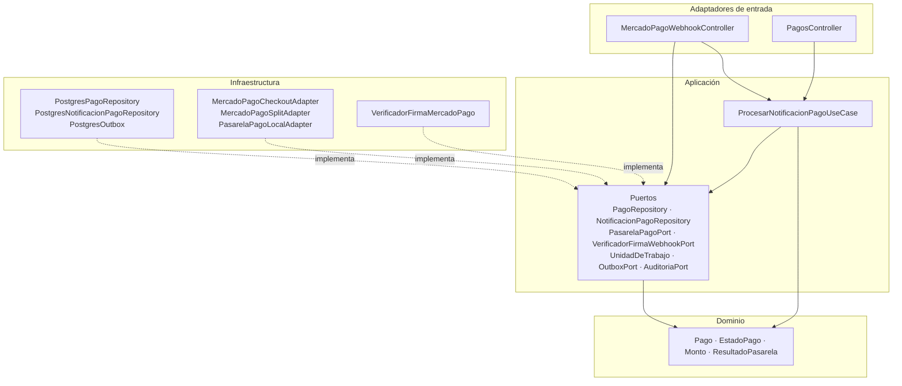
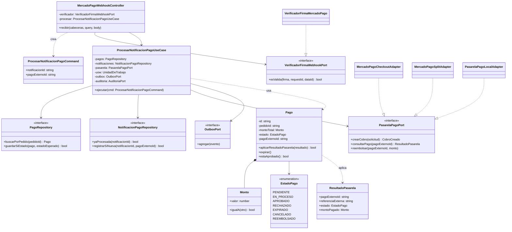
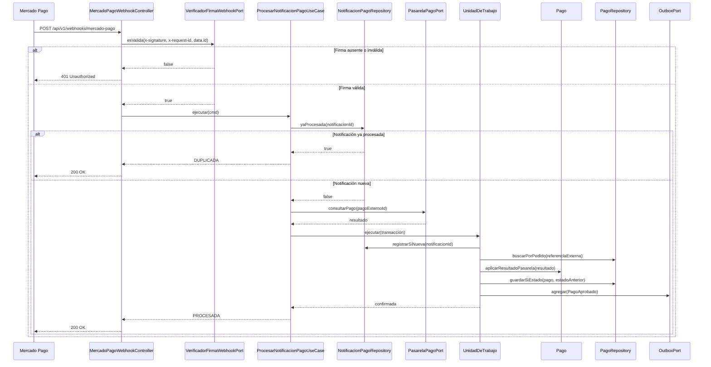

# Diseño Interno de Módulos

> **Proyecto:** Plataforma Integral Multivendedor para la Gestión Comercial y Operativa de un Mercado de Abastos
> **Backend:** NestJS + TypeScript · **Módulo de referencia:** Pagos
> **Enfoque arquitectónico:** Clean Architecture dentro de cada módulo del monolito modular
> **Nivel C4:** 4 – Código · **Versión:** 1.1

---

## 1. Propósito

Este documento describe **cómo se organiza el código dentro de un módulo** del monolito NestJS. Tiene tres objetivos:

- que todos los módulos se construyan con la misma estructura;
- que las reglas de negocio de inventario, pedidos y pagos queden aisladas de NestJS, PostgreSQL, Supabase y Mercado Pago;
- que cualquier integrante del equipo sepa dónde va cada archivo y de qué puede depender.

Se toma como referencia el módulo **Pagos** y su caso de uso **ProcesarNotificacionPago**, porque concentra reglas críticas del negocio: verificación de la notificación de la pasarela, consulta del estado real del pago, idempotencia, transiciones de estado y trazabilidad ([ADR-005](../../01-analisis-de-sistema/decisiones/ADR-005-pago-unico-mercado-pago.md)).

### 1.1 Reglas de negocio aplicadas

Las referencias entre paréntesis de este documento remiten a las siguientes secciones de ADR-005:

| Referencia | Regla | Origen |
|---|---|---|
| R1 | Solo se procesan notificaciones con firma válida | ADR-005 §5.3 (1) y §7 (1) |
| R2 | El estado del pago se obtiene de la API de Mercado Pago, no del contenido de la notificación | ADR-005 §5.3 (2) y §7 (2) |
| R3 | El monto aprobado debe coincidir con la suma de los subtotales por puesto | ADR-005 §5.1 y §5.3 (3) |
| R4 | Una notificación repetida no genera más de un cambio de estado | ADR-005 §5.3 (4) |
| R5 | Cada notificación y cada cambio de estado se registran para auditoría | ADR-005 §5.3 (5) y §7 (7) |
| R6 | Los productos de un puesto solo pasan a preparación con el pago APROBADO | ADR-005 §5.4 |

> Este diseño es una propuesta para la implementación. No implica que el código ya exista.

---

## 2. Estructura de carpetas

La estructura sigue la propuesta de la [organización interna de los módulos](../../02-arquitectura-software/enfoque-arquitectonico.md).

```text
src/
└── modules/
    └── pagos/
        ├── domain/
        │   ├── entities/
        │   │   └── pago.entity.ts                       Entidad Pago y sus reglas
        │   ├── value-objects/
        │   │   ├── estado-pago.ts                       Enumeración EstadoPago
        │   │   ├── monto.ts                             Objeto de valor Monto (soles)
        │   │   └── resultado-pasarela.ts                Resultado del pago informado por la pasarela
        │   └── errors/
        │       ├── transicion-pago-invalida.error.ts
        │       └── monto-no-coincide.error.ts
        ├── application/
        │   ├── ports/
        │   │   ├── pago.repository.ts                   Persistencia de pagos
        │   │   ├── notificacion-pago.repository.ts      Registro idempotente de notificaciones
        │   │   ├── pasarela-pago.port.ts                Contrato con la pasarela de pago
        │   │   ├── verificador-firma-webhook.port.ts    Verificación de la firma del Webhook
        │   │   ├── unidad-de-trabajo.port.ts            Transacción de base de datos
        │   │   ├── outbox.port.ts                       Registro de eventos para despacho asíncrono
        │   │   └── auditoria.port.ts                    Registro de operaciones críticas
        │   ├── use-cases/
        │   │   ├── iniciar-pago.use-case.ts
        │   │   ├── procesar-notificacion-pago.use-case.ts   Caso de uso ProcesarNotificacionPago
        │   │   ├── conciliar-pagos.use-case.ts
        │   │   └── registrar-reembolso.use-case.ts
        │   └── dto/
        │       └── procesar-notificacion-pago.command.ts
        ├── infrastructure/
        │   ├── persistence/
        │   │   ├── postgres-pago.repository.ts
        │   │   ├── postgres-notificacion-pago.repository.ts
        │   │   ├── postgres-unidad-de-trabajo.ts
        │   │   └── postgres-outbox.ts
        │   ├── pasarela/
        │   │   ├── mercado-pago-checkout.adapter.ts     Cobro único vigente (Checkout)
        │   │   ├── mercado-pago-split.adapter.ts        Alternativa de respaldo (división por puesto)
        │   │   ├── pasarela-pago-local.adapter.ts       Simulador local para desarrollo y pruebas
        │   │   └── verificador-firma-mercado-pago.ts    HMAC de la cabecera x-signature
        │   └── adapters/
        │       └── auditoria.adapter.ts                 Usa la API pública del módulo Auditoría
        ├── entry-adapters/
        │   ├── controllers/
        │   │   └── pagos.controller.ts                  Iniciar pago y consultar estado
        │   └── webhooks/
        │       └── mercado-pago-webhook.controller.ts   WebhookController de Mercado Pago
        ├── pagos.module.ts                              Raíz de composición (módulo NestJS)
        └── index.ts                                     API pública del módulo
```

| Archivo | Anillo | Responsabilidad | Importa de |
|---|---|---|---|
| `pago.entity.ts` | Dominio | Controlar los estados del pago y aplicar el resultado de la pasarela (R3, R4, R6) | Solo dominio |
| `estado-pago.ts` | Dominio | Definir PENDIENTE, EN_PROCESO, APROBADO, RECHAZADO, EXPIRADO, CANCELADO y REEMBOLSADO | Nada |
| `monto.ts` | Dominio | Representar importes en soles y compararlos (R3) | Nada |
| `resultado-pasarela.ts` | Dominio | Representar el estado, el monto y la referencia del pago informados por la pasarela | Dominio |
| `pago.repository.ts` | Aplicación (puerto) | Declarar **qué** operaciones de persistencia necesita el módulo | Dominio |
| `notificacion-pago.repository.ts` | Aplicación (puerto) | Registrar una notificación solo si no fue procesada antes (R4) | Nada |
| `pasarela-pago.port.ts` | Aplicación (puerto) | Declarar crear cobro, consultar pago y reembolsar, sin mencionar a Mercado Pago | Dominio |
| `verificador-firma-webhook.port.ts` | Aplicación (puerto) | Declarar la verificación de la firma de una notificación (R1) | Nada |
| `unidad-de-trabajo.port.ts` | Aplicación (puerto) | Ejecutar un bloque dentro de una transacción | Nada |
| `outbox.port.ts` | Aplicación (puerto) | Registrar eventos en la misma transacción para despacharlos después | Nada |
| `auditoria.port.ts` | Aplicación (puerto) | Declarar el registro de operaciones críticas (R5) | Nada |
| `procesar-notificacion-pago.use-case.ts` | Aplicación | Coordinar consulta, idempotencia, transición, auditoría y evento | Dominio + puertos |
| `procesar-notificacion-pago.command.ts` | Aplicación | Datos de entrada: `notificacionId`, `pagoExternoId` | Nada |
| `postgres-pago.repository.ts` | Infraestructura | Guardar el pago con actualización condicional en PostgreSQL | Dominio + cliente de BD |
| `postgres-notificacion-pago.repository.ts` | Infraestructura | `INSERT ... ON CONFLICT DO NOTHING` sobre el identificador de la notificación | Puerto + cliente de BD |
| `mercado-pago-checkout.adapter.ts` | Infraestructura | Implementar `PasarelaPagoPort` con un cobro único mediante Checkout | Puerto + SDK/API de Mercado Pago |
| `mercado-pago-split.adapter.ts` | Infraestructura | Implementar `PasarelaPagoPort` dividiendo el cobro entre las cuentas vinculadas de cada puesto | Puerto + SDK/API de Mercado Pago |
| `pasarela-pago-local.adapter.ts` | Infraestructura | Implementar `PasarelaPagoPort` en memoria para desarrollo local y pruebas | Puerto |
| `verificador-firma-mercado-pago.ts` | Infraestructura | Calcular y comparar el HMAC de la cabecera `x-signature` | Puerto + `node:crypto` |
| `mercado-pago-webhook.controller.ts` | Adaptador de entrada | Recibir la notificación, verificar la firma e invocar el caso de uso | Aplicación |
| `pagos.controller.ts` | Adaptador de entrada | Iniciar el pago y consultar su estado desde la Web/PWA | Aplicación |
| `pagos.module.ts` | Composición | Registrar los providers y elegir la estrategia de pasarela según la configuración | Todos los anillos |
| `index.ts` | Composición | Exponer solo lo que otros módulos pueden usar | `pagos.module.ts` |

---

## 3. Anillos del módulo y regla de dependencia



**Regla de dependencia:** el código solo puede importar hacia el centro (dominio). El dominio no conoce NestJS, PostgreSQL, Supabase ni Mercado Pago ([ADR-002](../../01-analisis-de-sistema/decisiones/ADR-002-clean-architecture.md)).

| Anillo | Contiene | Responsabilidad | Puede depender de | **No** puede depender de |
|---|---|---|---|---|
| **Dominio** | Entidades, objetos de valor, enumeraciones, errores | Reglas del negocio que serían ciertas con cualquier tecnología | Nada externo | Aplicación, infraestructura, adaptadores de entrada, NestJS, cliente de BD, SDK de Mercado Pago |
| **Aplicación** | Casos de uso, puertos (interfaces), comandos | Orquestar el flujo: qué paso va primero y qué hacer si falla | Dominio | Infraestructura, adaptadores de entrada, NestJS, SQL, SDK de Mercado Pago |
| **Infraestructura** | Repositorios concretos y adaptadores de salida | Implementar los puertos con una tecnología o con la API pública de otro módulo | Aplicación (puertos), dominio, librerías externas | Adaptadores de entrada |
| **Adaptadores de entrada** | Controladores REST y del Webhook | Traducir HTTP a llamadas del caso de uso y viceversa | Aplicación (casos de uso y puertos) | Infraestructura, base de datos, SDK de Mercado Pago |
| **Composición** | `pagos.module.ts` | Elegir implementaciones concretas y conectarlas mediante la inyección de dependencias de NestJS | Todos | — |

> **Cómo comprobarlo en el código:** basta revisar los `import` de `domain/` y `application/`. Si aparece `@nestjs/*`, `@supabase/*`, `pg`, `mercadopago` o cualquier archivo de `infrastructure/`, la regla se rompió. El SDK de Mercado Pago solo puede importarse en `infrastructure/pasarela/`.

---

## 4. Diagrama de clases



### 4.1 Notación UML utilizada

| Símbolo | Significado | Ejemplo en el diagrama |
|---|---|---|
| Línea continua con flecha abierta | Asociación: la clase guarda una referencia a la otra | `ProcesarNotificacionPagoUseCase` → `PasarelaPagoPort` |
| Línea discontinua con flecha abierta | Dependencia: la usa o la crea, pero no la guarda | `MercadoPagoWebhookController` «crea» `ProcesarNotificacionPagoCommand` |
| Línea discontinua con triángulo hueco | Realización: implementa una interfaz | `MercadoPagoCheckoutAdapter` ▷ `PasarelaPagoPort` |
| Rombo relleno | Composición: la parte no existe sin el todo | `Pago` ◆ `Monto` |
| «interface» | Interfaz (contrato sin implementación) | `PasarelaPagoPort`, `PagoRepository` |
| `-` / `+` | Privado / público | `- estado`, `+ aplicarResultadoPasarela()` |

---

## 5. Flujo de ejecución: procesar la notificación de pago



| Paso | Origen → destino | Acción | Anillo |
|---|---|---|---|
| 1 | Mercado Pago → `MercadoPagoWebhookController` | `POST /api/v1/webhooks/mercado-pago` con las cabeceras `x-signature` y `x-request-id` | Adaptador de entrada |
| 2 | Controlador → `VerificadorFirmaWebhookPort` | Verifica la firma; si es inválida responde `401` sin invocar el caso de uso (R1) | Adaptador de entrada → puerto |
| 3 | Controlador → `ProcesarNotificacionPagoUseCase` | `ejecutar(cmd)` con el identificador de la notificación y del pago | Adaptador de entrada → Aplicación |
| 4 | Caso de uso → `NotificacionPagoRepository` | `yaProcesada()`: descarte rápido de reenvíos sin consultar a la pasarela (R4) | Aplicación → puerto |
| 5 | Caso de uso → `PasarelaPagoPort` | `consultarPago()`: obtiene el estado real del pago, **fuera** de la transacción (R2) | Aplicación → Infraestructura |
| 6 | Caso de uso → `UnidadDeTrabajo` | Abre una transacción corta | Aplicación → puerto |
| 7 | En la transacción → `NotificacionPagoRepository` | `registrarSiNueva()`: inserción con clave única; si otra solicitud simultánea ya la registró, se termina sin cambios (R4) | Aplicación → Infraestructura |
| 8 | En la transacción → `Pago` | `aplicarResultadoPasarela()`: valida la transición y que el monto coincida (R3, R6) | Aplicación → Dominio |
| 9 | En la transacción → `PagoRepository` | `guardarSiEstado()`: actualización condicional sobre el estado anterior | Aplicación → Infraestructura |
| 10 | En la transacción → `OutboxPort` | Registra `PagoAprobado` y la auditoría en la misma transacción; el despacho a Pedidos y Notificaciones ocurre después (R5) | Aplicación → Infraestructura |
| 11 | Controlador → Mercado Pago | `200 OK` para que la pasarela no reintente | Adaptador de entrada |
| Alt. | — | `401` si la firma es inválida; `200` con `DUPLICADA` si la notificación ya fue procesada; `500` si la consulta a la pasarela falla, para que Mercado Pago reintente | Adaptador de entrada |

> **TODO:** confirmar en la documentación de Mercado Pago el formato de la marca de tiempo de `x-signature` y fijar el margen de tolerancia para rechazar notificaciones antiguas.

### 5.1 Idempotencia

La idempotencia se garantiza en tres niveles:

1. **Registro de notificaciones:** la tabla de notificaciones tiene una clave única sobre el identificador de la notificación. `registrarSiNueva()` usa `INSERT ... ON CONFLICT DO NOTHING` dentro de la transacción, por lo que dos entregas simultáneas de la misma notificación no pueden procesarse ambas.
2. **Transición en el dominio:** si el resultado de la pasarela coincide con el estado actual del pago, `aplicarResultadoPasarela()` devuelve `false` y no se guarda nada. Así, notificaciones distintas que informan el mismo estado no generan cambios.
3. **Actualización condicional:** `guardarSiEstado()` solo modifica la fila si el pago sigue en el estado leído, evitando que el Webhook y la conciliación periódica apliquen cambios incompatibles.

### 5.2 Adaptadores de pasarela

| Adaptador | Uso | Comportamiento de `crearCobro` |
|---|---|---|
| `MercadoPagoCheckoutAdapter` | Vigente en Sandbox | Crea un único cobro por la suma de los subtotales y devuelve la URL del Checkout |
| `MercadoPagoSplitAdapter` | Alternativa de respaldo de ADR-005 | Divide el cobro entre las cuentas vinculadas de los comerciantes de cada puesto |
| `PasarelaPagoLocalAdapter` | Desarrollo local y pruebas automatizadas | Simula cobros y resultados en memoria, sin conexión a Mercado Pago |

Los tres implementan el mismo contrato `PasarelaPagoPort`; el caso de uso no conoce cuál se está usando.

---

## 6. Código de referencia

El siguiente código es **referencial** y muestra cómo se aplica la regla de dependencia. Los nombres pueden ajustarse durante la implementación.

### 6.1 Dominio · entidad

```typescript
// domain/entities/pago.entity.ts
import { EstadoPago } from '../value-objects/estado-pago';
import { Monto } from '../value-objects/monto';
import { ResultadoPasarela } from '../value-objects/resultado-pasarela';
import { TransicionPagoInvalidaError } from '../errors/transicion-pago-invalida.error';
import { MontoNoCoincideError } from '../errors/monto-no-coincide.error';

const TRANSICIONES: Record<EstadoPago, EstadoPago[]> = {
  [EstadoPago.PENDIENTE]: [EstadoPago.EN_PROCESO, EstadoPago.APROBADO, EstadoPago.RECHAZADO, EstadoPago.EXPIRADO, EstadoPago.CANCELADO],
  [EstadoPago.EN_PROCESO]: [EstadoPago.APROBADO, EstadoPago.RECHAZADO, EstadoPago.EXPIRADO],
  [EstadoPago.APROBADO]: [EstadoPago.REEMBOLSADO],
  [EstadoPago.RECHAZADO]: [],
  [EstadoPago.EXPIRADO]: [],
  [EstadoPago.CANCELADO]: [],
  [EstadoPago.REEMBOLSADO]: [],
};

export class Pago {
  constructor(
    readonly id: string,
    readonly pedidoId: string,
    readonly montoTotal: Monto,
    private estado: EstadoPago,
    private pagoExternoId?: string,
  ) {}

  /** Devuelve false si el resultado no cambia el estado actual (notificación repetida, R4). */
  aplicarResultadoPasarela(resultado: ResultadoPasarela): boolean {
    if (resultado.estado === this.estado) return false;

    if (!TRANSICIONES[this.estado].includes(resultado.estado)) {
      throw new TransicionPagoInvalidaError(this.estado, resultado.estado);
    }
    if (resultado.estado === EstadoPago.APROBADO && !resultado.montoPagado.igualA(this.montoTotal)) {
      // El monto aprobado debe coincidir con la suma de los subtotales por puesto (R3)
      throw new MontoNoCoincideError(this.montoTotal, resultado.montoPagado);
    }

    this.estado = resultado.estado;
    this.pagoExternoId = resultado.pagoExternoId;
    return true;
  }

  estaAprobado(): boolean {
    return this.estado === EstadoPago.APROBADO;
  }

  get estadoActual(): EstadoPago {
    return this.estado;
  }

  get idExterno(): string | undefined {
    return this.pagoExternoId;
  }
}
```

### 6.2 Aplicación · puertos y caso de uso

```typescript
// application/ports/pasarela-pago.port.ts
import { Monto } from '../../domain/value-objects/monto';
import { ResultadoPasarela } from '../../domain/value-objects/resultado-pasarela';

export const PASARELA_PAGO_PORT = Symbol('PASARELA_PAGO_PORT');

export interface SolicitudCobro {
  pedidoId: string;
  montoTotal: Monto;
  subtotales: { puestoId: string; cuentaComercianteId: string; monto: Monto }[];
  expiraEn: Date;
}

export interface CobroCreado {
  referenciaCobro: string;
  urlCheckout: string;
}

export interface PasarelaPagoPort {
  crearCobro(solicitud: SolicitudCobro): Promise<CobroCreado>;
  consultarPago(pagoExternoId: string): Promise<ResultadoPasarela>;
  reembolsar(pagoExternoId: string, monto?: Monto): Promise<void>;
}
```

```typescript
// application/ports/notificacion-pago.repository.ts
export const NOTIFICACION_PAGO_REPOSITORY = Symbol('NOTIFICACION_PAGO_REPOSITORY');

export interface NotificacionPagoRepository {
  yaProcesada(notificacionId: string): Promise<boolean>;
  /** Inserta la notificación con clave única. Devuelve false si ya existía. */
  registrarSiNueva(notificacionId: string, pagoExternoId: string): Promise<boolean>;
}
```

```typescript
// application/use-cases/procesar-notificacion-pago.use-case.ts
export type ResultadoProcesamiento = 'PROCESADA' | 'DUPLICADA' | 'SIN_CAMBIOS';

export class ProcesarNotificacionPagoUseCase {
  constructor(
    private readonly pagos: PagoRepository,
    private readonly notificaciones: NotificacionPagoRepository,
    private readonly pasarela: PasarelaPagoPort,
    private readonly uow: UnidadDeTrabajo,
    private readonly outbox: OutboxPort,
    private readonly auditoria: AuditoriaPort,
  ) {}

  async ejecutar(cmd: ProcesarNotificacionPagoCommand): Promise<ResultadoProcesamiento> {
    if (await this.notificaciones.yaProcesada(cmd.notificacionId)) return 'DUPLICADA';

    // La consulta a la pasarela se realiza fuera de la transacción para mantenerla corta (R2)
    const resultado = await this.pasarela.consultarPago(cmd.pagoExternoId);

    return this.uow.ejecutar(async () => {
      const nueva = await this.notificaciones.registrarSiNueva(cmd.notificacionId, cmd.pagoExternoId);
      if (!nueva) return 'DUPLICADA';

      const pago = await this.pagos.buscarPorPedido(resultado.referenciaExterna);
      if (!pago) throw new PagoNoEncontradoError(resultado.referenciaExterna);

      const estadoAnterior = pago.estadoActual;
      if (!pago.aplicarResultadoPasarela(resultado)) return 'SIN_CAMBIOS';

      const guardado = await this.pagos.guardarSiEstado(pago, estadoAnterior);
      if (!guardado) throw new PagoModificadoConcurrentementeError(pago.id);

      await this.auditoria.registrar({
        operacion: 'PROCESAR_NOTIFICACION_PAGO',
        pedidoId: pago.pedidoId,
        notificacionId: cmd.notificacionId,
        estadoAnterior,
        estadoNuevo: pago.estadoActual,
      });

      if (pago.estaAprobado()) {
        await this.outbox.agregar({ tipo: 'PagoAprobado', pedidoId: pago.pedidoId, pagoId: pago.id });
      }
      return 'PROCESADA';
    });
  }
}
```

> El caso de uso no importa nada de NestJS ni de Mercado Pago: recibe sus dependencias por el constructor. Si la transacción falla, el registro de la notificación también se revierte y el reintento de Mercado Pago se procesa normalmente.

### 6.3 Infraestructura · repositorio y adaptador de pasarela

```typescript
// infrastructure/persistence/postgres-notificacion-pago.repository.ts
export class PostgresNotificacionPagoRepository implements NotificacionPagoRepository {
  constructor(private readonly db: ClienteBaseDatos) {}

  async registrarSiNueva(notificacionId: string, pagoExternoId: string): Promise<boolean> {
    const filas = await this.db.query(
      `INSERT INTO notificaciones_pago (notificacion_id, pago_externo_id, recibida_en)
       VALUES ($1, $2, now())
       ON CONFLICT (notificacion_id) DO NOTHING`,
      [notificacionId, pagoExternoId],
    );
    return filas.rowCount === 1;
  }

  // yaProcesada(...) consulta la existencia del identificador
}
```

```typescript
// infrastructure/pasarela/mercado-pago-checkout.adapter.ts
export class MercadoPagoCheckoutAdapter implements PasarelaPagoPort {
  constructor(private readonly cliente: ClienteMercadoPago) {}

  async crearCobro(solicitud: SolicitudCobro): Promise<CobroCreado> {
    const preferencia = await this.cliente.crearPreferencia({
      referenciaExterna: solicitud.pedidoId,
      monto: solicitud.montoTotal.valor,
      expiraEn: solicitud.expiraEn,
    });
    return { referenciaCobro: preferencia.id, urlCheckout: preferencia.urlCheckout };
  }

  async consultarPago(pagoExternoId: string): Promise<ResultadoPasarela> {
    const pago = await this.cliente.obtenerPago(pagoExternoId);
    return ResultadoPasarela.desdeProveedor(pago.id, pago.referenciaExterna, pago.estado, pago.monto);
  }

  // reembolsar(...) invoca la API de reembolsos con el monto total o parcial
}
```

```typescript
// infrastructure/pasarela/verificador-firma-mercado-pago.ts
import { createHmac, timingSafeEqual } from 'node:crypto';

export class VerificadorFirmaMercadoPago implements VerificadorFirmaWebhookPort {
  constructor(private readonly claveSecreta: string) {}

  esValida(firma: string | undefined, requestId: string | undefined, dataId: string | undefined): boolean {
    if (!firma || !requestId || !dataId) return false;

    const partes = Object.fromEntries(firma.split(',').map((p) => p.trim().split('=')));
    const { ts, v1 } = partes;
    if (!ts || !v1 || !this.dentroDeTolerancia(ts)) return false;

    const manifiesto = `id:${dataId};request-id:${requestId};ts:${ts};`;
    const esperado = createHmac('sha256', this.claveSecreta).update(manifiesto).digest('hex');

    return esperado.length === v1.length && timingSafeEqual(Buffer.from(esperado), Buffer.from(v1));
  }

  // dentroDeTolerancia(...) rechaza marcas de tiempo fuera del margen configurado
}
```

### 6.4 Adaptador de entrada · WebhookController

```typescript
// entry-adapters/webhooks/mercado-pago-webhook.controller.ts
@Controller('api/v1/webhooks/mercado-pago')
export class MercadoPagoWebhookController {
  constructor(
    @Inject(VERIFICADOR_FIRMA_WEBHOOK_PORT) private readonly verificador: VerificadorFirmaWebhookPort,
    private readonly procesarNotificacion: ProcesarNotificacionPagoUseCase,
  ) {}

  @Post()
  @HttpCode(200)
  async recibir(
    @Headers('x-signature') firma: string,
    @Headers('x-request-id') requestId: string,
    @Query('data.id') dataId: string,
    @Body() body: NotificacionMercadoPagoDto,
  ) {
    if (!this.verificador.esValida(firma, requestId, dataId)) {
      throw new UnauthorizedException();
    }
    if (body.type !== 'payment') return { recibida: true };

    const resultado = await this.procesarNotificacion.ejecutar({
      notificacionId: String(body.id),
      pagoExternoId: dataId,
    });
    return { recibida: true, resultado };
  }
}
```

> El endpoint del Webhook no usa la sesión de usuario: su autenticación es la firma de Mercado Pago (R1).

### 6.5 Raíz de composición

```typescript
// pagos.module.ts
const pasarelaPorModo = {
  checkout: MercadoPagoCheckoutAdapter,
  split: MercadoPagoSplitAdapter,
  local: PasarelaPagoLocalAdapter,
};

@Module({
  imports: [AuditoriaModule],
  controllers: [PagosController, MercadoPagoWebhookController],
  providers: [
    { provide: PAGO_REPOSITORY, useClass: PostgresPagoRepository },
    { provide: NOTIFICACION_PAGO_REPOSITORY, useClass: PostgresNotificacionPagoRepository },
    { provide: UNIDAD_DE_TRABAJO, useClass: PostgresUnidadDeTrabajo },
    { provide: OUTBOX_PORT, useClass: PostgresOutbox },
    { provide: AUDITORIA_PORT, useClass: AuditoriaAdapter },
    {
      provide: VERIFICADOR_FIRMA_WEBHOOK_PORT,
      useFactory: (config: ConfigService) => new VerificadorFirmaMercadoPago(config.getOrThrow('MP_WEBHOOK_SECRET')),
      inject: [ConfigService],
    },
    {
      provide: PASARELA_PAGO_PORT,
      useFactory: (config: ConfigService, moduleRef: ModuleRef) =>
        moduleRef.create(pasarelaPorModo[config.getOrThrow<keyof typeof pasarelaPorModo>('PASARELA_PAGO_MODO')]),
      inject: [ConfigService, ModuleRef],
    },
    {
      provide: ProcesarNotificacionPagoUseCase,
      useFactory: (r, n, p, u, o, a) => new ProcesarNotificacionPagoUseCase(r, n, p, u, o, a),
      inject: [PAGO_REPOSITORY, NOTIFICACION_PAGO_REPOSITORY, PASARELA_PAGO_PORT, UNIDAD_DE_TRABAJO, OUTBOX_PORT, AUDITORIA_PORT],
    },
  ],
  exports: [IniciarPagoUseCase],
})
export class PagosModule {}
```

> Solo `pagos.module.ts` conoce las clases concretas. La variable `PASARELA_PAGO_MODO` selecciona el adaptador de pasarela (`checkout`, `split` o `local`); en las pruebas se usa `local` junto con repositorios en memoria. Las credenciales y la clave del Webhook se leen de variables de entorno.

---

## 7. Aplicación al resto de módulos

| Módulo | Caso de uso de referencia | Puertos principales |
|---|---|---|
| Pedidos | `CrearPedido` | `PedidoRepository`, `ReservaInventarioPort`, `UnidadDeTrabajo` |
| Inventario | `ReservarInventario` | `InventarioRepository` |
| Comerciantes y puestos | `VincularCuentaMercadoPago` | `CuentaMercadoPagoRepository`, `AutorizacionMercadoPagoPort`, `CifradoTokensPort` |
| Notificaciones | `NotificarCambioEstado` | `CanalNotificacionPort` |

El detalle del flujo `CrearPedido` se presenta en el [Nivel 4 del modelo C4](../../04-modelo-c4/Nivel4-DiagramadeCodigo.md).
