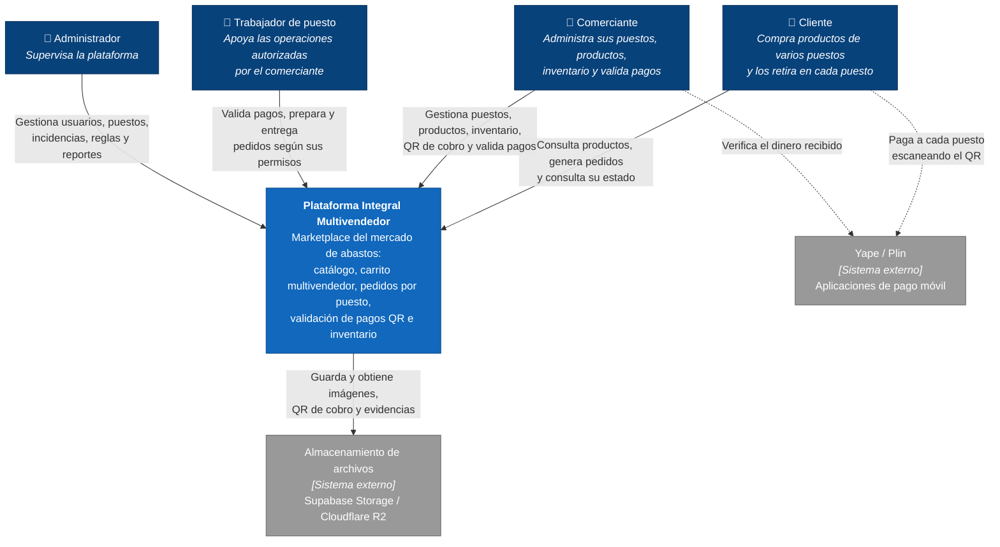

# Nivel 1 · Diagrama de Contexto del Sistema

> **Proyecto:** Plataforma Integral Multivendedor para la Gestión Comercial y Operativa de un Mercado de Abastos
> **Modelo:** C4 · Nivel 1 de 4 · **Versión:** 1.0

---

## 1. Objetivo

Mostrar la **plataforma como una sola caja**: quiénes la usan y con qué sistemas externos se relaciona. Es la vista de mayor nivel y la primera que se presenta a cualquier persona, técnica o no.

| Aspecto | Descripción |
|---|---|
| Pregunta que responde | ¿Qué es el sistema, quién lo usa y con quién se relaciona? |
| Audiencia | Todos: comerciantes del mercado, docentes, equipo de desarrollo |
| Qué **no** muestra | Tecnologías, servidores, bases de datos ni módulos internos |
| Siguiente nivel | [Nivel 2 · Diagrama de contenedores](Nivel2-DiagramadeContenedores.md) |

---

## 2. Diagrama

> Las líneas discontinuas son interacciones de las personas con Yape o Plin **fuera de la plataforma**: en la primera versión no existe integración por API con los medios de pago (RC13, RC14).

---

## 3. Personas (usuarios)

| Persona | Descripción | Qué hace en el sistema |
|---|---|---|
| **Cliente** | Persona que compra en el mercado | Busca productos de diferentes puestos, arma un carrito multivendedor, genera el pedido, paga a cada puesto por QR, consulta el estado y retira sus productos en cada puesto |
| **Comerciante** | Responsable de uno o más puestos | Administra tiendas, productos, precios, inventario y códigos QR; valida los pagos recibidos; prepara y entrega los pedidos de sus puestos |
| **Trabajador de puesto** | Usuario autorizado por el comerciante | Realiza solo las operaciones que el comerciante le asigna: validar pagos, preparar y entregar pedidos, apoyar en inventario |
| **Administrador** | Responsable de la plataforma | Gestiona usuarios, comerciantes, puestos, incidencias, reglas operativas, auditoría y reportes |

---

## 4. Sistemas

| Sistema | Tipo | Responsabilidad | Quién lo construye |
|---|---|---|---|
| **Plataforma Integral Multivendedor** | Sistema en alcance | Permite a los comerciantes publicar sus productos y a los clientes comprarlos en varios puestos con un solo pedido | El equipo del proyecto |
| **Yape / Plin** | Sistema externo | Transferencias de dinero del cliente al comerciante mediante QR | Proveedores de pago móvil |
| **Almacenamiento de archivos** | Sistema externo | Guarda imágenes de productos y tiendas, códigos QR de cobro y evidencias digitales | Supabase (Storage) o Cloudflare (R2) |

---

## 5. Relaciones

| Origen | Destino | Descripción | Protocolo |
|---|---|---|---|
| Cliente | Plataforma | Consulta el catálogo, genera pedidos y consulta su estado | — |
| Comerciante | Plataforma | Gestiona sus puestos, productos, inventario y valida pagos | — |
| Trabajador de puesto | Plataforma | Realiza las operaciones autorizadas del puesto | — |
| Administrador | Plataforma | Supervisa y configura la plataforma | — |
| Cliente | Yape / Plin | Paga a cada puesto escaneando su QR (fuera de la plataforma) | App móvil del proveedor |
| Comerciante | Yape / Plin | Verifica el dinero recibido (fuera de la plataforma) | App móvil del proveedor |
| Plataforma | Almacenamiento de archivos | Guarda y obtiene archivos | HTTPS/API |

> En el nivel 1 no se indica el protocolo entre personas y sistema: eso se detalla en el nivel 2.

---

## 6. Decisiones y supuestos

| # | Decisión o supuesto | Motivo |
|---|---|---|
| 1 | La plataforma **no se integra** con Yape ni Plin por API | Restricciones RC13 y RC14; la validación la registra el comerciante ([ADR-004](../01-analisis-de-sistema/decisiones/ADR-004-pagos-qr.md)) |
| 2 | La plataforma **no procesa dinero** ni almacena datos bancarios | El cliente paga directamente a cada puesto; se reduce el riesgo de seguridad |
| 3 | No hay servicio de delivery | Restricción RC17: el cliente retira sus productos en cada puesto |
| 4 | No hay integración con SUNAT, RENIEC ni hardware especializado | Restricciones RC16, RC18 y RC19 de la primera versión |

### Pendientes por definir

| Tema | Detalle |
|---|---|
| Canal de notificaciones | El módulo Notificaciones avisa los cambios de estado del pedido (RF41); falta definir si será correo, notificaciones push de la PWA u otro servicio. Cuando se defina, se agregará como sistema externo |
| Proveedor de almacenamiento definitivo | Se inicia con Supabase Storage y se mantiene Cloudflare R2 como alternativa (RC09) |
