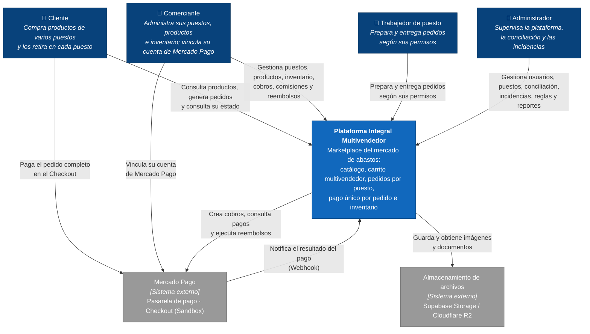

# Nivel 1 · Diagrama de Contexto del Sistema

> **Proyecto:** Plataforma Integral Multivendedor para la Gestión Comercial y Operativa de un Mercado de Abastos
> **Modelo:** C4 · Nivel 1 de 4 · **Versión:** 1.1

---

## 1. Objetivo

Mostrar la **plataforma como una sola caja**: quiénes la usan y con qué sistemas externos se relaciona. Es la vista de mayor nivel y la primera que se presenta a cualquier persona, técnica o no.

| Aspecto | Descripción |
|---|---|
| Pregunta que responde | ¿Qué es el sistema, quién lo usa y con quién se relaciona? |
| Audiencia | Todos: comerciantes del mercado, docentes, equipo de desarrollo |
| Qué **no** muestra | Tecnologías, servidores, bases de datos ni módulos internos |
| Siguiente nivel | [Nivel 2 · Diagrama de contenedores](Nivel2-DiagramadeContenedores.md) |

---

## 2. Diagrama

> La plataforma se integra con Mercado Pago en entorno Sandbox: crea el cobro del pedido, recibe la confirmación automática del pago y ejecuta los reembolsos (RC13, RC14, [ADR-005](../01-analisis-de-sistema/decisiones/ADR-005-pago-unico-mercado-pago.md)).

---

## 3. Personas (usuarios)

| Persona | Descripción | Qué hace en el sistema |
|---|---|---|
| **Cliente** | Persona que compra en el mercado | Busca productos de diferentes puestos, arma un carrito multivendedor, genera el pedido, lo paga en una sola transacción mediante Mercado Pago, consulta el estado y retira sus productos en cada puesto |
| **Comerciante** | Responsable de uno o más puestos | Administra tiendas, productos, precios e inventario; vincula su cuenta de Mercado Pago; prepara y entrega los pedidos de sus puestos con pago aprobado; consulta cobros y comisiones; solicita reembolsos |
| **Trabajador de puesto** | Usuario autorizado por el comerciante | Realiza solo las operaciones que el comerciante le asigna: preparar y entregar pedidos y apoyar en inventario. No valida pagos |
| **Administrador** | Responsable de la plataforma | Gestiona usuarios, comerciantes, puestos, conciliación de pagos, incidencias, reglas operativas, auditoría y reportes |

---

## 4. Sistemas

| Sistema | Tipo | Responsabilidad | Quién lo construye |
|---|---|---|---|
| **Plataforma Integral Multivendedor** | Sistema en alcance | Permite a los comerciantes publicar sus productos y a los clientes comprarlos en varios puestos con un solo pedido y un solo pago | El equipo del proyecto |
| **Mercado Pago** | Sistema externo | Procesa el pago único del pedido en su Checkout, notifica el resultado mediante Webhooks, permite consultar pagos y ejecutar reembolsos, y gestiona las cuentas de los comerciantes | Mercado Pago |
| **Almacenamiento de archivos** | Sistema externo | Guarda imágenes de productos y tiendas, y documentos de la plataforma | Supabase (Storage) o Cloudflare (R2) |

---

## 5. Relaciones

| Origen | Destino | Descripción | Protocolo |
|---|---|---|---|
| Cliente | Plataforma | Consulta el catálogo, genera pedidos y consulta su estado | — |
| Comerciante | Plataforma | Gestiona sus puestos, productos, inventario, cobros y reembolsos | — |
| Trabajador de puesto | Plataforma | Prepara y entrega los pedidos autorizados del puesto | — |
| Administrador | Plataforma | Supervisa, concilia pagos y configura la plataforma | — |
| Cliente | Mercado Pago | Paga el pedido completo en el Checkout, tras ser redirigido desde la plataforma | — |
| Comerciante | Mercado Pago | Autoriza la vinculación de su cuenta con la plataforma | — |
| Plataforma | Mercado Pago | Crea el cobro del pedido, consulta el estado de los pagos y ejecuta reembolsos | HTTPS/API |
| Mercado Pago | Plataforma | Notifica el resultado del pago | HTTPS (Webhook) |
| Plataforma | Almacenamiento de archivos | Guarda y obtiene archivos | HTTPS/API |

> En el nivel 1 no se indica el protocolo entre personas y sistemas: eso se detalla en el nivel 2.

---

## 6. Decisiones y supuestos

| # | Decisión o supuesto | Motivo |
|---|---|---|
| 1 | La plataforma **se integra** con Mercado Pago por API y Webhooks, en entorno Sandbox | Restricciones RC13 y RC14; pago único por pedido con confirmación automática ([ADR-005](../01-analisis-de-sistema/decisiones/ADR-005-pago-unico-mercado-pago.md)) |
| 2 | La plataforma **no almacena datos de tarjetas** | El cliente ingresa sus datos de pago directamente en el Checkout de Mercado Pago; se reduce el riesgo de seguridad |
| 3 | Cada comerciante vincula su cuenta de Mercado Pago y asume la comisión de la pasarela | Restricción RC14 |
| 4 | No hay servicio de delivery | Restricción RC17: el cliente retira sus productos en cada puesto |
| 5 | No hay integración con SUNAT, RENIEC ni hardware especializado | Restricciones RC16, RC18 y RC19 de la primera versión |

### Pendientes por definir

| Tema | Detalle |
|---|---|
| Canal de notificaciones | El módulo Notificaciones avisa los cambios de estado del pedido (RF41); falta definir si será correo, notificaciones push de la PWA u otro servicio. Cuando se defina, se agregará como sistema externo |
| Proveedor de almacenamiento definitivo | Se inicia con Supabase Storage y se mantiene Cloudflare R2 como alternativa (RC09) |
| Paso a producción de Mercado Pago | La primera versión opera en Sandbox; el uso de credenciales productivas requiere una decisión posterior |
