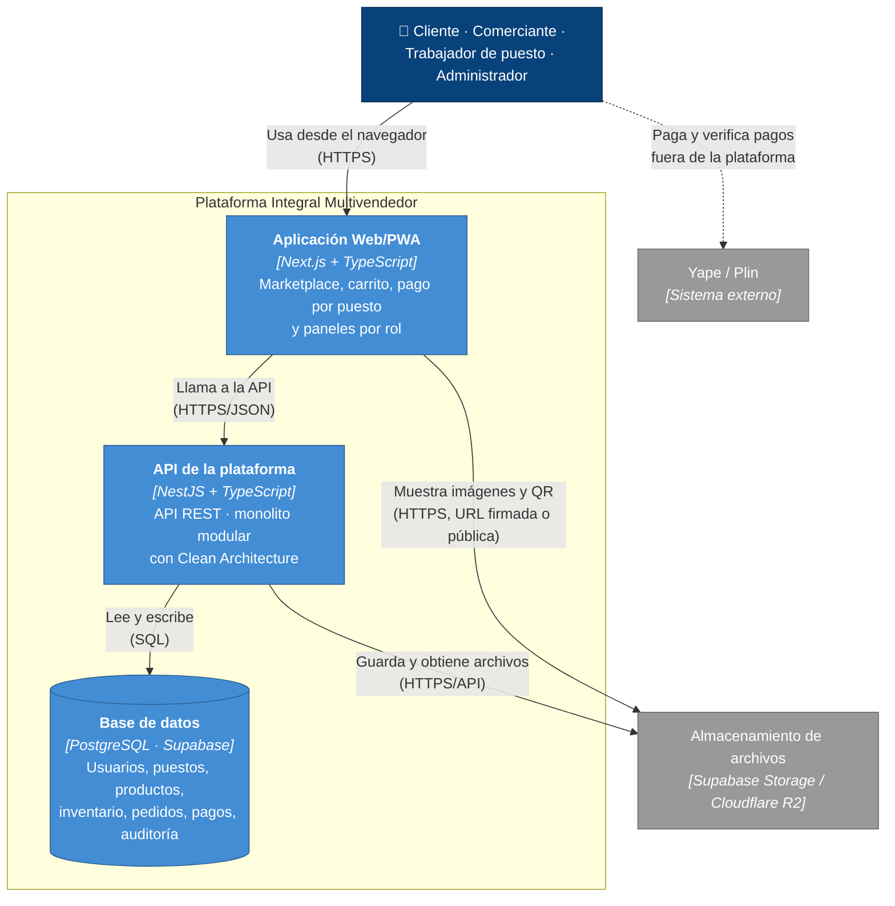

# Nivel 2 · Diagrama de Contenedores

> **Proyecto:** Plataforma Integral Multivendedor para la Gestión Comercial y Operativa de un Mercado de Abastos
> **Modelo:** C4 · Nivel 2 de 4 · **Versión:** 1.0

---

## 1. Objetivo

Abrir la caja «Plataforma Integral Multivendedor» del nivel 1 y mostrar los **contenedores** que la forman: las aplicaciones y almacenes de datos que se ejecutan por separado, la tecnología de cada uno y cómo se comunican.

| Aspecto | Descripción |
|---|---|
| Pregunta que responde | ¿De qué piezas ejecutables se compone el sistema y con qué tecnología? |
| Audiencia | Arquitectos, desarrolladores, operaciones |
| Qué es un contenedor | Algo que se ejecuta o almacena datos de forma independiente: una aplicación web, una API, una base de datos (no es lo mismo que un contenedor Docker) |
| Nivel anterior | [Nivel 1 · Diagrama de contexto](Nivel1-DiagramadeContextodelSistema.md) |
| Siguiente nivel | [Nivel 3 · Diagrama de componentes](Nivel3-Diagrama-de-Componentes.md) |

---

## 2. Diagrama

---

## 3. Contenedores

| Contenedor | Tecnología | Responsabilidad | Datos que maneja |
|---|---|---|---|
| **Aplicación Web/PWA** | Next.js + TypeScript | Interfaz responsive para clientes, comerciantes, trabajadores de puesto y administradores. Se puede instalar como PWA en Android e iOS | Ninguno persistente; solo el estado de la pantalla y la sesión |
| **API de la plataforma** | NestJS + TypeScript | Expone la API REST, aplica las reglas de negocio, controla los permisos por rol y por puesto. Es un **monolito modular**: un solo proceso con módulos internos ([ADR-001](../01-analisis-de-sistema/decisiones/ADR-001-monolito-modular.md)) | Ninguno propio; usa la base de datos y el almacenamiento |
| **Base de datos** | PostgreSQL (Supabase) | Almacena de forma permanente la información del negocio y garantiza la consistencia mediante transacciones ([ADR-003](../01-analisis-de-sistema/decisiones/ADR-003-control-concurrencia.md)) | Usuarios, roles, comerciantes, puestos, productos, inventario, carritos, pedidos, pagos, incidencias, auditoría |
| **Almacenamiento de archivos** *(externo)* | Supabase Storage (alternativa: Cloudflare R2) | Guarda los archivos digitales | Imágenes, códigos QR de cobro, evidencias |

---

## 4. Relaciones

| Origen | Destino | Descripción | Protocolo |
|---|---|---|---|
| Usuarios | Aplicación Web/PWA | Usan la aplicación desde el navegador | HTTPS |
| Aplicación Web/PWA | API de la plataforma | Llama a la API REST | HTTPS/JSON |
| API de la plataforma | Base de datos | Lee y escribe información | SQL sobre TCP |
| API de la plataforma | Almacenamiento de archivos | Sube y elimina archivos | HTTPS/API |
| Aplicación Web/PWA | Almacenamiento de archivos | Muestra imágenes y códigos QR | HTTPS |
| Cliente, Comerciante | Yape / Plin | Pagan y verifican pagos fuera de la plataforma | App móvil del proveedor |

---

## 5. Decisiones arquitectónicas reflejadas

| Decisión | Alternativa descartada | Motivo |
|---|---|---|
| Un único contenedor de backend (monolito modular) | Microservicios | Equipo pequeño y proyecto académico progresivo; las operaciones de pedido, inventario y pago necesitan consistencia transaccional ([ADR-001](../01-analisis-de-sistema/decisiones/ADR-001-monolito-modular.md)) |
| Frontend separado del backend (Web/PWA + API REST) | Lógica de negocio en el frontend | Las reglas y permisos se aplican siempre en el backend (RC06, DA05) |
| PostgreSQL como base de datos | Base de datos NoSQL | Inventario, pedidos y pagos necesitan transacciones y actualizaciones condicionales ([ADR-003](../01-analisis-de-sistema/decisiones/ADR-003-control-concurrencia.md)) |
| Aplicación Web/PWA | Aplicación móvil nativa | Restricción RC15; una sola aplicación para computadoras y móviles (DA13) |
| Sin contenedor de integración de pagos | Adaptador para una pasarela bancaria | Restricciones RC13 y RC14 ([ADR-004](../01-analisis-de-sistema/decisiones/ADR-004-pagos-qr.md)) |

---

## 6. Seguridad entre contenedores

| Comunicación | Medida |
|---|---|
| Navegador → Aplicación Web/PWA y API | Tráfico cifrado con HTTPS |
| Aplicación Web/PWA → API | Cada petición lleva el token de sesión del usuario; la API verifica el rol y el puesto antes de ejecutar la operación |
| API → Base de datos | Credenciales en variables de entorno; la base de datos no se expone directamente al navegador |
| API → Almacenamiento | Credenciales solo en el servidor; los archivos sensibles se entregan mediante URL firmadas y temporales |

> **TODO:** definir el mecanismo de autenticación (por ejemplo, Supabase Auth o JWT propio de NestJS) como parte de la estrategia de seguridad pendiente del driver DA03.
