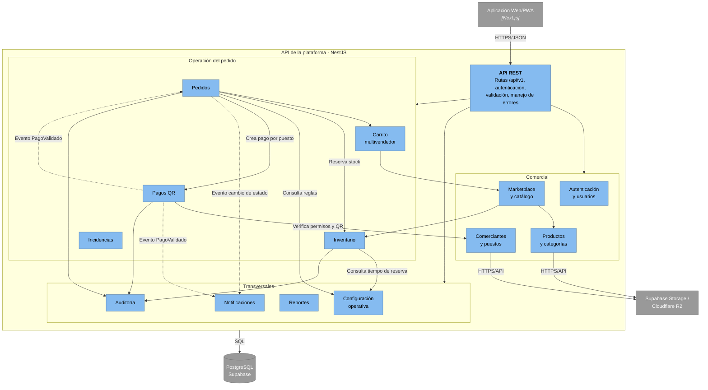

# Nivel 3 · Diagrama de Componentes

> **Proyecto:** Plataforma Integral Multivendedor · **Contenedor detallado:** API de la plataforma (NestJS)
> **Modelo:** C4 · Nivel 3 de 4 · **Versión:** 1.0

---

## 1. Objetivo

Abrir el contenedor **API de la plataforma** del nivel 2 y mostrar sus **componentes**: los módulos del monolito modular, la responsabilidad de cada uno y cómo se relacionan entre sí y con la base de datos y el almacenamiento de archivos.

| Aspecto | Descripción |
|---|---|
| Pregunta que responde | ¿Cómo se divide el backend por dentro y qué hace cada parte? |
| Audiencia | Arquitectos y desarrolladores |
| Qué es un componente | Un grupo de funcionalidades con una responsabilidad clara, accesible mediante una interfaz. En este proyecto, cada **módulo NestJS** del monolito es un componente |
| Nivel anterior | [Nivel 2 · Diagrama de contenedores](Nivel2-DiagramadeContenedores.md) |
| Siguiente nivel | [Nivel 4 · Diagrama de código](Nivel4-DiagramadeCodigo.md) |

---

## 2. Diagrama

> Las líneas continuas son llamadas en memoria a la API pública de otro módulo; las discontinuas son eventos en memoria.

---

## 3. Componentes

| Componente | Responsabilidad | Funcionalidades principales | Carpeta en el código |
|---|---|---|---|
| **API REST** | Punto de entrada HTTP del contenedor | Rutas `/api/v1`, autenticación, autorización por rol, validación de entrada, manejo de errores | `src/shared/http/` |
| **Autenticación y usuarios** | Identidad y acceso | Registro, inicio de sesión, roles y permisos (RF01–RF05) | `src/modules/usuarios/` |
| **Comerciantes y puestos** | Gestión de comerciantes y puestos | Puestos, tiendas virtuales, trabajadores autorizados, códigos QR de cobro (RF06–RF08, RF33) | `src/modules/comerciantes/` |
| **Productos y categorías** | Información de productos | Productos, categorías, precios, presentaciones e imágenes (RF09–RF11) | `src/modules/productos/` |
| **Marketplace y catálogo** | Consulta pública | Catálogo general, búsqueda y filtros (RF16–RF19) | `src/modules/catalogo/` |
| **Carrito multivendedor** | Selección previa a la compra | Ítems de varios puestos, subtotales por puesto y total (RF20–RF24) | `src/modules/carrito/` |
| **Pedidos** | Proceso de compra | Pedido agrupado por puesto, estados, preparación, retiro y variaciones (RF26–RF31, RF36–RF39) | `src/modules/pedidos/` |
| **Inventario** | Control de stock | Stock físico, reservado y disponible; reservas atómicas; movimientos (RF12–RF15, RF25) | `src/modules/inventario/` |
| **Pagos QR** | Pagos por puesto | QR e importe por puesto, aviso de pago, validación por el comerciante (RF32, RF34, RF35) | `src/modules/pagos/` |
| **Incidencias** | Problemas del pedido | Cancelaciones, devoluciones y reclamos (RF40) | `src/modules/incidencias/` |
| **Notificaciones** | Comunicación con el usuario | Avisos de cambios de estado del pedido (RF41) | `src/modules/notificaciones/` |
| **Auditoría** | Trazabilidad | Registro de operaciones críticas (RF42) | `src/modules/auditoria/` |
| **Reportes** | Indicadores | Reportes, paneles y operaciones por puesto (RF43, RF44, RF46) | `src/modules/reportes/` |
| **Configuración operativa** | Reglas operativas parametrizables | Tiempos de reserva y tolerancias de peso o precio, administrados por el administrador (RF45) | `src/modules/configuracion/` |

---

## 4. Relaciones entre componentes

| Origen | Destino | Descripción | Tipo de comunicación |
|---|---|---|---|
| Aplicación Web/PWA | API REST | Llama a la API | HTTPS/JSON |
| API REST | Módulos de negocio | Invoca los casos de uso | Llamada en memoria |
| Catálogo | Productos, Inventario | Obtiene productos publicados y su disponibilidad | Llamada en memoria (API pública del módulo) |
| Carrito | Catálogo | Consulta precio, puesto y disponibilidad | Llamada en memoria |
| Pedidos | Carrito | Convierte el carrito en pedido agrupado por puesto | Llamada en memoria |
| Pedidos | Inventario | Reserva el stock dentro de la misma transacción | Llamada en memoria |
| Pedidos, Inventario | Configuración operativa | Consultan tolerancias de peso o precio y tiempo de reserva; Configuración no depende de ningún otro módulo | Llamada en memoria |
| Pedidos | Pagos | Crea un pago por cada puesto del pedido | Llamada en memoria |
| Pagos | Comerciantes y puestos | Verifica que el usuario pertenezca al puesto y obtiene el QR | Llamada en memoria |
| Pagos | Pedidos | Informa que el pago de un puesto fue validado | Evento en memoria (`PagoValidado`) |
| Pagos, Pedidos | Notificaciones | Informan cambios de estado | Evento en memoria |
| Pagos, Pedidos, Inventario | Auditoría | Registran operaciones críticas | Llamada en memoria |

---

## 5. Relaciones con contenedores y sistemas externos

| Componente | Destino | Descripción | Protocolo | Patrón aplicado |
|---|---|---|---|---|
| Todos los módulos | Base de datos (PostgreSQL) | Cada módulo lee y escribe **solo sus propias tablas** | SQL | Repository |
| Pedidos + Inventario | Base de datos (PostgreSQL) | Reserva de stock y registro del pedido en una transacción | SQL | Unit of Work |
| Comerciantes y puestos, Productos | Almacenamiento de archivos | Guardan códigos QR e imágenes | HTTPS/API | Adapter |
| Pagos | Pedidos, Notificaciones | Avisa la validación del pago | Evento en memoria | Observer |

> Pagos **no** se comunica con Yape ni Plin: la validación la registra el comerciante ([ADR-004](../01-analisis-de-sistema/decisiones/ADR-004-pagos-qr.md)).

---

## 6. Reglas del monolito modular

| # | Regla | Motivo |
|---|---|---|
| 1 | Todos los componentes se despliegan juntos en el contenedor API de la plataforma | Es un monolito: un solo proceso y un solo despliegue |
| 2 | Un módulo usa a otro solo a través de su API pública (`index.ts` y `exports` del módulo NestJS) | Evita que un cambio interno en un módulo rompa a los demás |
| 3 | Un módulo no lee ni escribe las tablas de otro módulo | Mantiene la independencia de los datos de cada módulo |
| 4 | Las dependencias entre módulos no forman ciclos; cuando un módulo necesita avisar «hacia atrás» usa un evento | Ejemplo: Pedidos llama a Pagos, y Pagos responde con el evento `PagoValidado` |
| 5 | Un fallo en Notificaciones no revierte operaciones de compra, pago ni preparación | Driver DA11 – Aislamiento de fallos |
| 6 | Cada módulo se organiza por dentro con Clean Architecture | Las reglas de negocio no dependen de la tecnología ([Nivel 4](Nivel4-DiagramadeCodigo.md)) |
