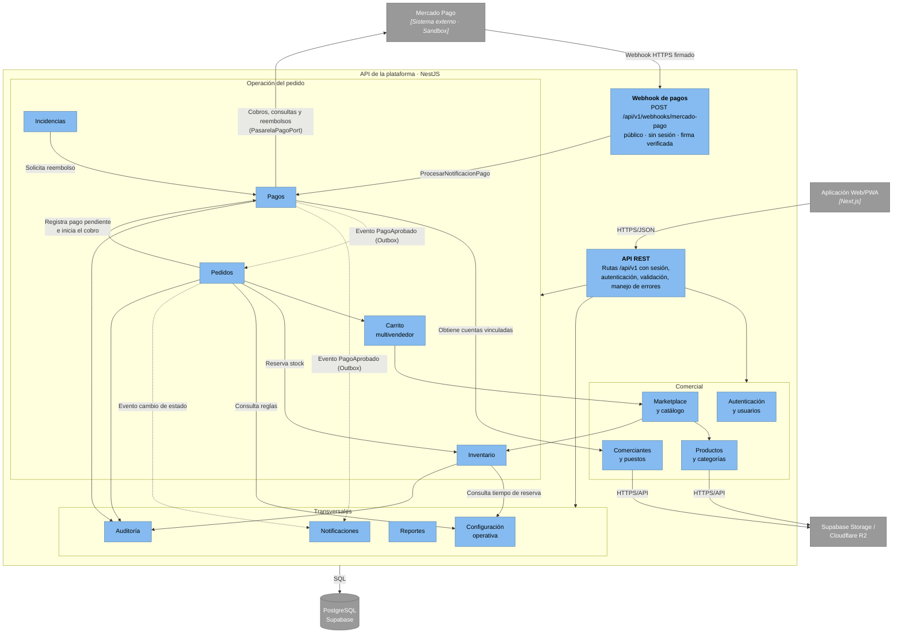

# Nivel 3 · Diagrama de Componentes

> **Proyecto:** Plataforma Integral Multivendedor · **Contenedor detallado:** API de la plataforma (NestJS)
> **Modelo:** C4 · Nivel 3 de 4 · **Versión:** 1.1

---

## 1. Objetivo

Abrir el contenedor **API de la plataforma** del nivel 2 y mostrar sus **componentes**: los módulos del monolito modular, la responsabilidad de cada uno y cómo se relacionan entre sí, con la base de datos, el almacenamiento de archivos y Mercado Pago.

| Aspecto | Descripción |
|---|---|
| Pregunta que responde | ¿Cómo se divide el backend por dentro y qué hace cada parte? |
| Audiencia | Arquitectos y desarrolladores |
| Qué es un componente | Un grupo de funcionalidades con una responsabilidad clara, accesible mediante una interfaz. En este proyecto, cada **módulo NestJS** del monolito es un componente |
| Nivel anterior | [Nivel 2 · Diagrama de contenedores](Nivel2-DiagramadeContenedores.md) |
| Siguiente nivel | [Nivel 4 · Diagrama de código](Nivel4-DiagramadeCodigo.md) |

---

## 2. Diagrama

> Las líneas continuas son llamadas en memoria a la API pública de otro módulo o llamadas HTTPS a sistemas externos; las discontinuas son eventos. Los eventos `PagoAprobado` se registran en el Outbox dentro de la transacción y se despachan después.

---

## 3. Componentes

| Componente | Responsabilidad | Funcionalidades principales | Carpeta en el código |
|---|---|---|---|
| **API REST** | Punto de entrada HTTP para usuarios | Rutas `/api/v1` con sesión, autenticación, autorización por rol, validación de entrada, manejo de errores | `src/shared/http/` |
| **Webhook de pagos** | Punto de entrada HTTP para Mercado Pago | Endpoint público `POST /api/v1/webhooks/mercado-pago`, **sin sesión de usuario**, autenticado mediante la verificación de la firma `x-signature`; rechaza con `401` las firmas inválidas y delega en `ProcesarNotificacionPago` (RF48, RF49) | `src/modules/pagos/entry-adapters/webhooks/` |
| **Autenticación y usuarios** | Identidad y acceso | Registro, inicio de sesión, roles y permisos (RF01–RF05) | `src/modules/usuarios/` |
| **Comerciantes y puestos** | Gestión de comerciantes y puestos | Puestos, tiendas virtuales, trabajadores autorizados, vinculación de la cuenta de Mercado Pago con tokens cifrados (RF06–RF08, RF52) | `src/modules/comerciantes/` |
| **Productos y categorías** | Información de productos | Productos, categorías, precios, presentaciones e imágenes (RF09–RF11) | `src/modules/productos/` |
| **Marketplace y catálogo** | Consulta pública | Catálogo general, búsqueda y filtros (RF16–RF19) | `src/modules/catalogo/` |
| **Carrito multivendedor** | Selección previa a la compra | Ítems de varios puestos, subtotales por puesto y total (RF20–RF24) | `src/modules/carrito/` |
| **Pedidos** | Proceso de compra | Pedido agrupado por puesto, estados, preparación, retiro y variaciones (RF26–RF31, RF36–RF39) | `src/modules/pedidos/` |
| **Inventario** | Control de stock | Stock físico, reservado y disponible; reservas atómicas; movimientos (RF12–RF15, RF25) | `src/modules/inventario/` |
| **Pagos** | Pago único por pedido | Cobro por la suma de subtotales mediante Mercado Pago Checkout, procesamiento idempotente de notificaciones, conciliación periódica, reembolsos, comisiones y vencimiento ligado a la reserva; aísla la pasarela mediante `PasarelaPagoPort` (RF32–RF35, RF47–RF51, RF53–RF55) | `src/modules/pagos/` |
| **Incidencias** | Problemas del pedido | Cancelaciones, devoluciones y reclamos; solicita los reembolsos al módulo Pagos (RF40) | `src/modules/incidencias/` |
| **Notificaciones** | Comunicación con el usuario | Avisos de cambios de estado del pedido (RF41) | `src/modules/notificaciones/` |
| **Auditoría** | Trazabilidad | Registro de operaciones críticas (RF42) | `src/modules/auditoria/` |
| **Reportes** | Indicadores | Reportes, paneles, operaciones por puesto y resultados de la conciliación (RF43, RF44, RF46) | `src/modules/reportes/` |
| **Configuración operativa** | Reglas operativas parametrizables | Tiempos de reserva y tolerancias de peso o precio, administrados por el administrador (RF45) | `src/modules/configuracion/` |

---

## 4. Relaciones entre componentes

| Origen | Destino | Descripción | Tipo de comunicación |
|---|---|---|---|
| Aplicación Web/PWA | API REST | Llama a la API | HTTPS/JSON |
| Mercado Pago | Webhook de pagos | Notifica el resultado del pago | HTTPS (Webhook firmado) |
| API REST | Módulos de negocio | Invoca los casos de uso | Llamada en memoria |
| Webhook de pagos | Pagos | Invoca `ProcesarNotificacionPago` tras verificar la firma | Llamada en memoria |
| Catálogo | Productos, Inventario | Obtiene productos publicados y su disponibilidad | Llamada en memoria (API pública del módulo) |
| Carrito | Catálogo | Consulta precio, puesto y disponibilidad | Llamada en memoria |
| Pedidos | Carrito | Convierte el carrito en pedido agrupado por puesto | Llamada en memoria |
| Pedidos | Inventario | Reserva el stock dentro de la misma transacción | Llamada en memoria |
| Pedidos, Inventario | Configuración operativa | Consultan tolerancias de peso o precio y tiempo de reserva; Configuración no depende de ningún otro módulo | Llamada en memoria |
| Pedidos | Pagos | Registra el pago PENDIENTE del pedido dentro de la transacción e inicia el cobro después de confirmarla | Llamada en memoria |
| Pagos | Comerciantes y puestos | Obtiene las cuentas de Mercado Pago vinculadas de los puestos del pedido | Llamada en memoria |
| Pagos | Pedidos | Informa que el pago del pedido fue aprobado por la pasarela | Evento (`PagoAprobado`, vía Outbox) |
| Incidencias | Pagos | Solicita reembolsos totales o parciales | Llamada en memoria |
| Pagos, Pedidos | Notificaciones | Informan cambios de estado | Evento |
| Pagos, Pedidos, Inventario | Auditoría | Registran operaciones críticas | Llamada en memoria |

---

## 5. Relaciones con contenedores y sistemas externos

| Componente | Destino | Descripción | Protocolo | Patrón aplicado |
|---|---|---|---|---|
| Todos los módulos | Base de datos (PostgreSQL) | Cada módulo lee y escribe **solo sus propias tablas** | SQL | Repository |
| Pedidos + Inventario + Pagos | Base de datos (PostgreSQL) | Reserva de stock, registro del pedido y del pago PENDIENTE en una transacción | SQL | Unit of Work |
| Pagos | Mercado Pago | Crea cobros, consulta pagos y ejecuta reembolsos, siempre fuera de la transacción de base de datos | HTTPS/JSON | Adapter + Strategy |
| Mercado Pago | Webhook de pagos | Envía las notificaciones de pago | HTTPS (Webhook firmado) | — |
| Comerciantes y puestos, Productos | Almacenamiento de archivos | Guardan imágenes y documentos | HTTPS/API | Adapter |
| Pagos | Pedidos, Notificaciones | Avisa la aprobación del pago | Evento despachado desde el Outbox | Outbox + Observer |

> Solo el módulo Pagos se comunica con Mercado Pago, a través de `PasarelaPagoPort` ([ADR-005](../01-analisis-de-sistema/decisiones/ADR-005-pago-unico-mercado-pago.md)). Ningún otro módulo importa el SDK ni llama a la API de la pasarela.

---

## 6. Reglas del monolito modular

| # | Regla | Motivo |
|---|---|---|
| 1 | Todos los componentes se despliegan juntos en el contenedor API de la plataforma | Es un monolito: un solo proceso y un solo despliegue |
| 2 | Un módulo usa a otro solo a través de su API pública (`index.ts` y `exports` del módulo NestJS) | Evita que un cambio interno en un módulo rompa a los demás |
| 3 | Un módulo no lee ni escribe las tablas de otro módulo | Mantiene la independencia de los datos de cada módulo |
| 4 | Las dependencias entre módulos no forman ciclos; cuando un módulo necesita avisar «hacia atrás» usa un evento | Ejemplo: Pedidos llama a Pagos, y Pagos responde con el evento `PagoAprobado` |
| 5 | Un fallo en Notificaciones no revierte operaciones de compra, pago ni preparación | Driver DA11 – Aislamiento de fallos |
| 6 | El Webhook de pagos es el único endpoint sin sesión de usuario que modifica estados; su autenticación es la firma de Mercado Pago | Driver DA03 – Seguridad; RF48 |
| 7 | Ninguna llamada a Mercado Pago se ejecuta dentro de una transacción de base de datos | Evita retener bloqueos sobre el inventario si la pasarela es lenta o no responde (DA11, [ADR-003](../01-analisis-de-sistema/decisiones/ADR-003-control-concurrencia.md)) |
| 8 | Cada módulo se organiza por dentro con Clean Architecture | Las reglas de negocio no dependen de la tecnología ([Nivel 4](Nivel4-DiagramadeCodigo.md)) |
