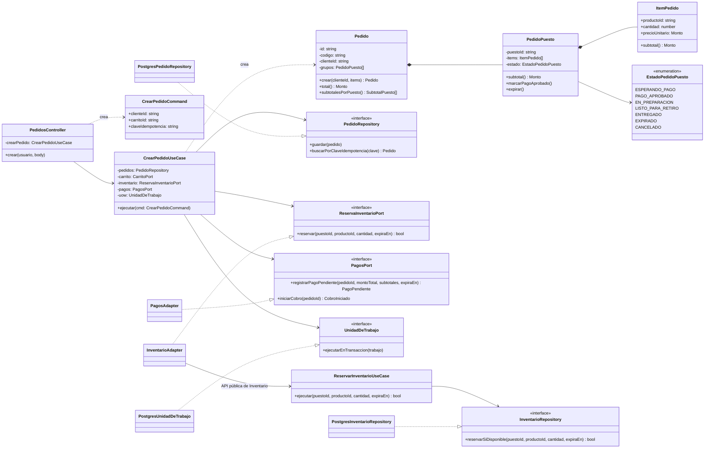
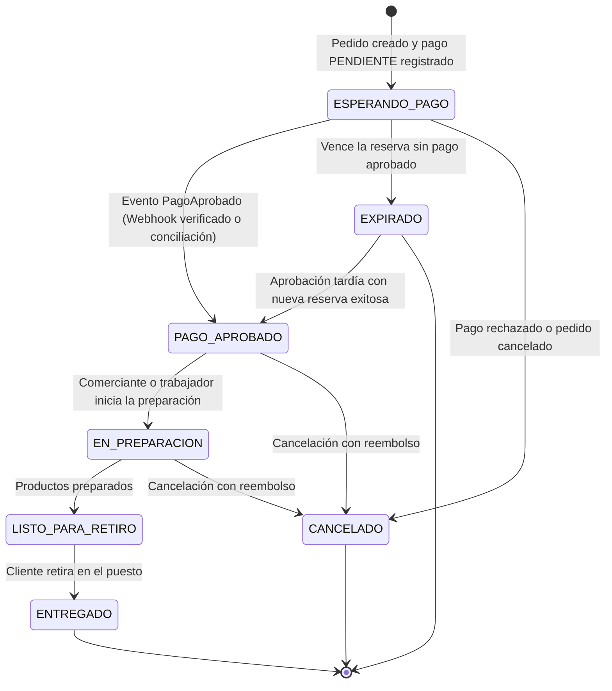
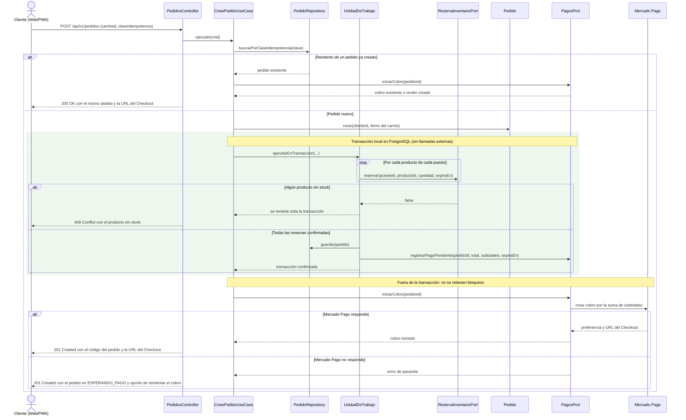

# Nivel 4 · Diagrama de Código

> **Proyecto:** Plataforma Integral Multivendedor · **Módulos detallados:** Pedidos e Inventario
> **Modelo:** C4 · Nivel 4 de 4 · **Notación:** UML · **Versión:** 1.1

---

## 1. Objetivo

Mostrar **cómo está organizado el código** de un componente del nivel 3: sus clases, interfaces y la forma en que colaboran. Se detalla el flujo **Crear pedido multivendedor**, que involucra a los módulos **Pedidos**, **Inventario** y **Pagos** y responde a los drivers DA02 (consistencia del inventario), DA07 (pedidos multivendedor) y DA08 (pago único por pedido).

| Aspecto | Descripción |
|---|---|
| Pregunta que responde | ¿Qué clases existen dentro de un módulo y cómo se relacionan? |
| Audiencia | Desarrolladores |
| Notación | UML (diagrama de clases, de secuencia y de estados). El modelo C4 recomienda UML para este nivel |
| Por qué estos módulos | El nivel 4 es opcional en C4 y se dibuja solo para los componentes más críticos. Pedidos e Inventario concentran la reserva concurrente de stock ([ADR-003](../01-analisis-de-sistema/decisiones/ADR-003-control-concurrencia.md)) |
| Nivel anterior | [Nivel 3 · Diagrama de componentes](Nivel3-Diagrama-de-Componentes.md) |

> El flujo de **procesamiento del Webhook de pago** del módulo Pagos se detalla en el [diseño interno de módulos](../03-diseño-de-software/diseño-interno/diseño-interno-de-modulos.md).

---

## 2. Diagrama de clases



### 2.1 Anillos de Clean Architecture

| Anillo | Contiene | Regla |
|---|---|---|
| **Adaptadores de entrada** | Controladores REST de NestJS | Traducen HTTP a llamadas del caso de uso y viceversa |
| **Aplicación** | Casos de uso y puertos (interfaces) | Coordina los pasos del proceso; no conoce la tecnología |
| **Dominio** | Entidades, objetos de valor, enumeraciones | Contiene las reglas del negocio; no importa nada de los otros anillos |
| **Infraestructura** | Repositorios y adaptadores de salida | Implementa los puertos con PostgreSQL o con la API pública de otro módulo |

> **Regla de dependencia:** las flechas del código apuntan hacia el dominio. Las clases de infraestructura implementan los puertos (triángulo hueco); el dominio nunca conoce a la infraestructura ([ADR-002](../01-analisis-de-sistema/decisiones/ADR-002-clean-architecture.md)).

### 2.2 Clases del módulo Pedidos

| Clase | Tipo | Anillo | Responsabilidad |
|---|---|---|---|
| `PedidosController` | Controlador | Adaptador de entrada | Recibe `POST /api/v1/pedidos` y responde al cliente |
| `CrearPedidoUseCase` | Caso de uso | Aplicación | Valida el carrito, reserva el stock, registra el pedido y el pago PENDIENTE en una transacción y, **después de confirmarla**, inicia el cobro en la pasarela |
| `CrearPedidoCommand` | DTO | Aplicación | Datos de entrada, incluida la clave de idempotencia para reintentos |
| `Pedido` | Entidad | Dominio | Pedido principal: código único, cliente, agrupaciones por puesto, subtotales y total general (RF26–RF29) |
| `PedidoPuesto` | Entidad | Dominio | Parte del pedido de un puesto: ítems, subtotal y estado propio (DA07, DA09) |
| `ItemPedido` | Objeto de valor | Dominio | Producto, cantidad, precio unitario y subtotal |
| `EstadoPedidoPuesto` | Enumeración | Dominio | Estados de la parte del pedido de cada puesto (ver sección 3) |
| `PedidoRepository` | Interfaz | Aplicación | Contrato para guardar pedidos y buscar por clave de idempotencia |
| `ReservaInventarioPort` | Interfaz | Aplicación | Contrato para reservar stock en el módulo Inventario con vencimiento |
| `PagosPort` | Interfaz | Aplicación | Contrato con el módulo Pagos, separado en dos operaciones: `registrarPagoPendiente` (solo escribe en la base de datos, se usa **dentro** de la transacción) e `iniciarCobro` (llama a la pasarela, se usa **fuera** de la transacción) |
| `UnidadDeTrabajo` | Interfaz | Aplicación | Contrato para ejecutar varias operaciones en una sola transacción |
| `PostgresPedidoRepository` | Repositorio | Infraestructura | Implementa `PedidoRepository` con PostgreSQL |
| `PostgresUnidadDeTrabajo` | Adaptador | Infraestructura | Implementa `UnidadDeTrabajo` con transacciones de PostgreSQL |
| `InventarioAdapter` | Adaptador | Infraestructura | Implementa `ReservaInventarioPort` usando la API pública del módulo Inventario |
| `PagosAdapter` | Adaptador | Infraestructura | Implementa `PagosPort` usando la API pública del módulo Pagos (`IniciarPagoUseCase`) |

#### Firma de `PagosPort`

```typescript
// pedidos/application/ports/pagos.port.ts
export interface SubtotalPuesto {
  puestoId: string;
  monto: Monto;
}

export interface PagoPendiente {
  pagoId: string;
  expiraEn: Date;
}

export interface CobroIniciado {
  pagoId: string;
  urlCheckout: string;
}

export interface PagosPort {
  /** Registra el pago en estado PENDIENTE. Solo escribe en PostgreSQL: se invoca dentro de la transacción. */
  registrarPagoPendiente(
    pedidoId: string,
    montoTotal: Monto,
    subtotales: SubtotalPuesto[],
    expiraEn: Date,
  ): Promise<PagoPendiente>;

  /** Crea el cobro en la pasarela y devuelve la URL del Checkout. Se invoca fuera de cualquier transacción. Es idempotente por pedido. */
  iniciarCobro(pedidoId: string): Promise<CobroIniciado>;
}
```

### 2.3 Clases del módulo Inventario

| Clase | Tipo | Anillo | Responsabilidad |
|---|---|---|---|
| `ReservarInventarioUseCase` | Caso de uso (API pública) | Aplicación | Único punto por el que otros módulos reservan stock |
| `InventarioRepository` | Interfaz | Aplicación | Contrato para reservar solo si hay stock disponible, con fecha de vencimiento |
| `PostgresInventarioRepository` | Repositorio | Infraestructura | Ejecuta el `UPDATE` condicional sobre stock físico y reservado ([ADR-003](../01-analisis-de-sistema/decisiones/ADR-003-control-concurrencia.md)) |

### 2.4 Notación UML utilizada

| Símbolo | Significado | Ejemplo |
|---|---|---|
| Línea continua con flecha abierta | Asociación: la clase tiene una referencia a la otra | `CrearPedidoUseCase` → `PedidoRepository` |
| Línea discontinua con flecha abierta | Dependencia: la usa o la crea | `CrearPedidoUseCase` «crea» `Pedido` |
| Línea discontinua con triángulo hueco | Realización: implementa una interfaz | `PostgresPedidoRepository` ▷ `PedidoRepository` |
| Rombo relleno | Composición: la parte no existe sin el todo | `Pedido` ◆ `PedidoPuesto` ◆ `ItemPedido` |
| «interface» | Interfaz | `ReservaInventarioPort`, `PagosPort` |
| `-` y `+` | Atributo o método privado y público | `- estado`, `+ total()` |

---

## 3. Flujo de estados de la parte del pedido de cada puesto



| Estado | Significado | Origen del cambio |
|---|---|---|
| `ESPERANDO_PAGO` | El pedido y las reservas existen; el pago del pedido está PENDIENTE o EN_PROCESO en la pasarela | `CrearPedidoUseCase` |
| `PAGO_APROBADO` | Mercado Pago aprobó el pago del pedido; el puesto puede preparar (RF35) | Evento `PagoAprobado` despachado desde el Outbox |
| `EN_PREPARACION` | El puesto está preparando los productos | Comerciante o trabajador autorizado |
| `LISTO_PARA_RETIRO` | Los productos están listos en el puesto | Comerciante o trabajador autorizado |
| `ENTREGADO` | El cliente retiró los productos | Comerciante o trabajador autorizado |
| `EXPIRADO` | La reserva venció sin pago aprobado; el stock se liberó (RF54) | Proceso de expiración ([ADR-003](../01-analisis-de-sistema/decisiones/ADR-003-control-concurrencia.md) §6.5) |
| `CANCELADO` | El pago fue rechazado o el pedido se canceló; si había pago aprobado, se registra el reembolso (RF40, RF51) | Pagos o Incidencias |

> Un único pago aprueba todas las agrupaciones del pedido a la vez: el evento `PagoAprobado` cambia a `PAGO_APROBADO` cada `PedidoPuesto` del pedido.

---

## 4. Diagrama de secuencia: crear pedido multivendedor



| Paso | Origen → destino | Acción |
|---|---|---|
| 1 | Web/PWA → `PedidosController` | Envía `POST /api/v1/pedidos` con el carrito y una clave de idempotencia |
| 2 | `PedidosController` → `CrearPedidoUseCase` | Ejecuta el caso de uso |
| 3 | `CrearPedidoUseCase` → `PedidoRepository` | Si la clave ya existe, devuelve el pedido anterior sin crear otro e intenta de nuevo `iniciarCobro`, que es idempotente (ADR-003, sección 7) |
| 4 | `CrearPedidoUseCase` → `Pedido` | Crea el pedido agrupando los productos por puesto y calcula subtotales y total |
| 5 | `CrearPedidoUseCase` → `UnidadDeTrabajo` | Inicia una transacción corta en PostgreSQL |
| 6 | `UnidadDeTrabajo` → `ReservaInventarioPort` | Reserva cada producto con actualización condicional y vencimiento; si no hay stock, la reserva falla |
| 7 | Alternativa | Si una reserva falla, se revierte todo: no queda pedido parcial, ni stock reservado, ni pago registrado (AC08) |
| 8 | `UnidadDeTrabajo` → `PedidoRepository` | Guarda el pedido y sus agrupaciones por puesto en `ESPERANDO_PAGO` |
| 9 | `UnidadDeTrabajo` → `PagosPort` | `registrarPagoPendiente`: crea el pago PENDIENTE con el total (suma de subtotales) y su vencimiento ligado a la reserva (RF54). Solo escribe en la base de datos |
| 10 | `UnidadDeTrabajo` → `CrearPedidoUseCase` | Se confirma la transacción y se liberan los bloqueos de las filas de inventario |
| 11 | `CrearPedidoUseCase` → `PagosPort` → Mercado Pago | `iniciarCobro`: **fuera de la transacción**, el módulo Pagos crea el cobro en la pasarela mediante `PasarelaPagoPort` (RF47) |
| 12 | `PedidosController` → Web/PWA | Responde `201 Created` con la URL del Checkout; la Web/PWA redirige al cliente a Mercado Pago |
| Alt. | Mercado Pago no responde | El pedido queda en `ESPERANDO_PAGO` con su reserva vigente; el cliente puede reintentar el cobro y, si no paga antes del vencimiento, la reserva expira y se libera (ADR-003 §6.5) |

> **Por qué la llamada a la pasarela va fuera de la transacción:** la transacción mantiene bloqueadas las filas de inventario reservadas. Si la llamada HTTP a Mercado Pago se hiciera dentro de ella, una respuesta lenta o un tiempo de espera agotado retendría esos bloqueos y haría esperar a otros clientes que compran los mismos productos. Por eso la transacción solo contiene operaciones locales sobre PostgreSQL, y la confirmación posterior del pago llega por el Webhook ([ADR-005](../01-analisis-de-sistema/decisiones/ADR-005-pago-unico-mercado-pago.md)).

---

## 5. Patrones y principios que se ven en este nivel

| Elemento del diagrama | Patrón o principio |
|---|---|
| `PedidoRepository` y `PostgresPedidoRepository` | Patrón **Repository** |
| `UnidadDeTrabajo` y `PostgresUnidadDeTrabajo` | Patrón **Unit of Work** |
| `InventarioAdapter`, `PagosAdapter` | Patrón **Adapter** hacia la API pública de otro módulo |
| `registrarPagoPendiente` dentro de la transacción e `iniciarCobro` después de confirmarla | **Procesamiento fuera de la transacción principal**, en coherencia con el patrón Outbox del módulo Pagos |
| El caso de uso recibe interfaces, no clases concretas | Principio de **inversión de dependencias** (SOLID) |
| `PagosPort` separa la operación local de la operación con la pasarela | Principio de **segregación de interfaces** (SOLID) |
| Una clase por responsabilidad (controlador, caso de uso, entidad, repositorio) | Principio de **responsabilidad única** (SOLID) |
| Pedidos usa a Inventario y Pagos solo mediante su API pública | Regla del **monolito modular**: comunicación por la API pública del módulo |
| `claveIdempotencia` en el comando e `iniciarCobro` idempotente | **Idempotencia** frente a reintentos ([ADR-003](../01-analisis-de-sistema/decisiones/ADR-003-control-concurrencia.md)) |

> Detalle completo en [patrones de diseño](../03-diseño-de-software/diseño-interno/patrones-de-diseño.md) y [principios de diseño](../03-diseño-de-software/diseño-interno/principios-de-diseño.md).
