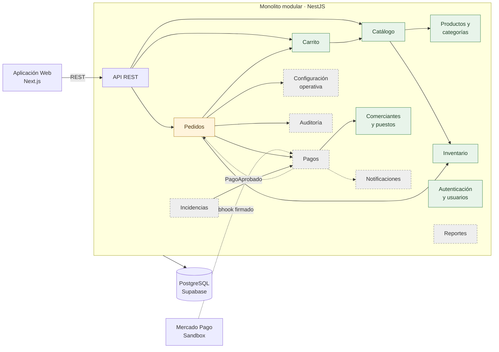

# Informe del Sprint 02: Diseño de la Arquitectura de Software y Evaluación de Atributos de Calidad

| Campo | Descripción |
|---|---|
| Proyecto | Plataforma Integral Multivendedor para la Gestión Comercial y Operativa de un Mercado de Abastos |
| Curso | IS-488 Arquitectura de Software · Escuela Profesional de Ingeniería de Sistemas · UNSCH · semestre 2026-II |
| Integrantes | Fernandez Pillman, Dhean Jhoner · Gómez Prado, Ederson |
| Fecha | 16/11/2026 |
| Versión evaluada | Repositorio publicado: `origin/main` (`1aab552`, 06/11/2026). También se revisó el trabajo local de Pedidos, aún no publicado (rama `feat/pedidos-backend`, `a3f0cd0`); cada afirmación sobre ese trabajo lo indica como «rama local» |
| Documentos de esta entrega | Este informe · [Evaluación de atributos de calidad](02-evaluacion-atributos-calidad.md) · [Matriz de trazabilidad](03-matriz-de-trazabilidad.md) · [Evidencias del 16/11/2026](evidencias/2026-11-16/README.md) |

> **Nota del 18/11/2026.** Este informe corresponde a la entrega de **diseño y evaluación inicial** del 16/11/2026 y se conserva sin cambios de contenido (versión `1aab552`). La entrega final del sprint, «Implementación y validación de la arquitectura de software», con la primera versión funcional, OpenAPI, Jest, cobertura y la matriz oficial de cumplimiento sobre `200675c`, está en el [informe final](04-informe-final-sprint-02.md) y en la [matriz oficial](05-matriz-oficial-de-cumplimiento.md).

## 1. Resumen

La plataforma adopta un **monolito modular** en NestJS, organizado en 13 módulos de negocio; dentro de cada módulo aplica **Clean Architecture** (puertos y adaptadores). El frontend es una aplicación web en Next.js que consume la API REST, y PostgreSQL en Supabase, con acceso mediante Prisma, es el almacén de datos. El cobro previsto es un **pago único por pedido** con Mercado Pago (Sandbox), diseñado pero aún sin implementar. Estas decisiones se documentan en el modelo C4 completo (niveles 1 a 4) y en cuatro ADR (001, 002, 003 y 005). El equipo declara vigentes esos ADR, pero formalmente siguen en estado «Propuesta» hasta que se resuelva DEC-04.

En este sprint se consolidó el diseño existente y se añadieron las piezas que faltaban para evaluarlo:

- el catálogo de **tácticas** por atributo;
- un **árbol de utilidad**;
- el análisis de **sensibilidad, compromisos y riesgos** por escenario;
- una **evaluación basada en evidencia** que distingue el objetivo propuesto, la prueba ejecutada y el resultado observado;
- la **trazabilidad** completa RF → driver → decisión → componente → prueba.

**Tres cifras que no deben confundirse:**

| Medida | Resultado | Qué significa |
|---|---|---|
| Cobertura documental | **12 de 12** elementos de la entrega | La documentación exigida existe y está enlazada |
| Atributos satisfechos | **Ninguno por completo; 2 con reservas** (rendimiento y concurrencia) | Una medición cumple el umbral, pero solo en una parte del escenario o en un entorno local |
| Atributos pendientes de verificación | **5**: 3 parciales (seguridad, integridad y mantenibilidad) y 2 no verificados (escalabilidad y disponibilidad) | Falta medir el escenario completo, casi siempre porque el código que lo ejercitaría aún no existe |

Lo pendiente se concentra en el módulo de **Pagos**: todavía no existe y es el que reúne los escenarios de mayor prioridad.

## 2. Introducción

### 2.1 Objetivo del sprint

Presentar el diseño de la arquitectura de software y evaluar, con evidencia verificable, si responde a los atributos de calidad priorizados durante el análisis.

### 2.2 Alcance y método

- **Punto de partida.** Se revisó toda la documentación del repositorio (`docs/01` a `docs/06`, ADR, registro de decisiones DEC, constitución de Spec Kit, especificaciones `specs/001` a `specs/004` y evidencias de pruebas). No se partió de cero.
- **Línea base intacta.** No se modificaron los requisitos (`docs/01`), los ADR, los diagramas C4 ni el código. Las discrepancias encontradas se registran en la §11 como cambios pendientes, para que el equipo los resuelva por la vía acordada (principalmente DEC-12).
- **Método.** Evaluación basada en escenarios, adaptada de ATAM ([detalle del método](02-evaluacion-atributos-calidad.md#2-método)).
- **Criterios de la entrega.** No se encontró una guía ni una rúbrica específica del Sprint 02, ni en el repositorio ni en los archivos del equipo que se consultaron. Por eso se usaron los doce elementos de la §10, acordados por el equipo. La «Guía 04» encontrada pertenece a otro curso y no se utilizó.
- **Fuentes no publicadas.** La constitución de Spec Kit (`.specify/memory/constitution.md`) y las especificaciones `specs/003` y `specs/004` solo existen en el equipo local: todavía no están versionadas en GitHub (C-23, DEC-11). Por eso se citan por su ruta, sin enlace.

## 3. Diseño arquitectónico

### 3.1 Drivers y restricciones

El análisis identificó 14 drivers (DA01–DA14), derivados de 55 requisitos funcionales, 12 atributos de calidad y 20 restricciones, de los cuales 8 son prioritarios ([drivers](../01-analisis-de-sistema/06-drivers-arquitectonicos.md), [restricciones](../01-analisis-de-sistema/05-restricciones.md)). Los que más condicionan la arquitectura son tres:

- **DA02** y **DA07:** consistencia del inventario en pedidos con productos de varios puestos.
- **DA08:** pago único por pedido con confirmación automática por Webhook.
- **DA14** (con RC11): un equipo de dos personas que debe desarrollar y desplegar una sola unidad.

La propia documentación declara tres drivers pendientes de decisiones complementarias: **DA03** (estrategia de seguridad), **DA10** (auditoría) y **DA11** (aislamiento de fallos).

### 3.2 Estilo arquitectónico y alternativas

| Alternativa | Resultado | Motivo principal |
|---|---|---|
| Monolito tradicional | Descartada | Alto acoplamiento sin límites entre funcionalidades |
| Microservicios | Descartada | Despliegue, comunicación y consistencia distribuida desproporcionados para dos integrantes (RC11) |
| **Monolito modular** | **Seleccionada** | Módulos con responsabilidades separadas, un solo despliegue y transacciones compartidas en PostgreSQL (DA14) |

Detalle en [estilo-arquitectonico.md §7](../02-arquitectura-software/estilo-arquitectonico.md#7-alternativas-evaluadas) y [ADR-001 §4](../01-analisis-de-sistema/decisiones/ADR-001-monolito-modular.md#4-alternativas-evaluadas). Clean Architecture **no** es un segundo estilo: organiza el interior de cada módulo ([ADR-002](../01-analisis-de-sistema/decisiones/ADR-002-clean-architecture.md)).

### 3.3 Los 13 módulos y su estado

El diagrama resume los módulos del [nivel 3 del C4](../04-modelo-c4/Nivel3-Diagrama-de-Componentes.md), sus dependencias en el flujo de compra y el estado del código verificado el 16/11/2026.

Leyenda: verde = implementado e integrado en `main`; amarillo = en desarrollo en la rama local `feat/pedidos-backend`, no publicada (en `main`, `orders` es un módulo vacío); gris discontinuo = sin implementar. Las flechas discontinuas son eventos asíncronos (Outbox). La lista completa de relaciones está en el [C4 nivel 3 §4](../04-modelo-c4/Nivel3-Diagrama-de-Componentes.md#4-relaciones-entre-componentes).

| Grupo | Módulos (documentación → código) | Estado |
|---|---|---|
| Identidad y administración | Autenticación y usuarios → `auth`, `users`; Comerciantes y puestos → `merchants` | Implementado. Pendiente: permisos del trabajador de puesto, tiendas y vinculación con Mercado Pago |
| Gestión comercial | Productos y categorías → `products`; Inventario → `inventory`; Catálogo → `catalog` | Implementado |
| Proceso de compra | Carrito → `cart`; Pedidos → `orders`; Pagos → `payments` | Carrito implementado; Pedidos en desarrollo solo en la rama local (13 de 30 tareas); Pagos vacío |
| Transversales y análisis | Incidencias, Notificaciones, Auditoría, Reportes, Configuración operativa | Sin implementar |

### 3.4 Clean Architecture y regla de dependencias

Cada módulo tiene cuatro anillos: dominio, aplicación (casos de uso y puertos), adaptadores de entrada e infraestructura. Las dependencias apuntan siempre hacia el dominio ([ADR-002 §6](../01-analisis-de-sistema/decisiones/ADR-002-clean-architecture.md#6-regla-de-dependencias), [diseño interno §3](../03-diseño-de-software/diseño-interno/diseño-interno-de-modulos.md#3-anillos-del-módulo-y-regla-de-dependencia)). La regla ya no es solo documental: [`backend/.dependency-cruiser.cjs`](../../backend/.dependency-cruiser.cjs) la verifica automáticamente con cuatro reglas de severidad `error`:

- los módulos se relacionan solo mediante `index.ts` o `*.module.ts`;
- el núcleo (dominio y aplicación) no usa frameworks;
- el SDK de Mercado Pago solo puede aparecer en su adaptador;
- no hay ciclos.

El 16/11/2026 se ejecutó sobre `origin/main` con **0 violaciones** en 106 módulos ([evidencia](evidencias/2026-11-16/AC05-arquitectura-main/README.md)), y también sobre la rama local de Pedidos, con 0 violaciones en 133 módulos ([evidencia](evidencias/2026-11-16/README.md)). Un límite queda fuera de su alcance: el catálogo lee tablas de otros módulos (C-05), lo que contradice la regla 3 del C4 nivel 3.

## 4. Modelo C4 y componentes

| Nivel | Qué muestra | Documento |
|---|---|---|
| 1 · Contexto | La plataforma, los 4 actores y los sistemas externos (Mercado Pago, almacenamiento) | [Nivel 1](../04-modelo-c4/Nivel1-DiagramadeContextodelSistema.md) |
| 2 · Contenedores | Aplicación web, API NestJS, PostgreSQL y almacenamiento de archivos, con su tecnología y protocolos | [Nivel 2](../04-modelo-c4/Nivel2-DiagramadeContenedores.md) |
| 3 · Componentes | Los 13 módulos y el Webhook de pagos, sus relaciones y las 8 reglas del monolito modular | [Nivel 3](../04-modelo-c4/Nivel3-Diagrama-de-Componentes.md) |
| 4 · Código | Clases, estados y secuencia de «crear pedido multivendedor» (Pedidos, Inventario, Pagos) | [Nivel 4](../04-modelo-c4/Nivel4-DiagramadeCodigo.md) |

El **diseño interno** usa el módulo Pagos como referencia ([diseño interno de módulos](../03-diseño-de-software/diseño-interno/diseño-interno-de-modulos.md)): anillos, diagrama de clases, flujo del Webhook y raíz de composición. Lo complementan los [patrones de diseño](../03-diseño-de-software/diseño-interno/patrones-de-diseño.md) (Repository, Adapter, Strategy, Unit of Work, Outbox, Observer, Facade e inyección de dependencias) y los [principios SOLID](../03-diseño-de-software/diseño-interno/principios-de-diseño.md).

Las **interfaces entre módulos** se definen como API públicas (`index.ts`). En `main` existen en 5 de los 9 módulos del código (`users`, `merchants`, `products`, `catalog` e `inventory`), y la rama local añade la de `cart`. Los contratos completos están propuestos en [docs/06 · contratos públicos](../06-gobernanza-sdd/03-contratos-publicos-entre-modulos.md), pendientes de aprobación (DEC-03).

## 5. Decisiones arquitectónicas (ADR)

| ADR | Decisión | Consecuencia positiva clave | Consecuencia negativa clave | Estado formal |
|---|---|---|---|---|
| [ADR-001](../01-analisis-de-sistema/decisiones/ADR-001-monolito-modular.md) | Monolito modular | Transacciones compartidas y un solo despliegue | Sin escalado por módulo; un fallo no controlado afecta a todos | Propuesta |
| [ADR-002](../01-analisis-de-sistema/decisiones/ADR-002-clean-architecture.md) | Clean Architecture por módulo | Reglas de negocio aisladas de NestJS, PostgreSQL/Supabase y Mercado Pago; pruebas sin infraestructura | Más interfaces y archivos | Propuesta |
| [ADR-003](../01-analisis-de-sistema/decisiones/ADR-003-control-concurrencia.md) | Reserva atómica en PostgreSQL | Sin sobreventa; coordinación entre instancias a través de la base de datos | Contención sobre productos muy solicitados | Propuesta |
| [ADR-004](../01-analisis-de-sistema/decisiones/ADR-004-pagos-qr.md) | Pago por QR por puesto | — | Validación manual y un pago por puesto | Reemplazada por ADR-005 |
| [ADR-005](../01-analisis-de-sistema/decisiones/ADR-005-pago-unico-mercado-pago.md) | Pago único con Mercado Pago | Un solo pago con confirmación automática | Dependencia externa crítica; Webhooks, idempotencia y conciliación | Propuesta |

**Nota sobre el estado.** El equipo declara vigentes ADR-001, 002, 003 y 005 ([gobernanza](../06-gobernanza-sdd/README.md#aprobadas-vigentes-por-declaración-del-equipo)), y el código ya los aplica. Sin embargo, su estado formal sigue siendo «Propuesta» hasta resolver **DEC-04**. Este informe **no** los aprueba. De ADR-005, el equipo declara vigente solo el pago único. La elección de **Prisma** como ORM figura en el README y en la constitución, pero ningún ADR la registra (D-13). La distribución del pago entre comerciantes tampoco está decidida (DEC-01, DEC-02 y [borrador de ADR-006](../06-gobernanza-sdd/borradores/ADR-006-modelo-de-pagos-y-distribucion.md)).

## 6. Atributos de calidad y escenarios

Se definieron 12 atributos (AC01–AC12) y se priorizaron 7, cada uno con un criterio de evaluación ([atributos](../01-analisis-de-sistema/04-atributos-de-calidad.md)). Los 8 escenarios EQ tienen el formato fuente-estímulo-condición-respuesta-medida, con herramientas de medición ([escenarios](../01-analisis-de-sistema/08-escenarios-atributos-calidad.md)) y una ficha de medición cada uno ([matriz de mediciones](../05-implementacion/cumplimiento/03-matriz-de-mediciones.md)).

| Prioridad | Atributo | Escenario | Medida documentada |
|---|---|---|---|
| 1 | Seguridad (AC04) | EQ-01 y criterio de roles | 100 % de Webhooks falsificados rechazados; ningún acceso fuera del rol |
| 2 | Integridad (AC08) | EQ-02 | Ninguna operación fallida deja estados inconsistentes |
| 3 | Concurrencia (AC07) | EQ-03 | 0 reservas incompatibles |
| 4 | Rendimiento (AC01) | EQ-04 | p95 < 2 s con 100 usuarios (propuesta por validar) |
| 5 | Escalabilidad (AC02) | EQ-05 | Alta de puestos sin cambiar código |
| 6 | Disponibilidad (AC03) | EQ-06, EQ-08 | 0 operaciones perdidas; conciliación en 15 min o menos |
| 7 | Mantenibilidad (AC05) | EQ-07 | 0 archivos modificados fuera de Pagos al cambiar el adaptador |

El [árbol de utilidad](02-evaluacion-atributos-calidad.md#3-árbol-de-utilidad) cruza importancia y dificultad: los escenarios (A, A) son **EQ-01** y **EQ-08**, ambos de pagos.

## 7. Evaluación basada en evidencia

La evaluación completa, con las 25 tácticas, el análisis de cada escenario y la verificación del origen de cada evidencia, está en [02-evaluacion-atributos-calidad.md](02-evaluacion-atributos-calidad.md). Síntesis:

| Atributo | Prueba realmente ejecutada | Resultado observado | Veredicto |
|---|---|---|---|
| Seguridad (AC04) | Matriz rol × ruta (05/11 y 16/11; la prueba y los controladores son idénticos en `main`) | 198/198 y 252/252 casos conformes | **PARCIAL**: falta la parte de pagos (EQ-01) |
| Integridad (AC08) | POC de la unidad de trabajo sobre PostgreSQL y 7 casos de fallo forzado en `CrearPedido` (ambas en la rama local) | V1–V8 aprobadas; 7/7 sin estado parcial | **PARCIAL**: la medición EQ-02 sobre PostgreSQL está pendiente |
| Concurrencia (AC07) | Vitest y k6 sobre `ReservarInventario` (05/11) | 400/400; 10 reservas exactas con 200 usuarios | **SATISFECHO CON RESERVAS**: falta medirlo sobre «crear pedido»; en `main` sigue la versión medida |
| Rendimiento (AC01) | k6 con 100 usuarios virtuales, 2 minutos, 5 000 productos (05/11) | p95 = 381,4 ms; 0 % de errores | **SATISFECHO CON RESERVAS**: entorno local |
| Mantenibilidad (AC05) | dependency-cruiser sobre `main` y sobre la rama local (16/11) | 0 violaciones | **PARCIAL**: EQ-07 no es medible sin Pagos |
| Escalabilidad (AC02) | Ninguna | — | **NO VERIFICADO** |
| Disponibilidad (AC03) | Ninguna | — | **NO VERIFICADO** |

**Criterio aplicado.** Ninguna de las 558 pruebas unitarias en verde (rama local) se usó, por sí sola, para declarar satisfecho un atributo. Solo cuentan las mediciones contra el umbral del escenario. Todas las mediciones son locales (una sola máquina, sin Supabase) y deben repetirse en el entorno de despliegue (RC20).

## 8. Riesgos y compromisos arquitectónicos

**Compromisos principales**

| Decisión | Se gana | Se cede |
|---|---|---|
| Transacción compartida del monolito (ADR-001, ADR-003) | Atomicidad simple del pedido multivendedor | Acoplamiento de los módulos en tiempo de ejecución; extraer servicios exigiría sagas |
| Pago único con Mercado Pago (ADR-005) | Usabilidad (un pago, confirmación automática) | Dependencia externa crítica y complejidad (firmas, idempotencia, conciliación) |
| Confirmar el pago con una consulta a la API | Seguridad: no se confía en el Webhook | Latencia y disponibilidad ligadas a la pasarela |
| Vigencia de la reserva (RF45) | Reservas largas protegen pagos lentos | Retienen stock; las cortas producen aprobaciones tardías y reembolsos |
| Lectura directa del catálogo (situación actual, C-05) | Rendimiento: una sola consulta | Independencia de datos entre módulos |
| Clean Architecture (ADR-002) | Mantenibilidad y pruebas sin infraestructura | Más interfaces, clases y archivos |

**Temas de riesgo** (registro completo en la [evaluación §8](02-evaluacion-atributos-calidad.md#8-temas-de-riesgo)):

1. **Pagos sin implementar ni decidir.** Es el riesgo dominante: afecta a los dos escenarios de mayor prioridad (EQ-01 y EQ-08) y a la mantenibilidad (EQ-07).
2. **Integridad y concurrencia medidas antes del flujo completo.** Además, en la rama local la envoltura transaccional de la reserva cambió después de medir EQ-03.
3. **Operación y observabilidad ausentes.** No hay despliegue, meta de disponibilidad, auditoría ni registros estructurados.
4. **Límites de datos entre módulos y gobernanza pendientes.** Siguen abiertos C-05, DEC-03, DEC-04 y DEC-09.
5. **Mediciones solo en entorno local.**

## 9. Trazabilidad

La [matriz de trazabilidad](03-matriz-de-trazabilidad.md) une, para los 13 módulos y los 55 RF, la cadena RF → HU → driver → ADR → componente → escenario → prueba → estado. Además detalla, en 12 filas, la cadena de los requisitos críticos. Los tramos de la cadena ya existían por separado; lo nuevo es la cadena completa y su cierre con las pruebas reales. Los huecos que quedan son: RF41 sin historia de usuario, AC09, AC10 y AC12 sin escenario, y la cadena de pagos sin pruebas.

## 10. Matriz de cumplimiento de la entrega

**Criterio.** Completo = el elemento existe, cubre su alcance y está respaldado por un documento o una prueba. Parcial = existe, pero disperso o incompleto. Ausente = no existe. Para el porcentaje se pondera Completo = 1, Parcial = 0,5 y Ausente = 0. La columna «Antes» refleja el repositorio al iniciar este sprint; «Ahora», tras los documentos de `docs/07-sprint-02`.

| # | Elemento | Dónde está | Antes | Ahora | Pendiente |
|---|---|---|---|---|---|
| 1 | Drivers y restricciones | [06-drivers](../01-analisis-de-sistema/06-drivers-arquitectonicos.md), [05-restricciones](../01-analisis-de-sistema/05-restricciones.md) | Completo | Completo | Decisiones complementarias para DA03, DA10 y DA11 |
| 2 | Estilo y alternativas | [Estilo §3 y §7](../02-arquitectura-software/estilo-arquitectonico.md), ADR-001 §4 | Completo | Completo | — |
| 3 | Monolito modular y sus 13 módulos | [Componentes §2](../02-arquitectura-software/componentes-arquitectonicos.md), ADR-001 §5, C4 N3 | Completo | Completo | Equivalencia de nombres entre documentación y código (DEC-06) |
| 4 | Clean Architecture y regla de dependencias | ADR-002 §6, [enfoque §6](../02-arquitectura-software/enfoque-arquitectonico.md), diseño interno §3, `.dependency-cruiser.cjs` | Completo | Completo (con verificación del 16/11) | — |
| 5 | C4 de los cuatro niveles | [docs/04](../04-modelo-c4/) | Completo | Completo | Supabase Auth ausente en N1 y N2 (D-09); PWA declarada sin implementar (D-10); nombres de N4 (D-11) |
| 6 | Diseño interno: componentes, interfaces y responsabilidades | [docs/03](../03-diseño-de-software/diseño-interno/), C4 N4, [contratos](../06-gobernanza-sdd/03-contratos-publicos-entre-modulos.md) | Completo | Completo | Aprobar los contratos públicos (DEC-03) |
| 7 | ADR y sus consecuencias | [ADR-001 a ADR-005](../01-analisis-de-sistema/decisiones/) | Completo | Completo | Estado formal «Propuesta» (DEC-04) |
| 8 | Escenarios medibles de calidad | [08-escenarios](../01-analisis-de-sistema/08-escenarios-atributos-calidad.md), [fichas de medición](../05-implementacion/cumplimiento/03-matriz-de-mediciones.md) | Completo | Completo | AC09, AC10 y AC12 sin escenario; estado de EQ-03 y EQ-04 desactualizado en `docs/01` |
| 9 | Tácticas arquitectónicas | Antes: dispersas en ADR, patrones y C4 N3. Ahora: [evaluación §4](02-evaluacion-atributos-calidad.md#4-tácticas-arquitectónicas-por-atributo) | Parcial | Completo | — |
| 10 | Evaluación de los 7 atributos | Antes: mediciones sueltas (EQ-03, EQ-04, AC04). Ahora: [evaluación §5–§7](02-evaluacion-atributos-calidad.md) | Parcial | Completo como documento | Las mediciones EQ-01, 02, 05, 06, 07 y 08 siguen pendientes |
| 11 | Riesgos y compromisos | Antes: consecuencias en cada ADR. Ahora: [evaluación §5 y §8](02-evaluacion-atributos-calidad.md#8-temas-de-riesgo) e informe §8 | Parcial | Completo | Validar el árbol de utilidad con los interesados |
| 12 | Trazabilidad RF → driver → decisión → componente → prueba | Antes: por tramos. Ahora: [matriz de trazabilidad](03-matriz-de-trazabilidad.md) | Parcial | Completo | Huecos de la matriz §3 |

**Cobertura documental:** antes 8 completos y 4 parciales, es decir **10 de 12 (83 %)**; ahora **12 de 12 (100 %)**.

**Cumplimiento de calidad**, que es distinto de la cobertura: 0 de 7 atributos satisfechos por completo; 2 satisfechos con reservas, 3 parciales y 2 no verificados.

## 11. Cambios pendientes en la documentación original

En esta entrega no se modificó ningún documento original. La lista siguiente recoge lo que deberá actualizarse más adelante y por qué vía. **Editorial** significa que no cambia ninguna decisión (cambio único previsto en DEC-12); **seguimiento**, que se actualizan documentos de `docs/05`; **decisión**, que antes debe aprobarlo el equipo.

| ID | Documento original | Problema | Cambio propuesto | Vía |
|---|---|---|---|---|
| D-01 | [08-escenarios](../01-analisis-de-sistema/08-escenarios-atributos-calidad.md#resumen-de-medición) | Dice que ninguna medida se ha ejecutado y marca EQ-03 y EQ-04 como «Pendiente»; ambas se midieron el 05/11 y cumplen | Actualizar el estado y el resultado de EQ-03 y EQ-04, con enlace a sus evidencias | Editorial (DEC-12) |
| D-02 | [Componentes §5](../02-arquitectura-software/componentes-arquitectonicos.md#5-verificación-de-coherencia-documental) | «Todos los escenarios siguen sin pruebas ejecutadas» está desactualizado. Su nota «No constituye una evaluación formal (ATAM)» queda atendida por [02-evaluacion](02-evaluacion-atributos-calidad.md) | Actualizar la fila «Atributos frente a escenarios» y enlazar `docs/07-sprint-02` | Editorial (DEC-12) |
| D-03 | [01-matriz-de-cumplimiento](../05-implementacion/cumplimiento/01-matriz-de-cumplimiento.md) | El resumen (§2) afirma que el inventario no existe y cuenta 41 RF que no cumplen, aunque las filas RF12–RF15 ya lo dan por implementado. RF20–RF24 (Carrito, integrado el 06/11) siguen como «Pendiente». En los atributos, el resumen cuenta 1 CUMPLE y 2 NO CUMPLE; el detalle (§5.2), 2 y 1 | Rehacer el resumen y actualizar las filas de Carrito | Seguimiento |
| D-04 | [03-matriz-de-mediciones](../05-implementacion/cumplimiento/03-matriz-de-mediciones.md) | La §2 dice que k6 no está disponible (se usó con Docker) y que dependency-cruiser da «6 advertencias» (hoy: 0 violaciones con severidad `error`). La ficha EQ-03 pide 300 iteraciones; se ejecutaron 400 | Corregir la §2 y la ficha EQ-03 | Seguimiento |
| D-05 | [Evidencia EQ-03](../05-implementacion/evidencias/EQ-03/2026-11-05/entorno.txt) | Afirma que `reservar` no cambió, lo que era cierto el 06/11. En la rama local de Pedidos, su envoltura transaccional cambió el 12/11 (`bc1d4a4`) | Añadir la nota cuando Pedidos se integre en `main`, o sustituirla por la nueva medición (T027) | Tras integrar Pedidos |
| D-06 | [08-escenarios, EQ-05](../01-analisis-de-sistema/08-escenarios-atributos-calidad.md#eq-05-escalabilidad-incorporación-de-nuevos-comerciantes-y-puestos) | Cita «Drizzle + Faker»; el proyecto usa Prisma (C-11) | Sustituir por «seed con Prisma y Faker» | Editorial (DEC-12) |
| D-07 | [C4 N3 §3](../04-modelo-c4/Nivel3-Diagrama-de-Componentes.md#3-componentes), columna «Carpeta» | Nombres en español (`usuarios`, `pagos`) frente a los del código en inglés (`users`, `payments`); el documento describe un módulo donde el código tiene dos (`auth` y `users`) (C-08, C-09) | Publicar la tabla de equivalencias o usar los nombres del código | Decisión (DEC-06) |
| D-08 | Fuera del repositorio (`RESPALDO-ADR/`) | Dos borradores del 08/10/2026, «ADR-005 Seguridad, autorización y auditoría» y «ADR-006 Aislamiento de fallos», que abordan DA03, DA10 y DA11. No están incorporados y su numeración choca con el ADR-005 vigente y con el borrador de ADR-006 | Decidir si se incorporan como borradores con una numeración nueva o se descartan | Decisión del equipo |
| D-09 | [C4 N1](../04-modelo-c4/Nivel1-DiagramadeContextodelSistema.md) y [C4 N2 §6](../04-modelo-c4/Nivel2-DiagramadeContenedores.md#6-seguridad-entre-contenedores) | **Supabase Auth**, que el frontend usa para el inicio de sesión y la recuperación de contraseña y el backend para verificar el JWT, no aparece como sistema externo. N2 §6 conserva el TODO «definir el mecanismo de autenticación» (C-04) | Añadir Supabase Auth como sistema externo en N1 y N2 y sustituir el TODO por el mecanismo implementado | Editorial (DEC-12): la decisión ya está implementada |
| D-10 | [C4 N2 §3](../04-modelo-c4/Nivel2-DiagramadeContenedores.md#3-contenedores) | Afirma que la aplicación web «se puede instalar como PWA», pero no tiene manifiesto ni service worker (C-18) | Indicar que la PWA es un objetivo pendiente | Editorial (DEC-12) |
| D-11 | [C4 N4](../04-modelo-c4/Nivel4-DiagramadeCodigo.md) | En la rama local, los 7 estados y las 9 transiciones coinciden con el diagrama, pero los nombres de clase difieren: `PedidoPuesto` → `Subpedido`, `ItemPedido` → `LineaPedido`, `EstadoPedidoPuesto` → `EstadoSubpedido`, `CrearPedidoUseCase` → `CrearPedido`, `Postgres*` → `Prisma*` | Alinear los nombres cuando Pedidos se integre en `main` | Tras integrar Pedidos (DEC-06) |
| D-12 | C4 N1 (el comerciante vincula su cuenta), N2 (cuentas vinculadas cifradas) y N3 (Pagos obtiene cuentas vinculadas) | Suponen la vinculación de cuentas, cuya modalidad no está decidida (C-01) | Revisar los tres niveles cuando se resuelvan DEC-01 y DEC-02 y se acepte o rechace el borrador de ADR-006 | Decisión (DEC-01, DEC-02) |
| D-13 | ADR y [patrones](../03-diseño-de-software/diseño-interno/patrones-de-diseño.md) | Prisma es el ORM en uso (README y constitución IV), pero ningún ADR lo registra. Los patrones y el diseño interno hablan de `postgres-*.repository.ts` y de «cliente `pg`, Supabase o un ORM» | Registrar la elección de Prisma y alinear los nombres de los archivos de ejemplo | Decisión del equipo |
| D-14 | [Evidencia AC04 del 05/11](../05-implementacion/evidencias/AC04/2026-11-05/README.md) | No registra entorno ni commit; esos datos solo están en el [resumen H0](../05-implementacion/evidencias/H0-2026-11-05/resumen.md) del mismo día (`23bd5d3` más cambios locales, Node 24.19.0) | Añadir `entorno.txt` con esos datos | Seguimiento |
| D-15 | `.specify/` y `specs/003`, `specs/004` | La constitución y dos especificaciones no están versionadas en GitHub (C-23); este informe las cita sin enlace | Versionarlas | Decisión (DEC-11) |
| D-16 | ADR-001, 002, 003 y 005 | Formalmente en estado «Propuesta», aunque el equipo los declara vigentes (C-03) | Cambiar a «Aceptada» solo si el equipo lo aprueba. **Este informe no los aprueba** | Decisión (DEC-04) |

## 12. Conclusiones

1. **El diseño arquitectónico está completo y es coherente.** Drivers, estilo, módulos, Clean Architecture, C4, diseño interno y ADR están documentados y enlazados entre sí, y el código respeta la regla de dependencias, que se verifica automáticamente. Las diferencias que quedan entre el C4 y el código son de actualización (Supabase Auth, PWA, nombres de clases), no de estructura: los 13 módulos y la máquina de estados del pedido coinciden.
2. **La evaluación muestra un patrón claro.** Lo que existe en el código pasó sus mediciones: la reserva atómica, el catálogo bajo carga y la autorización por rol. Lo que no está verificado coincide con lo que aún no existe: Pagos, notificaciones y despliegue. La arquitectura no falló en ningún escenario medido.
3. **Los escenarios más prioritarios (EQ-01 y EQ-08) son los menos avanzados.** El siguiente incremento debería resolver primero DEC-01 y DEC-02 y después implementar Pagos con sus mediciones, antes de ampliar otros módulos.
4. **Las mediciones existentes deben repetirse** en dos casos: sobre «crear pedido» (EQ-02 y EQ-03) y en el entorno de despliegue (EQ-04), antes de presentarlas como resultado final.
5. **La gobernanza pendiente (DEC-01 a DEC-12) es parte del riesgo.** En particular DEC-04, el estado formal de los ADR, que el equipo debe resolver de forma explícita.

## 13. Referencias

**Documentos del proyecto**

- Análisis: [actores](../01-analisis-de-sistema/01-actores.md), [historias de usuario](../01-analisis-de-sistema/02-historias-de-usuario.md), [requisitos funcionales](../01-analisis-de-sistema/03-requisitos-funcionales.md), [atributos de calidad](../01-analisis-de-sistema/04-atributos-de-calidad.md), [restricciones](../01-analisis-de-sistema/05-restricciones.md), [drivers](../01-analisis-de-sistema/06-drivers-arquitectonicos.md), [decisiones](../01-analisis-de-sistema/07-decisiones-arquitectonicas.md), [escenarios](../01-analisis-de-sistema/08-escenarios-atributos-calidad.md).
- Arquitectura: [arquitectura inicial](../02-arquitectura-software/arquitectura-inicial.md), [estilo](../02-arquitectura-software/estilo-arquitectonico.md), [enfoque (Clean Architecture)](../02-arquitectura-software/enfoque-arquitectonico.md), [componentes](../02-arquitectura-software/componentes-arquitectonicos.md).
- Diseño: [diseño interno de módulos](../03-diseño-de-software/diseño-interno/diseño-interno-de-modulos.md), [patrones](../03-diseño-de-software/diseño-interno/patrones-de-diseño.md), [principios SOLID](../03-diseño-de-software/diseño-interno/principios-de-diseño.md).
- Modelo C4: [nivel 1](../04-modelo-c4/Nivel1-DiagramadeContextodelSistema.md), [nivel 2](../04-modelo-c4/Nivel2-DiagramadeContenedores.md), [nivel 3](../04-modelo-c4/Nivel3-Diagrama-de-Componentes.md), [nivel 4](../04-modelo-c4/Nivel4-DiagramadeCodigo.md).
- Implementación y evidencias: [matriz de cumplimiento](../05-implementacion/cumplimiento/01-matriz-de-cumplimiento.md), [matriz de mediciones](../05-implementacion/cumplimiento/03-matriz-de-mediciones.md), evidencias [EQ-03](../05-implementacion/evidencias/EQ-03/2026-11-05/README.md), [EQ-04](../05-implementacion/evidencias/EQ-04/2026-11-05/README.md), [AC04](../05-implementacion/evidencias/AC04/2026-11-05/README.md) y [16/11/2026](evidencias/2026-11-16/README.md).
- Gobernanza: [revisión de consistencia](../06-gobernanza-sdd/01-revision-de-consistencia.md) y [registro DEC-01 a DEC-12](../06-gobernanza-sdd/02-registro-de-decisiones.md). La constitución (`.specify/memory/constitution.md`) y la especificación `specs/003-pedidos-subpedidos/` aún no están publicadas en GitHub (D-15).

**Bibliografía**

- Bass, L., Clements, P. y Kazman, R. (2021). *Software Architecture in Practice* (4.ª ed.). Addison-Wesley. (Tácticas y escenarios de calidad).
- Kazman, R., Klein, M. y Clements, P. (2000). *ATAM: Method for Architecture Evaluation* (CMU/SEI-2000-TR-004). Software Engineering Institute.
- Brown, S. *The C4 model for visualising software architecture*. https://c4model.com
- Martin, R. C. (2017). *Clean Architecture: A Craftsman's Guide to Software Structure and Design*. Prentice Hall.
- Nygard, M. (2011). *Documenting Architecture Decisions* (formato ADR).
