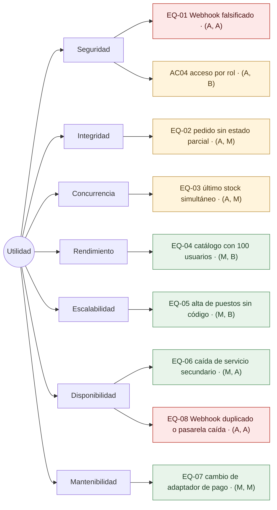

# Evaluación de la Arquitectura frente a los Atributos de Calidad

| Campo | Descripción |
|---|---|
| Proyecto | Plataforma Integral Multivendedor para la Gestión Comercial y Operativa de un Mercado de Abastos |
| Curso | IS-488 Arquitectura de Software · UNSCH · 2026-II |
| Entrega | Sprint 02: Diseño de la Arquitectura de Software y Evaluación de Atributos de Calidad |
| Fecha | 16/11/2026 |
| Versión evaluada | `origin/main` (`1aab552`). El trabajo local de Pedidos, aún no publicado (rama `feat/pedidos-backend`, `a3f0cd0`), se marca siempre como «rama local» |
| Método | Evaluación basada en escenarios, adaptada de ATAM (ver §2) |
| Arquitectura evaluada | Monolito modular ([ADR-001](../01-analisis-de-sistema/decisiones/ADR-001-monolito-modular.md)), Clean Architecture por módulo ([ADR-002](../01-analisis-de-sistema/decisiones/ADR-002-clean-architecture.md)), control de concurrencia ([ADR-003](../01-analisis-de-sistema/decisiones/ADR-003-control-concurrencia.md)) y pago único con Mercado Pago ([ADR-005](../01-analisis-de-sistema/decisiones/ADR-005-pago-unico-mercado-pago.md)) |
| Estado | Evaluación con evidencia parcial: 3 de 8 escenarios EQ tienen alguna prueba ejecutada y ninguno está cerrado por completo |

Este documento no modifica la línea base (`docs/01`, ADR y C4). Se apoya en ella y en las evidencias del repositorio, y explica qué tan bien responde la arquitectura a cada atributo prioritario.

## 1. Propósito y alcance

Se evalúan los siete atributos prioritarios de [04-atributos-de-calidad.md](../01-analisis-de-sistema/04-atributos-de-calidad.md#atributos-de-calidad-prioritarios): seguridad, integridad de la información, concurrencia, rendimiento, escalabilidad, disponibilidad y mantenibilidad. Para cada uno se separan cinco cosas que no deben confundirse:

1. **Objetivo de calidad propuesto:** el umbral copiado de los criterios y escenarios EQ, sin modificarlo.
2. **Prueba realmente ejecutada:** solo las pruebas con salida archivada o reproducida en esta evaluación.
3. **Resultado observado:** las cifras tal como figuran en la evidencia.
4. **Veredicto:** si el objetivo está satisfecho o pendiente (escala de §2).
5. **Limitaciones:** las condiciones que impiden generalizar el resultado.

## 2. Método

El Architecture Tradeoff Analysis Method (ATAM) del SEI evalúa una arquitectura frente a escenarios de calidad y busca **puntos de sensibilidad**, **compromisos**, **riesgos** y **no-riesgos**. Aquí se aplicó de forma simplificada:

| Paso ATAM | Aplicación en este documento |
|---|---|
| Presentar drivers y arquitectura | Resumidos en el [informe del Sprint 02](01-informe-sprint-02.md#3-diseño-arquitectónico) |
| Identificar los enfoques arquitectónicos | ADR-001, 002, 003 y 005 y los patrones de [patrones-de-diseño.md](../03-diseño-de-software/diseño-interno/patrones-de-diseño.md) |
| Generar el árbol de utilidad | §3 |
| Analizar los enfoques por escenario | §4 (tácticas) y §5 (análisis) |
| Contrastar con pruebas | §6 (origen de las evidencias) y §7 (resultados) |
| Lluvia de ideas con interesados y segunda ronda de análisis | **No se realizó.** Es una limitación de esta evaluación: el árbol de utilidad lo propone el equipo y no se validó con los usuarios del mercado |

**Escala de veredictos.** Que las pruebas unitarias estén en verde no basta para declarar satisfecho un atributo de rendimiento, disponibilidad, escalabilidad o seguridad.

| Veredicto | Criterio |
|---|---|
| SATISFECHO | Existe una prueba ejecutada y archivada que compara el resultado con el umbral documentado del escenario completo y lo cumple |
| SATISFECHO CON RESERVAS | La prueba cumple el umbral, pero cubre solo una parte del escenario, o el código medido cambió después de la medición |
| PARCIAL | Una parte del criterio está verificada; otra parte no existe o no se ha medido |
| NO VERIFICADO | No hay medición del escenario: solo diseño o pruebas indirectas |

**Términos.** Un *punto de sensibilidad* es un parámetro de la arquitectura del que depende fuertemente un atributo. Un *compromiso* (*trade-off*) es una decisión que mejora un atributo a costa de otro. Un *riesgo* es una decisión, o la ausencia de una, que puede impedir alcanzar un atributo. Un *no-riesgo* es una decisión que se considera adecuada.

## 3. Árbol de utilidad

La prioridad se deriva de documentos existentes, con dos criterios explícitos que el equipo debe validar:

- **Importancia:** **A** si el escenario involucra alguno de los tres atributos de mayor prioridad (seguridad, integridad, concurrencia); **M** si no.
- **Dificultad:** **A** si depende de Mercado Pago o de mecanismos de aislamiento de fallos aún no decididos (DA11); **M** si requiere coordinar varios módulos en una transacción o un contrato entre módulos; **B** si lo resuelve un módulo con los mecanismos ya elegidos (PostgreSQL, Supabase Auth, NestJS).

En el diagrama, los nodos rojos son (A, A); los amarillos tienen importancia A con dificultad menor; los verdes, importancia M. Los dos escenarios (A, A), EQ-01 y EQ-08, corresponden a **pagos**, justamente la parte sin implementar. Ese es el resultado principal del árbol.

## 4. Tácticas arquitectónicas por atributo

Una táctica es una decisión de diseño que influye en la respuesta a un estímulo de calidad (catálogo de Bass, Clements y Kazman, *Software Architecture in Practice*). La documentación del proyecto ya contenía estos mecanismos, pero dispersos y sin nombrarlos como tácticas. Aquí se consolidan, con su estado verificado en el código el 16/11/2026: **Implementada** (existe en `main`), **Implementada (rama local)** (solo en `feat/pedidos-backend`, no publicada), **Diseñada** (solo documentada) o **Futura** (mencionada como evolución).

| Atributo | Táctica | Aplicación en el proyecto | Fuente | Estado |
|---|---|---|---|---|
| Seguridad | Autenticar actores | Supabase Auth y verificación del JWT en el backend con `jose` | [02-autenticacion-supabase.md](../05-implementacion/02-autenticacion-supabase.md) | Implementada (`auth/infrastructure/jose-verificador-token.ts`) |
| Seguridad | Autorizar actores | Rol leído de PostgreSQL, guarda por ruta y comprobación de titularidad del puesto | C4 N3 §3; constitución V y VIII | Implementada (`auth/entry-adapters/auth.guard.ts`; matriz AC04) |
| Seguridad | Verificar la integridad del mensaje | Firma `x-signature` del Webhook; rechazo con 401 | ADR-005 §5.3 y §7; C4 N3 regla 6 | Diseñada (`payments` vacío) |
| Seguridad | No confiar en la entrada | El estado del pago se consulta a la API de Mercado Pago, no al Webhook ni a la redirección | ADR-005 §5.2 y §7 (2) | Diseñada |
| Seguridad | Cifrar datos | Tokens de Mercado Pago de los comerciantes cifrados en reposo | ADR-005 §7 (3) | Diseñada; depende de DEC-02 |
| Seguridad | Limitar la exposición | Sin datos de tarjeta; secretos en variables de entorno | ADR-005 §6 y §7 | Parcial (variables de entorno en uso; pagos inexistentes) |
| Integridad | Transacción atómica (unidad de trabajo) | Reserva, pedido y vaciado del carrito en una sola transacción | ADR-003 §6.2; patrón Unit of Work | Implementada (rama local): `shared/infrastructure/prisma/unidad-de-trabajo.ts`; POC-001 aprobada. En `main`, cada operación de Inventario usa su propia transacción corta |
| Integridad | Restricciones en la base de datos | `CHECK`, claves foráneas y únicos como última barrera | ADR-003 §6.3 | Implementada: 14 `CHECK` en las 4 migraciones de `main`; 24 con la migración de pedidos de la rama local |
| Integridad | Idempotencia por clave de operación | Un reintento devuelve el resultado anterior sin reservar dos veces | ADR-003 §7 | Implementada en Inventario. En Pedidos, parcial y solo en la rama local (T018 y T019 pendientes) |
| Integridad / Disponibilidad | Separar efectos externos de la transacción | Outbox: el cobro y el evento `PagoAprobado` se despachan fuera de la transacción | C4 N3 regla 7; patrón Outbox | Diseñada |
| Concurrencia | Comprobar y actualizar en una sola sentencia | `UPDATE … WHERE stock_fisico - stock_reservado >= cantidad` | ADR-003 §6.3 | Implementada (`inventory/infrastructure/prisma-inventario.repository.ts`) |
| Concurrencia | Bloqueo acotado | `FOR UPDATE` del carrito y bloqueo consultivo por cliente en la creación del pedido | Especificación local de Pedidos (T003, T012) | Implementada (rama local): `prisma-carrito.repository.ts` y `prisma-pedido.repository.ts` |
| Concurrencia | Reintento acotado ante errores transitorios | Reintentar interbloqueos y fallos de serialización, nunca errores de dominio | ADR-003 §7 | Implementada. En `main`, como reintento propio del repositorio de Inventario; en la rama local, centralizado en `shared/infrastructure/prisma/errores-transitorios.ts` (22 pruebas) |
| Rendimiento | Reducir el trabajo por solicitud | Paginación y filtrado en la base de datos | RF16–RF18 | Implementada (`catalog/infrastructure/prisma-catalogo.repository.ts`) |
| Rendimiento | No retener recursos ante dependencias lentas | Ninguna llamada a Mercado Pago dentro de una transacción | C4 N3 regla 7 | Diseñada |
| Rendimiento | Mantener copias (caché) | Caché y optimización de consultas | Estilo §6.5 | Futura |
| Escalabilidad | Variar por datos, no por código | Comerciantes, puestos y productos se incorporan por registro | ADR-001 §6; DA04 | Implementada (API de administración, hito H0) |
| Escalabilidad | Escalar horizontalmente | Varias instancias del monolito coordinadas por la base de datos compartida | Estilo §6.5; ADR-003 §9 | Futura (no hay despliegue: RC20) |
| Disponibilidad | Detectar por consulta (conciliación) | Conciliación periódica con Mercado Pago (≤ 15 min) | RF50; ADR-005 §10 | Diseñada |
| Disponibilidad | Recuperar estado (expiración idempotente) | Las reservas vencidas se liberan una sola vez | ADR-003 §6.5 | Implementada en Inventario; el vínculo con el pago (RF54) está solo diseñado |
| Disponibilidad | Aislar fallos con eventos | Notificaciones por eventos; su fallo no revierte la compra | C4 N3 regla 5; patrón Observer | Diseñada (DA11 pendiente de profundizar) |
| Mantenibilidad | Encapsular | API pública por módulo (`index.ts`) | C4 N3 regla 2; DEC-03 | Implementada en 5 de los 9 módulos de `main` (`users`, `merchants`, `products`, `catalog` e `inventory`); la rama local añade `cart` |
| Mantenibilidad | Usar un intermediario | Puertos y adaptadores; el dominio no conoce NestJS ni la tecnología de persistencia | ADR-002 §6 | Implementada |
| Mantenibilidad | Restringir dependencias | Reglas de dependency-cruiser con severidad `error` | `backend/.dependency-cruiser.cjs` | Implementada: 0 violaciones el 16/11 en `main` (106 módulos) y en la rama local (133 módulos) |
| Mantenibilidad | Diferir el enlace | Adaptador de pasarela elegido por configuración (Strategy) | Patrones (Strategy) | Diseñada |

## 5. Análisis de enfoques por escenario

Los escenarios se presentan en el orden del árbol de utilidad. Los riesgos llevan un identificador (R-xx) que se reúne en §8.

### 5.1 EQ-01 · Webhook falsificado o no autorizado (A, A)

| Elemento | Análisis |
|---|---|
| Enfoque | Endpoint sin sesión autenticado solo por la firma; el estado se confirma consultando la API y comparando monto y referencia (ADR-005 §5.3) |
| Puntos de sensibilidad | La clave secreta del Webhook y el margen de tiempo aceptado para la firma; la comparación del monto con la suma de subtotales |
| Compromiso | **Seguridad frente a disponibilidad y latencia:** cada notificación exige una consulta a Mercado Pago. Si la pasarela no responde, la notificación no puede confirmarse y el caso pasa a la conciliación |
| Riesgos | **R-01** El módulo `payments` está vacío: ninguna de estas tácticas existe en el código. **R-02** El modelo de distribución y la vinculación de cuentas siguen sin decidir (C-01; DEC-01 y DEC-02; borrador de ADR-006), y de ellos depende el cifrado de tokens |
| No-riesgos | Que el Webhook sea el único endpoint sin sesión que cambia estados, y que no confíe en su propio cuerpo, es coherente con la amenaza descrita |

### 5.2 EQ-08 · Webhook duplicado o caída de la pasarela (A, A)

| Elemento | Análisis |
|---|---|
| Enfoque | Idempotencia por identificador de pago, conciliación periódica, Outbox y ninguna llamada externa dentro de una transacción |
| Puntos de sensibilidad | La frecuencia de la conciliación (meta: 15 minutos) y el tiempo de vigencia de la reserva (RF45) |
| Compromiso | **Disponibilidad del stock frente a la experiencia de pago:** una reserva larga protege los pagos lentos pero retiene stock; una corta lo libera antes, pero produce aprobaciones tardías que terminan en una nueva reserva o un reembolso (ADR-003 §6.5) |
| Riesgos | **R-03** Mercado Pago es una dependencia externa crítica: sin pasarela no hay compra (estilo §9). **R-04** Configuración operativa (RF45) no existe, así que los tiempos de reserva no son configurables |
| No-riesgos | Serializar en una transacción el Webhook y la expiración del mismo pedido (ADR-003 §6.5) elimina la carrera que liberaría el stock de un pedido ya pagado |

### 5.3 EQ-02 · Integridad del pedido multivendedor (A, M)

| Elemento | Análisis |
|---|---|
| Enfoque | El monolito comparte una transacción de PostgreSQL entre Pedidos, Inventario y Carrito mediante una unidad de trabajo (ADR-001, DA14, ADR-003 §6.2). La unidad de trabajo está implementada en la rama local |
| Puntos de sensibilidad | El límite de la unidad de trabajo: qué operaciones entran en ella y cuáles, como el cobro, quedan fuera |
| Compromiso | **Consistencia fuerte frente a independencia de los módulos:** compartir la transacción simplifica la atomicidad, pero acopla los módulos en tiempo de ejecución e impide extraerlos a servicios sin rediseñar el flujo (con sagas o compensaciones) |
| Riesgos | **R-05** La medición EQ-02 sobre PostgreSQL no existe (tareas T016 y T026 pendientes) |
| No-riesgos | En la rama local, el mecanismo se validó sobre PostgreSQL real en POC-001 (V1–V8, tres ejecuciones), y el caso de uso revierte todo ante un fallo forzado en cada paso (7 de 7 casos con dobles en memoria) |

### 5.4 EQ-03 · Reserva simultánea del último stock (A, M)

| Elemento | Análisis |
|---|---|
| Enfoque | Actualización condicional atómica, restricciones `CHECK`, idempotencia por clave y reintento acotado (ADR-003) |
| Puntos de sensibilidad | La contención sobre las filas de los productos muy demandados y el tamaño del pool de conexiones (10 por defecto) |
| Compromiso | **Consistencia frente a latencia bajo contención:** con 200 usuarios sin pausa sobre un mismo producto, el p95 fue de unos 1,2 s (dato informativo de la evidencia EQ-03, no es su criterio). Rechazar con 409 a quien llega tarde es el comportamiento esperado, no un error |
| Riesgos | **R-06** En la rama local `feat/pedidos-backend`, aún no publicada, la envoltura transaccional de `reservar` cambió el 12/11 (`bc1d4a4`, pasó a `atomico()`) después de la medición. La tarea T002 declara la regresión «sin cambio de resultado», pero sin evidencia archivada. Además, falta medir sobre «crear pedido» (T027) |
| No-riesgos | La sentencia SQL condicional no cambió; en `main` sigue la versión medida. Ninguna ejecución registró filas con reservado mayor que físico |

### 5.5 AC04 · Acceso según el rol (A, B)

| Elemento | Análisis |
|---|---|
| Enfoque | Identidad delegada en Supabase Auth; autorización en el backend con el rol almacenado en PostgreSQL |
| Puntos de sensibilidad | La tabla de permisos por ruta y el orden «autorizar antes de validar» (un defecto de ese tipo se corrigió el 05/11) |
| Compromiso | **Menor esfuerzo frente a dependencia del proveedor:** delegar la identidad en Supabase reduce el código propio, pero la verificación depende de su emisor de tokens |
| Riesgos | **R-07** El trabajador de puesto no tiene permisos por puesto (C-14, DEC-09), así que HU20 no es verificable. Pedidos aún no expone rutas |
| No-riesgos | 252 de 252 casos conformes, y la prueba falla si aparece una ruta sin declarar en la tabla de permisos |

### 5.6 EQ-06 · Fallo de un servicio secundario (M, A)

| Elemento | Análisis |
|---|---|
| Enfoque | Las notificaciones se publican como eventos desde el Outbox; Storage queda detrás de un adaptador |
| Puntos de sensibilidad | La confiabilidad del despachador del Outbox y su política de reintento |
| Compromiso | **Consistencia eventual de las notificaciones frente a disponibilidad de la compra** |
| Riesgos | **R-08** Un solo proceso: un fallo no controlado afecta a todos los módulos (ADR-001 §7). No hay despliegue ni meta numérica de disponibilidad (RC20; EQ-06 «por definir»). Los mecanismos de DA11 siguen pendientes y no existen registros estructurados ni auditoría (AC06, C-13) |
| No-riesgos | — |

### 5.7 EQ-07 · Intercambio del adaptador de pago (M, M)

| Elemento | Análisis |
|---|---|
| Enfoque | Puerto `PasarelaPagoPort`, adaptadores intercambiables por configuración e inyección de dependencias de NestJS |
| Puntos de sensibilidad | La estabilidad del contrato del puerto: si refleja la semántica de un proveedor concreto, cambiar de adaptador obliga a tocar los casos de uso |
| Compromiso | **Mantenibilidad frente a complejidad:** más interfaces, clases y archivos (ADR-002 §9) |
| Riesgos | **R-02** (de nuevo): la ambigüedad entre Checkout y cuentas vinculadas tipo Split (C-01) impide definir el contrato del puerto hasta resolver DEC-01 |
| No-riesgos | Las reglas de dependencia ya están automatizadas y sin violaciones |

### 5.8 EQ-04 · Rendimiento del catálogo (M, B)

| Elemento | Análisis |
|---|---|
| Enfoque | Consulta paginada y filtrada en PostgreSQL dentro del monolito, sin llamadas entre procesos |
| Puntos de sensibilidad | El pool de conexiones y el volumen de productos: sin tiempo de espera, el p95 subió de 381 ms a 1 043 ms |
| Compromiso | **Rendimiento frente a independencia de datos entre módulos:** el catálogo lee directamente el modelo `producto` con sus relaciones `categoria` y `puesto` (C-05), lo que resuelve cada consulta en un solo viaje a la base de datos. Los contratos propuestos en DEC-03 recuperarían la independencia de datos mediante composición de API públicas, a cambio de más consultas |
| Riesgos | **R-09** La medición es local: no usa Supabase ni el entorno de producción. Además, el código del catálogo cambió después (`64bf830` en `main`; `bc1d4a4` en la rama local) |
| No-riesgos | Hay un margen amplio frente al umbral: 381 ms medidos frente a 2 000 ms exigidos |

### 5.9 EQ-05 · Incorporación de comerciantes y puestos (M, B)

| Elemento | Análisis |
|---|---|
| Enfoque | Modelo de datos multivendedor (comerciante → puestos → productos) con alta por la API de administración |
| Compromiso | **Simplicidad de despliegue frente a escalado selectivo:** el monolito escala como un todo, no por módulo (ADR-001 §7) |
| Riesgos | El flujo de compra está incompleto, por lo que el escenario no es medible hasta el hito H7 |
| No-riesgos | Indicio indirecto: la siembra de EQ-04 (50 comerciantes, 100 puestos, 5 000 productos) se sirvió sin cambiar código. No sustituye a la medición EQ-05 |

## 6. Verificación del origen de las evidencias

Antes de citarlas, se contrastaron las evidencias del 05/11 con sus archivos de datos y con el código actual.

| Evidencia | Comprobación | Resultado |
|---|---|---|
| [EQ-04](../05-implementacion/evidencias/EQ-04/2026-11-05/README.md) | `primaria/resumen.json`: p(95), solicitudes, fallos y usuarios virtuales | Coincide: p(95) = 381,41 ms; 10 886 solicitudes; 0 fallidas; 100 usuarios virtuales. Esfuerzo máximo: p(95) = 1 043,03 ms |
| [EQ-03](../05-implementacion/evidencias/EQ-03/2026-11-05/README.md) | `eq03-vitest.json` y `eq03-k6.json` | Coincide: 400 de 400 iteraciones y 0 reservas incompatibles. k6: 10 reservas aceptadas, 13 933 faltas de stock controladas, 0 respuestas inesperadas, 0 filas con reservado mayor que físico, 200 usuarios virtuales. `http_reqs` = 13 945, de las cuales 13 943 son comprobaciones de reserva |
| EQ-03, huellas del código | SHA-256 de los 6 archivos registrados en `entorno.txt` frente al código actual | 5 de 6 coinciden. El repositorio de inventario cambió dos veces: `02b57ee` (`variarStock`, en `main` y declarado en la evidencia) y `bc1d4a4` (envoltura `atomico()` de las cuatro escrituras, incluida `reservar`, solo en la rama local). En `main`, el archivo solo difiere de lo medido por `02b57ee` |
| [AC04 (05/11)](../05-implementacion/evidencias/AC04/2026-11-05/README.md) | `matriz-autorizacion.json` | Coincide: 33 rutas, 6 identidades, 198 casos, 198 conformes |
| Origen del código medido | `entorno.txt` de EQ-03 y EQ-04 | Ambas se midieron sobre `23bd5d3` más cambios sin confirmar, que luego se confirmaron en `4fd1933` y `6949a5b`. Está declarado en las propias evidencias |

**Verificaciones nuevas del 16/11/2026**, sin base de datos y sobre la rama local, salvo la repetición de AC05 sobre `main` (detalle en [evidencias/2026-11-16](evidencias/2026-11-16/README.md)):

- **AC04:** matriz rol × ruta con 252 de 252 casos conformes en 42 rutas. La prueba, su helper y los controladores son idénticos en `origin/main`, así que el resultado también vale para `main`.
- **AC05:** dependency-cruiser sin violaciones en la rama local (133 módulos y 447 dependencias). Como ese código incluye Pedidos, se repitió sobre `origin/main` en un worktree limpio: también 0 violaciones (106 módulos y 365 dependencias; [evidencia](evidencias/2026-11-16/AC05-arquitectura-main/README.md)).
- **EQ-02 (caso de uso):** 7 de 7 casos de fallo forzado pasan, dentro de 558 de 558 pruebas unitarias. Solo existen en la rama local.

## 7. Resultados por atributo

| Atributo | Objetivo propuesto (documentación) | Prueba realmente ejecutada | Resultado observado | Veredicto | Limitaciones |
|---|---|---|---|---|---|
| **AC04 Seguridad** | Ningún acceso fuera de los permisos del rol; 100 % de los Webhooks falsificados rechazados; tokens cifrados (EQ-01) | Matriz rol × ruta con Vitest y Supertest sobre la aplicación con repositorios en memoria (05/11 y 16/11; prueba y controladores idénticos en `main`) | 198/198 (33 rutas) y 252/252 (42 rutas); 1 defecto encontrado y corregido el 05/11 | **PARCIAL** | La parte de pagos (EQ-01) no existe. Solo mide la autorización, no las reglas de negocio. Sin OWASP ZAP |
| **AC08 Integridad** | Ningún fallo deja reservas, pedidos o agrupaciones inconsistentes (EQ-02) | POC-001 de la unidad de trabajo sobre PostgreSQL (06/11) y 7 casos de fallo forzado en `CrearPedido` con dobles en memoria (16/11), ambos en la rama local | V1–V8 aprobadas tres veces; 7 de 7 casos sin estado parcial | **PARCIAL** | No es la medición EQ-02: faltan el flujo completo sobre PostgreSQL y las consultas SQL antes y después (T016, T026). Las pruebas `*.db-spec.ts` no se ejecutaron en esta evaluación |
| **AC07 Concurrencia** | 0 reservas incompatibles en el 100 % de las pruebas concurrentes (EQ-03) | Vitest con `Promise.all` sobre PostgreSQL desechable y k6 con 200 usuarios virtuales (05/11) | 400/400; exactamente 10 reservas con stock 10; 0 filas con reservado mayor que físico | **SATISFECHO CON RESERVAS** | Se midió `ReservarInventario`, no «crear pedido». La envoltura transaccional cambió después en la rama local; en `main` sigue la versión medida. Una sola máquina |
| **AC01 Rendimiento** | Con 100 usuarios, el 95 % de las consultas del catálogo en menos de 2 s (propuesta por validar) (EQ-04) | k6 con 100 usuarios virtuales durante 2 minutos sobre 5 000 productos (05/11) | p95 = 381,4 ms; 0 % de errores; sin pausa, p95 = 1 043 ms | **SATISFECHO CON RESERVAS** | Entorno local, sin red ni Supabase. El código del catálogo cambió después. Lighthouse no se ejecutó |
| **AC05 Mantenibilidad** | Cambiar un módulo sin modificar las reglas de otros; 0 archivos fuera de Pagos al cambiar el adaptador (EQ-07) | dependency-cruiser con 4 reglas de severidad `error` (16/11, sobre `main` y sobre la rama local) | 0 violaciones | **PARCIAL** | EQ-07 no es medible porque `payments` está vacío. La herramienta no detecta la lectura de tablas ajenas (C-05) |
| **AC02 Escalabilidad** | Incorporar comerciantes y puestos solo con datos (EQ-05) | Ninguna medición EQ-05 | Indicio indirecto: la siembra de EQ-04 | **NO VERIFICADO** | Requiere el flujo de compra completo (hito H7) |
| **AC03 Disponibilidad** | Ninguna operación confirmada perdida; conciliación en 15 minutos o menos (EQ-06, EQ-08) | Ninguna | — | **NO VERIFICADO** | Pagos, notificaciones y despliegue no existen. La meta numérica de disponibilidad está por definir |

**Resumen:** 0 SATISFECHO · 2 SATISFECHO CON RESERVAS (AC01, AC07) · 3 PARCIAL (AC04, AC05, AC08) · 2 NO VERIFICADO (AC02, AC03).

Fuera de los siete atributos evaluados, la **observabilidad (AC06)** no cumple: no existen registros estructurados ni el módulo Auditoría (C-13). Es relevante porque DA10 es un driver prioritario.

## 8. Temas de riesgo

| Tema | Riesgos | Atributos afectados | Mitigación prevista en la documentación |
|---|---|---|---|
| **T1. Pagos sin implementar ni decidir** | R-01 módulo `payments` vacío; R-02 modelo de distribución y vinculación pendiente (C-01); R-03 dependencia crítica de Mercado Pago | Seguridad, disponibilidad, mantenibilidad y usabilidad (AC09) | Hito H5; DEC-01, DEC-02 y ADR-006 (borrador); conciliación y Outbox ya diseñados |
| **T2. Integridad y concurrencia medidas antes del flujo completo** | R-05 sin EQ-02 sobre PostgreSQL; R-06 cambio de envoltura posterior a EQ-03 (rama local) | Integridad y concurrencia | Tareas T016, T017, T026 y T027 de la especificación local `specs/003-pedidos-subpedidos` |
| **T3. Operación y observabilidad ausentes** | R-08 proceso único sin despliegue, sin meta de disponibilidad, sin auditoría ni registros; R-04 sin Configuración operativa | Disponibilidad, recuperabilidad y observabilidad | Hitos H1 (configuración, auditoría, registros) y H7 (despliegue); DEC-05 |
| **T4. Límites entre módulos a nivel de datos y gobernanza pendiente** | C-05 (catálogo lee tablas ajenas); ADR en estado «Propuesta» (DEC-04); trabajador de puesto sin permisos (R-07, DEC-09) | Mantenibilidad y seguridad | Contratos públicos de DEC-03; ratificación de DEC-04 y DEC-09 |
| **T5. Mediciones en entorno local** | R-09 EQ-03 y EQ-04 en una sola máquina, sin Supabase | Rendimiento y concurrencia | Repetir en el entorno de despliegue final (RC20), como exige la evidencia EQ-04 |

## 9. Conclusión de la evaluación

La arquitectura **responde en su diseño** a los siete atributos prioritarios: cada uno tiene tácticas identificadas y una decisión que lo respalda. La evidencia ejecutada confirma lo siguiente:

- **Concurrencia:** la reserva atómica cumple su umbral.
- **Rendimiento:** el catálogo cumple con amplio margen.
- **Seguridad:** la autorización por rol se cumple en todas las rutas existentes.
- **Mantenibilidad:** las reglas de dependencia se respetan.

Lo que no puede afirmarse todavía es justo lo de mayor prioridad en el árbol de utilidad: la seguridad y la disponibilidad del pago (EQ-01, EQ-08), la integridad del pedido completo sobre PostgreSQL (EQ-02) y la escalabilidad (EQ-05). Esos resultados no fallan; están **pendientes** porque el código que los ejercitaría aún no existe. Los compromisos principales de la arquitectura son tres:

- **Consistencia fuerte a cambio de acoplamiento en tiempo de ejecución:** la transacción compartida del monolito.
- **Simplicidad a cambio de una dependencia externa crítica:** el pago único con Mercado Pago.
- **Rendimiento a cambio de independencia de datos:** la lectura directa del catálogo.
