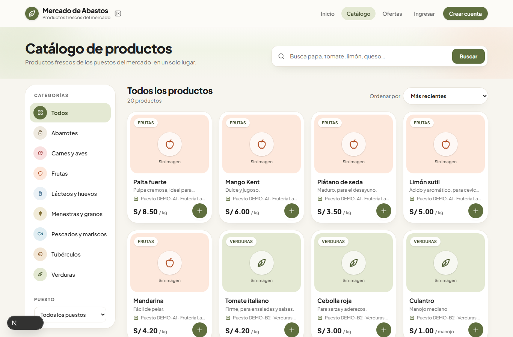
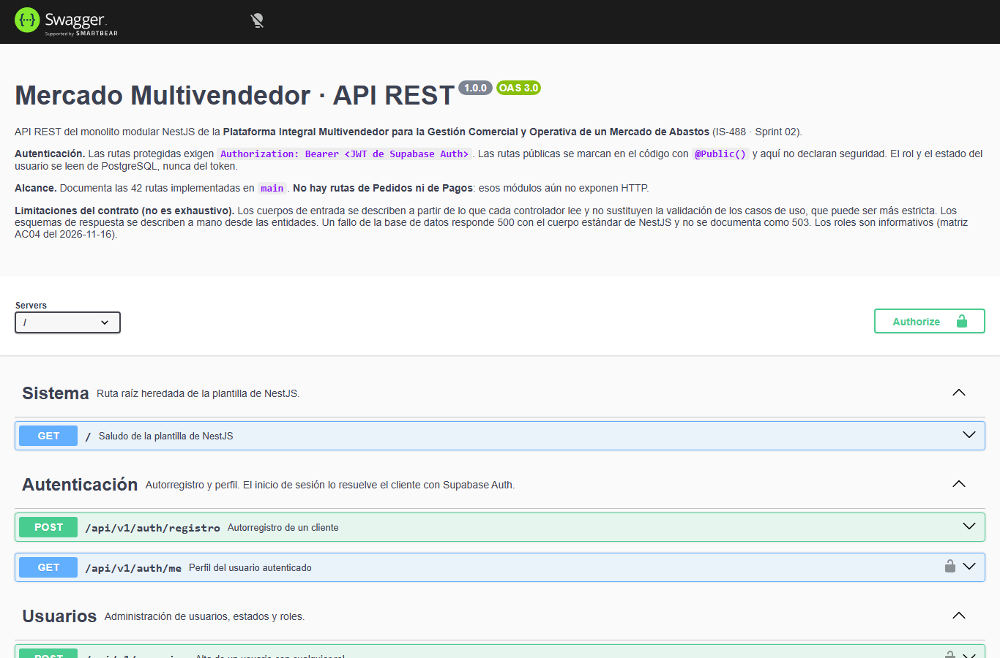

# Informe final del Sprint 02: Implementación y validación de la arquitectura de software

| Campo | Descripción |
|---|---|
| Proyecto | Plataforma Integral Multivendedor para la Gestión Comercial y Operativa de un Mercado de Abastos |
| Curso | IS-488 Arquitectura de Software · Escuela Profesional de Ingeniería de Sistemas · UNSCH · semestre 2026-II |
| Integrantes | Fernandez Pillman, Dhean Jhoner · Gómez Prado, Ederson |
| Fecha | 18/11/2026 |
| Versión evaluada | `origin/main` en **`200675c`** (merge del PR #12). Incluye Frontend (#9), Demo (#10), Swagger/OpenAPI (#11), Jest, cobertura y CI (#12) |
| Relación con el informe del 16/11 | El [informe de diseño](01-informe-sprint-02.md) (versión `1aab552`) se **conserva sin cambios** como la parte de diseño y de evaluación inicial. Este informe lo completa con la implementación y la validación |
| Documentos | [Matriz oficial de cumplimiento](05-matriz-oficial-de-cumplimiento.md) · [Evidencias del 18/11/2026](evidencias/2026-11-18/README.md) · [Evaluación de atributos](02-evaluacion-atributos-calidad.md) · [Trazabilidad](03-matriz-de-trazabilidad.md) |

## 1. Resumen ejecutivo

El Sprint 02 entrega una **primera versión funcional** del Mercado Multivendedor, con el backend organizado según la arquitectura propuesta (monolito modular con Clean Architecture), un frontend que lo consume, la API REST documentada con OpenAPI, pruebas automatizadas con cobertura medida y una validación parcial de los atributos de calidad.

| Entregable oficial | Estado | En una línea |
|---|---|---|
| 1. Código organizado según la arquitectura | **Cumplido** para los módulos implementados | 7 módulos con cuatro anillos; 0 violaciones de dependencia en 111 módulos |
| 2. Primera versión funcional | **Parcial** | Catálogo validado de extremo a extremo; carrito validado por API real, no desde una sesión de Supabase; Pedidos y Pagos no implementados |
| 3. OpenAPI/Swagger | **Cumplido** en rutas, seguridad y parámetros | 42 rutas; esquemas de cuerpo y respuesta descritos a mano |
| 4. Pruebas con Jest y cobertura | **Cumplido con limitaciones** | Jest 88/88 sobre una selección; cobertura global de Vitest 73,52 / 70,73 / 78,07 / 76,01 % |
| 5. Validación de atributos de calidad | **Parcial** | 0 de 7 atributos satisfechos por completo; AC04 y AC05 repetidos sobre `200675c`; EQ-03 y EQ-04 son del 05/11 |

El CI de GitHub Actions ejecutó con éxito, en el PR #12 y en el merge, todos los pasos (incluidos Jest, la cobertura y el Vitest del frontend). El detalle de cada afirmación, con archivo, prueba y evidencia, está en la [matriz oficial](05-matriz-oficial-de-cumplimiento.md).

## 2. Introducción

El Sprint 01 documentó el análisis y la línea base arquitectónica. El Sprint 02 se entregó primero (16/11/2026) como diseño y evaluación; el título oficial del sprint exige además **implementación y validación**. Este informe consolida esa segunda parte.

Criterios de lectura:

- Cada cifra lleva su **fecha y commit**. Las mediciones del 05/11 y del 16/11 se citan como históricas y no se repitieron salvo donde se indica.
- Lo que no se ejecutó se declara como tal (§11).
- No se enlazan documentos de forma redundante: el diseño está en el [informe del 16/11](01-informe-sprint-02.md) y aquí solo se resume.

## 3. Alcance de la primera versión funcional

| Dentro del incremento | Fuera del incremento |
|---|---|
| Usuarios, roles, comerciantes y puestos · productos y categorías con imágenes · inventario (stock, movimientos, reservas atómicas) · catálogo público · carrito multivendedor · panel de gestión · documentación OpenAPI | **Pedidos** (avances solo en una rama local, no publicada) · **Pagos** y Mercado Pago · notificaciones, auditoría, incidencias, reportes y configuración operativa |

La demostración usa **datos de demostración** en una base PostgreSQL local y desechable; no es un despliegue de producción (el despliegue es el Sprint 03).

## 4. Implementación de la arquitectura

El backend es **un único monolito NestJS** ([ADR-001](../01-analisis-de-sistema/decisiones/ADR-001-monolito-modular.md)). Cada módulo de negocio tiene cuatro anillos ([ADR-002](../01-analisis-de-sistema/decisiones/ADR-002-clean-architecture.md)):

| Anillo | Carpeta | Contenido | Ejemplo (carrito) |
|---|---|---|---|
| Dominio | `domain/` | Reglas puras y errores de negocio | [`calculo.ts`](../../backend/src/modules/cart/domain/calculo.ts) |
| Aplicación | `application/` | Casos de uso y **puertos** (interfaces) | [`carrito.use-cases.ts`](../../backend/src/modules/cart/application/use-cases/carrito.use-cases.ts), [`ports.ts`](../../backend/src/modules/cart/application/ports/ports.ts) |
| Entrada | `entry-adapters/` | Controladores HTTP: traducen HTTP ↔ casos de uso | [`carrito.controller.ts`](../../backend/src/modules/cart/entry-adapters/carrito.controller.ts) |
| Infraestructura | `infrastructure/` | Repositorios Prisma y adaptadores externos | [`prisma-carrito.repository.ts`](../../backend/src/modules/cart/infrastructure/prisma-carrito.repository.ts) |

Estado real de los módulos en `main`:

| Módulo de código | Estado |
|---|---|
| `auth`, `users`, `merchants`, `products`, `inventory`, `catalog`, `cart` | **Implementados** con sus cuatro anillos (equivalen a 6 de los 13 módulos de la documentación) |
| `orders`, `payments` | Vacíos en `main` (solo el archivo del módulo) |
| Otros 5 módulos de la documentación (notificaciones, auditoría, incidencias, reportes, configuración) | No existen |

El frontend es una aplicación **Next.js 16** (App Router) con 19 páginas ([estructura](evidencias/2026-11-18/funcional/estructura-codigo.txt)) que consume solo la API REST `/api/v1`. El contrato de la API se documenta en §7 y la estructura completa del código está archivada en las evidencias.

**Verificación automática de la arquitectura.** `npm run arquitectura` (dependency-cruiser) aplica cuatro reglas de severidad `error` definidas en [`.dependency-cruiser.cjs`](../../backend/.dependency-cruiser.cjs):

| Regla | Qué impide |
|---|---|
| `limites-entre-modulos` | Importar archivos internos de otro módulo (solo se permite `index.ts` y el `*.module.ts`) |
| `sin-framework-en-el-nucleo` | Que `domain/` y `application/` importen NestJS, Prisma, `pg` o `jose` |
| `sdk-mercadopago-solo-en-su-adaptador` | Usar el SDK de Mercado Pago fuera del adaptador de Pagos |
| `sin-ciclos` | Dependencias circulares |

Resultado sobre `200675c`: **0 violaciones** (111 módulos, 375 dependencias) — [salida](evidencias/2026-11-18/pruebas/arquitectura.txt); además se ejecuta en cada pull request.

## 5. Clean Architecture y SOLID en el código

Referencias a la versión `200675c`. Son **ejemplos representativos**, no una auditoría exhaustiva de cada clase.

### 5.1 Clean Architecture

| Principio | Dónde se ve |
|---|---|
| El dominio no depende de nada externo | [`Stock`](../../backend/src/modules/inventory/domain/stock.ts#L18) impone el invariante «0 ≤ reservado ≤ físico» sin framework ni base de datos; la regla `sin-framework-en-el-nucleo` lo garantiza |
| Los casos de uso dependen de **puertos**, no de implementaciones | [`DependenciasCarrito`](../../backend/src/modules/cart/application/use-cases/carrito.use-cases.ts#L18) agrupa `CarritoRepository`, `ProductoVendiblePort` y `DisponibilidadPort` ([`ports.ts`](../../backend/src/modules/cart/application/ports/ports.ts#L10)) |
| La infraestructura implementa los puertos | [`PrismaCarritoRepository implements CarritoRepository`](../../backend/src/modules/cart/infrastructure/prisma-carrito.repository.ts#L16) |
| Los controladores solo traducen | [`CarritoController`](../../backend/src/modules/cart/entry-adapters/carrito.controller.ts#L14): cada método llama a un caso de uso y devuelve su resultado |
| La autenticación es un puerto | [`AuthGuard`](../../backend/src/modules/auth/entry-adapters/auth.guard.ts#L9) usa el puerto [`VerificadorToken`](../../backend/src/modules/auth/application/ports/ports.ts#L4), implementado por [`JoseVerificadorToken`](../../backend/src/modules/auth/infrastructure/jose-verificador-token.ts#L19) |
| Los errores de negocio no conocen HTTP | [`ErrorDeDominio`](../../backend/src/shared/domain/errors.ts#L2) y un único filtro, [`DomainErrorFilter`](../../backend/src/shared/http/domain-error.filter.ts#L15), los traduce a estados HTTP |

### 5.2 SOLID

| Principio | Ejemplo | Referencia |
|---|---|---|
| **S**: una responsabilidad | Cada operación del carrito es una clase: `ConsultarCarrito`, `AgregarAlCarrito`, `QuitarDelCarrito`, `VaciarCarrito` | [`carrito.use-cases.ts`](../../backend/src/modules/cart/application/use-cases/carrito.use-cases.ts#L25) (L25, L42, L77, L88) |
| **O**: abierto a extensión, cerrado a modificación | `ALMACEN_URL_PUBLICA` cambia el origen de las imágenes **sin tocar** el puerto `AlmacenArchivos` ni los casos de uso | [`supabase-almacen.adapter.ts`](../../backend/src/shared/infrastructure/storage/supabase-almacen.adapter.ts#L82) frente a [`almacen-archivos.port.ts`](../../backend/src/shared/application/ports/almacen-archivos.port.ts#L2) |
| **L**: sustitución de Liskov | Los dobles en memoria `CarritoEnMemoria` e `InventarioEnMemoria` implementan los mismos puertos y las mismas pruebas de casos de uso (Vitest y Jest) los usan en lugar de PostgreSQL | [`test-doubles.ts` del carrito](../../backend/src/modules/cart/application/use-cases/test-doubles.ts#L4), [del inventario](../../backend/src/modules/inventory/application/use-cases/test-doubles.ts#L26) |
| **I**: segregación de interfaces | El carrito no depende de los módulos Catálogo e Inventario completos, sino de dos puertos de un solo método: `ProductoVendiblePort.obtener` y `DisponibilidadPort.disponible` | [`ports.ts`](../../backend/src/modules/cart/application/ports/ports.ts#L35) (L35 y L40) |
| **D**: inversión de dependencias | Los casos de uso reciben sus puertos por constructor; la composición se hace en el módulo de Nest | [`cart.module.ts`](../../backend/src/modules/cart/cart.module.ts#L32) (L32–L35) |

## 6. Especificaciones SDD

El desarrollo sigue Spec-Driven Development ([constitución](../../.specify/memory/constitution.md)). Estado real de cada especificación:

| Spec | Tema | Tareas | Estado |
|---|---|---|---|
| [001 · Inventario](../../specs/001-inventario/spec.md) | Existencias, movimientos y reservas | **Sin `tasks.md` ni `plan.md`** | **Incompleta**: solo existe la especificación; el módulo está implementado y probado |
| [002 · Carrito](../../specs/002-carrito/spec.md) | Reglas del carrito e interfaz | 32 de 32 | Completa |
| [004 · Catálogo público](../../specs/004-catalogo-publico/spec.md) | Catálogo, Demo, fotografías y rediseño | 54 de 54 | Completa; las fotografías reales siguen pendientes |
| [005 · OpenAPI](../../specs/005-openapi-swagger/spec.md) | Documentación de la API | 12 de 12 | Completa; el contrato no es exhaustivo |
| [006 · Jest y cobertura](../../specs/006-pruebas-cobertura/spec.md) | Jest, cobertura global y CI | 14 de 14 | Completa tras el CI del PR #12 |

No existe la especificación 003 (reservada a Pedidos y Pago). Cada especificación incluye criterios de aceptación con la prueba que los verifica y una sección de resultados con limitaciones.

## 7. API REST y Swagger/OpenAPI

- **Swagger UI:** `/api/docs`. **Documento JSON:** `/api/docs-json`. **Contrato exportado y versionado:** [`backend/openapi/openapi.json`](../../backend/openapi/openapi.json) (`npm run openapi:exportar`).
- **Cobertura del contrato:** **42 rutas** (`GET /` y 41 bajo `/api/v1`): **6 públicas** y **36 protegidas** con Bearer (JWT de Supabase Auth); 9 grupos; 20 esquemas; OpenAPI 3.0.3.
- **Fidelidad con el código.** Las pruebas comparan el documento con las rutas reales de la aplicación: rutas (42 = 42), `@Public()`, parámetros de ruta y de consulta, y códigos de éxito ([`openapi.e2e-spec.ts`](../../backend/test/openapi.e2e-spec.ts), 6/6); el documento es OpenAPI válido y el archivo versionado coincide con el generado ([`documento.spec.ts`](../../backend/src/shared/http/openapi/documento.spec.ts), 9/9). Si una ruta cambia sin actualizar el contrato, el CI falla.
- **Limitación.** Los esquemas de **cuerpo y de respuesta** se describen a mano; ninguna prueba los compara con los casos de uso. El documento lo declara. Los roles son informativos (matriz AC04). Con la base caída la API responde 500, no 503.
- **Evidencia.** Capturas de Swagger UI en [`capturas/08`](evidencias/2026-11-18/funcional/capturas/08-swagger-ui.png) y [`09`](evidencias/2026-11-18/funcional/capturas/09-swagger-operacion.png); documento servido por la API real idéntico al exportado ([flujos-api.txt](evidencias/2026-11-18/funcional/flujos-api.txt)).
- **Pendiente.** La política de Swagger en producción (activo por defecto; `OPENAPI_HABILITADO=false` lo desactiva) se decide en el Sprint 03.

## 8. Pruebas con Jest y cobertura

**Ejecutores.** Vitest es el **ejecutor principal** del backend (decisión del equipo: no migrar las suites existentes). **Jest 30** se incorporó como ejecutor **adicional** con una suite representativa. Se justifica en la [spec 006](../../specs/006-pruebas-cobertura/spec.md) y debe confirmarse con la docente (§12).

| Suite | Resultado | Dónde |
|---|---|---|
| Vitest backend · unitarias | **338/338** (21 archivos) | [salida](evidencias/2026-11-18/pruebas/vitest-unitarias.txt) |
| Vitest backend · HTTP (aplicación completa con repositorios en memoria; `DATABASE_URL` ficticia) | **132/132** (9 archivos) | [salida](evidencias/2026-11-18/pruebas/vitest-http.txt) |
| **Jest** (carrito, inventario, catálogo y compatibilidad) | **88/88** (6 suites) | [salida](evidencias/2026-11-18/pruebas/jest.txt) |
| Vitest frontend | **177/177** (13 archivos), ejecutado en el CI | [resumen-ci](evidencias/2026-11-18/ci/resumen-ci.txt) |
| Pruebas con PostgreSQL (`test:db`, 7 archivos) | **Solo en CI**: pasó. No se ejecutó localmente para esta versión | [resumen-ci](evidencias/2026-11-18/ci/resumen-ci.txt) |

**Cobertura global del backend (Vitest, unitarias + HTTP, 470 pruebas, 95 archivos de `src/`)** — comando `npm run test:cov:todo`, definición única en [`vitest.cobertura.ts`](../../backend/vitest.cobertura.ts):

| Sentencias | Ramas | Funciones | Líneas |
|---|---|---|---|
| **73,52 %** (1 333/1 813) | **70,73 %** (718/1 015) | **78,07 %** (438/561) | **76,01 %** (1 138/1 497) |

- Excluye código generado de Prisma, archivos de prueba y dobles de prueba; **no** excluye `main.ts`, módulos de Nest ni repositorios Prisma.
- Umbrales (70 / 67 / 75 / 73 %) bajo lo medido; el CI falla si la cobertura baja de ellos.
- **No incluye `test:db`**, por lo que los repositorios Prisma quedan entre 6 % y 30 %. Por capa (medición del 18/11 sobre `59826e7`, antes de excluir los dobles de prueba): dominio 98 %, aplicación 99,8 %, adaptadores de entrada 100 %, infraestructura 44 %.
- Frente a la línea base del 18/11 sobre `59826e7` (74,89 / 71,36 / 80,16 / 77,08 %) baja entre 0,6 y 2,1 puntos por un cambio de denominador (se excluyen los dobles de prueba y se añade OpenAPI), no por menos pruebas.
- Una cifra anterior de 94,14 % (`npm test:cov` sin configurar) **no es la cobertura del sistema**: solo medía los archivos que las pruebas importan. No debe citarse.

**Cobertura de Jest (parcial, 10 archivos)**: 88,16 % sentencias · 94,34 % ramas · 95,34 % funciones · 88,16 % líneas. Mide solo los archivos que Jest ejercita; **no** es la del backend ni se suma a la global.

**CI.** [`ci.yml`](../../.github/workflows/ci.yml) ejecutó con éxito, en el PR #12 y en el merge a `main`, los trabajos `atribucion`, `backend` (prisma validate, build, lint, arquitectura, `npm test`, `test:e2e`, `test:db`, `test:jest`, `test:cov:todo` y subida del artefacto) y `frontend` (lint, `npm test`, build) — [resumen](evidencias/2026-11-18/ci/resumen-ci.txt). El artefacto `cobertura-backend` existe (≈ 840 KB, expira el 02/12/2026), pero su descarga exige autenticación: **su contenido no se inspeccionó**.

## 9. Validación de atributos de calidad

La evaluación completa (método adaptado de ATAM, 25 tácticas, escenarios y riesgos) está en el [documento del 16/11](02-evaluacion-atributos-calidad.md) y **se conserva sin cambios**. Resultados actualizados con su fecha y versión:

| Atributo | Prueba | Resultado | Fecha y versión | Veredicto |
|---|---|---|---|---|
| **AC04 Seguridad** | Matriz rol × ruta (Vitest/Supertest) | **252/252** casos conformes, 42 rutas, 6 identidades | **18/11/2026 · `200675c`** (repetida) · antes: 198/198 (05/11) y 252/252 (16/11) | **Parcial**: falta la parte de pagos (EQ-01) |
| **AC05 Mantenibilidad** | dependency-cruiser | 0 violaciones, 111 módulos | **18/11/2026 · `200675c`** (repetida) | **Parcial**: EQ-07 no es medible sin Pagos |
| **AC07 Concurrencia** (EQ-03) | Vitest y k6 sobre PostgreSQL desechable | 400/400; 0 reservas incompatibles | **05/11/2026**, código anterior; **no repetida** | **Satisfecho con reservas** |
| **AC01 Rendimiento** (EQ-04) | k6, 100 usuarios, 2 min, 5 000 productos | p95 = 381,4 ms (umbral 2 000 ms); 0 % de errores | **05/11/2026**, entorno local; **no repetida** | **Satisfecho con reservas** |
| **AC08 Integridad** (EQ-02) | Unidad de trabajo de Pedidos | Evidencia en la rama local de Pedidos | 16/11/2026 · `a3f0cd0` (no está en `main`) | **Parcial**: no aplica a `main` |
| **AC02 Escalabilidad · AC03 Disponibilidad** | — | Sin medición | — | **No verificado** |

Resumen: **0 atributos satisfechos por completo**; 2 con reservas (AC01, AC07), 3 parciales (AC04, AC05, AC08) y 2 sin verificar. Que la documentación y las pruebas estén en verde **no** equivale a que los atributos estén validados. Las mediciones son locales y deben repetirse en el entorno de despliegue (Sprint 03). Los escenarios con mayor prioridad (EQ-01 y EQ-08) dependen de Pagos, que no existe.

Evidencias: [matriz AC04 vigente](evidencias/2026-11-18/calidad/ac04/matriz-autorizacion.md) · [EQ-03](../05-implementacion/evidencias/EQ-03/2026-11-05/README.md) · [EQ-04](../05-implementacion/evidencias/EQ-04/2026-11-05/README.md) · [AC04 del 05/11](../05-implementacion/evidencias/AC04/2026-11-05/README.md) · [evidencias del 16/11](evidencias/2026-11-16/README.md).

## 10. Evidencias de funcionamiento

Todo se ejecutó sobre `200675c`, con el frontend (`:3001`), el backend (`:3000`) y PostgreSQL 17.11 aislado, **sin dobles de prueba ni red simulada**. Índice: [evidencias del 18/11](evidencias/2026-11-18/README.md).

| Flujo | Resultado | Evidencia |
|---|---|---|
| Base de datos: 4 migraciones y seed | 8 categorías, 4 puestos, 20 productos, 20 inventarios; sin tablas de Pedidos | [postgresql.txt](evidencias/2026-11-18/funcional/postgresql.txt) |
| API: categorías, puestos, catálogo, búsqueda, filtros, orden, rango de precio, paginación y detalle | 24 de 24 comprobaciones correctas (200, 400 y 404 esperados) | [flujos-api.txt](evidencias/2026-11-18/funcional/flujos-api.txt) |
| Navegador: inicio → catálogo (20) → filtro Frutas (5) → detalle (S/ 8.50) | 9 de 9 pasos | [navegador.txt](evidencias/2026-11-18/funcional/navegador.txt), [capturas](evidencias/2026-11-18/funcional/capturas/) |
| Swagger UI y documento OpenAPI | 200; 42 operaciones, 6 públicas y 36 con Bearer | [capturas 08 y 09](evidencias/2026-11-18/funcional/capturas/) |
| Seguridad | 401 sin token; 503 «servicio de autenticación no configurado» con un token (sin Supabase) | [flujos-api.txt](evidencias/2026-11-18/funcional/flujos-api.txt) |
| **Carrito (API real, token local)** | 17 de 17: vacío, agregar de dos puestos (total S/ 33.20), sumar, cambiar, quitar, vaciar; 400, 404, 409 y 403; no reserva stock; 0 líneas al final | [carrito-real.txt](evidencias/2026-11-18/funcional/carrito-real.txt) |
| Verificación oficial de la Demo | 16 de 16 | [db-dev-verificar.txt](evidencias/2026-11-18/funcional/db-dev-verificar.txt) |

## 11. Limitaciones

1. **Sin Supabase Auth en la demostración.** No se probaron el registro, el inicio de sesión ni el panel de gestión en el navegador. `/carrito` redirige a `/login`.
2. **El carrito se validó por API**, con un token HS256 firmado con un secreto aleatorio local (no es una sesión de Supabase). La **interfaz del carrito con sesión no se probó** con datos reales.
3. **Pedidos y Pagos no están implementados** en `main`; EQ-01, EQ-02 y EQ-08 no son medibles.
4. **Jest cubre una selección** de archivos y su cobertura es parcial; la **cobertura global no incluye `test:db`**.
5. **El contrato OpenAPI no es exhaustivo** en cuerpos y respuestas.
6. **Sin fotografías reales:** los productos muestran «Sin imagen».
7. **EQ-03 y EQ-04 no se repitieron** sobre `200675c`; todas las mediciones son locales.
8. **No se descargó el artefacto de cobertura** del CI.
9. **La Demo no es un despliegue de producción** (PostgreSQL local, `next dev`, valores de Supabase ficticios).
10. Los ADR siguen formalmente en «Propuesta» y las decisiones DEC-01 a DEC-12 están pendientes (véase el [informe de diseño](01-informe-sprint-02.md)).
11. La spec 001 (Inventario) carece de `plan.md` y `tasks.md`.

## 12. Conclusiones

1. **La arquitectura está implementada y es verificable.** El backend respeta la regla de dependencias (0 violaciones, comprobadas en cada pull request) y los siete módulos implementados siguen los cuatro anillos de Clean Architecture, con ejemplos concretos de SOLID.
2. **Existe una primera versión funcional**: el catálogo público funciona de extremo a extremo con la API y PostgreSQL reales; el carrito funciona en la API. Lo que depende de Supabase Auth, Pedidos y Pagos queda fuera del incremento y se declara.
3. **La API está documentada y la documentación no se desactualiza sin que el CI lo detecte**, aunque los esquemas de cuerpo y respuesta son manuales.
4. **La automatización de pruebas es sólida y está en CI**: 338 + 132 + 88 pruebas de backend y 177 de frontend; cobertura global del 73,5 % en sentencias, con umbrales. La cifra mejoraría al medir `test:db`.
5. **La validación de calidad es parcial y honesta**: ningún atributo está satisfecho por completo; los dos mejor evidenciados (AC01, AC07) siguen con reservas y las mediciones históricas se identifican con su fecha.

**Decisiones pendientes del equipo o de la docente:**

- Confirmar que **Vitest como ejecutor principal, con Jest como suite adicional**, satisface el requisito de «pruebas con Jest». Si se exige Jest literalmente, habría que migrar las suites del backend.
- Autorizar un **Supabase de desarrollo** (por ejemplo local) para demostrar registro, inicio de sesión, carrito y panel desde el navegador.
- Completar la spec 001 y decidir la política de Swagger en producción.
- Repetir EQ-03 y EQ-04 sobre `200675c` y en el entorno de despliegue (Sprint 03).

## 13. Referencias

[Informe de diseño del 16/11](01-informe-sprint-02.md) · [Evaluación de atributos](02-evaluacion-atributos-calidad.md) · [Trazabilidad](03-matriz-de-trazabilidad.md) · [Matriz oficial](05-matriz-oficial-de-cumplimiento.md) · [Evidencias del 18/11](evidencias/2026-11-18/README.md) · [Evidencias del 16/11](evidencias/2026-11-16/README.md) · [Constitución SDD](../../.specify/memory/constitution.md) · [ADR-001 a ADR-005](../01-analisis-de-sistema/decisiones/) · [Modelo C4](../04-modelo-c4/)
