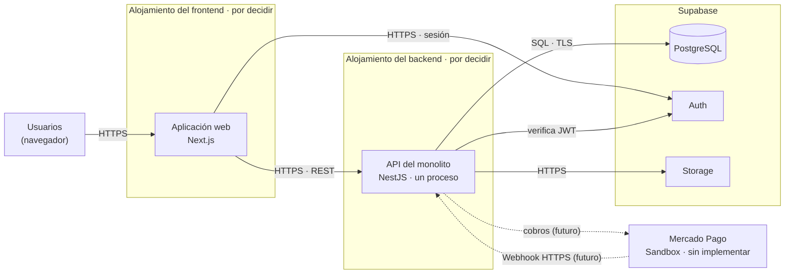

# 01 · Arquitectura de despliegue

> **Estado: plantilla.** Nada de lo descrito está desplegado. Los elementos marcados «por decidir» requieren una decisión del equipo, registrada en un ADR.

## 1. Componentes que se despliegan

Los componentes son los contenedores del [C4 nivel 2](../../04-modelo-c4/Nivel2-DiagramadeContenedores.md) y los servicios externos del [nivel 1](../../04-modelo-c4/Nivel1-DiagramadeContextodelSistema.md).

| Componente | Tecnología (versión del repositorio) | Cómo se ejecuta | Dónde se ejecutará en producción |
|---|---|---|---|
| Aplicación web | Next.js 16 + React 19 + TypeScript, Node.js 24 | `npm run build` y `npm start` (`frontend/package.json`) | Por decidir |
| API del monolito modular | NestJS 12 + TypeScript, Node.js 24; un solo proceso (ADR-001) | `npm run build` y `npm run start:prod` (`node dist/main`); escucha en `PORT` (3000 por defecto) | Por decidir |
| Base de datos | PostgreSQL en Supabase (RC07, RC08), con acceso mediante Prisma | Servicio gestionado; esquema aplicado con migraciones de Prisma | Supabase: proyecto de producción por crear o confirmar |
| Autenticación | Supabase Auth (correo y contraseña); el backend verifica el JWT | Servicio gestionado | Supabase |
| Almacenamiento de archivos | Supabase Storage (RC09; alternativa Cloudflare R2) | Servicio gestionado; bucket configurado por variable | Supabase |
| Pasarela de pago | Mercado Pago Checkout, entorno Sandbox (ADR-005) | Servicio externo | **Sin implementar** en el código |

## 2. Vista de despliegue propuesta

Las líneas discontinuas corresponden al módulo de Pagos, que aún no existe.

## 3. Decisiones pendientes

| Decisión | Opciones a evaluar | Criterios (de la documentación) |
|---|---|---|
| Alojamiento del frontend | Por evaluar | RC01 y RC20; costo para un equipo de 2 integrantes (RC11) |
| Alojamiento del backend | Por evaluar | Un solo proceso desplegable (ADR-001, DA14); URL HTTPS pública estable para el Webhook (ADR-005); latencia hacia Supabase (EQ-04) |
| Proyecto de Supabase de producción | Separado del de desarrollo o reutilizado | Aislamiento de datos de prueba; límites del plan |
| Registro de la decisión | ADR nuevo de despliegue | Mantener la trazabilidad driver → decisión |
